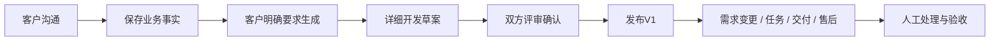

# SupportFlow 项目说明

面向软件开发业务的需求接待与项目协作 Agent。客户先用自然语言讲业务，顾问累计需求；需求生成智能体主动补齐工程细节，输出可供技术评审、任务拆分和开发使用的详细草案。客户未选择的设计标为 **【自动生成】**，后续以客户新要求为准。

草案经客户与负责人分别确认后发布V1，再进入需求变更、开发任务、交付验收与售后闭环。当前实现不包含自动开发、自动报价或自动排期。

## 文档入口

从[文档导航](docs/文档导航.md)开始。四个智能体均有业务流程图、实际LangGraph节点图和模拟执行：

| 智能体   | 职责                                       | 说明                                         |
| -------- | ------------------------------------------ | -------------------------------------------- |
| 需求沟通 | 自然访谈、事实来源、保存与等待客户         | [流程 / 节点 / 模拟](docs/需求沟通智能体.md) |
| 需求生成 | 独立规划、选工具、写详细章节、标注补充设计 | [流程 / 节点 / 模拟](docs/需求生成智能体.md)     |
| 草案审查 | 按Markdown块检查、局部候选、确认应用和历史恢复 | [流程 / 节点 / 模拟](docs/草案审查智能体.md) |
| 项目协作 | 读取基线、比较变更、准备工单及其他业务草稿 | [流程 / 节点 / 模拟](docs/项目协作智能体.md) |

整体执行、事务与并发见[执行架构](docs/执行架构.md)；真实测试范围及局部问题见[验收记录](docs/验收记录.md)。

后续改造按[后续开发说明](docs/后续开发说明.md)分阶段进行：四个业务智能体、统一程序调度与交接协议，重点完善稳定分块、依赖分批生成、局部修订及最近一次撤销。P0交接、P1稳定目录、P2关联块局部更新与最近一次撤销已编码；设计依赖与首次分批改造仍在P3。已有稿使用“更新需求”，全量重写另有明确入口。Q01～Q04内容质量验收仍未通过。

## 演示范围

当前可演示需求沟通、详细需求生成、关联块修改与最近一次撤销、人工接待及聊天溯源，以及提交评审和双方确认发布。AI相关演示需要本机配置有效模型密钥和可用额度；账号、客户聊天、数据库及模型密钥不随仓库上传。未连接模型时，手动文档、人工聊天和业务评审仍可使用，不能用模拟回答冒充真实模型。

建议使用独立测试账号，按“说明业务但不生成 → 明确生成需求 → 修改一条规则 → 查看差异并撤销 → 联系人工 → 提交评审”的顺序演示。未指定的技术设计应标【自动生成】；正式发布后只能走变更，不直接覆盖原基线。演示完成不表示生成内容已经通过全部工程验收。

## 产品流程



- 客户无需先填写完整项目表或技术栈；只有本轮明确要求才起草，不因“信息齐全”自动生成。
- 详细稿保留字段、接口、状态、异常、并发、技术、部署与验收；自动建议和客户事实分开。
- 草案完成不等于实现正确或已发布。待确认问题阻止确认；编辑正文清空双方签名；正式版不可覆盖。
- 普通用户仅访问本人记录，后台只允许管理员。每个浏览器标签页可以选不同账号。
- 客户可点击“联系人工”或直接输入“转人工”。已有AI操作完成并保存后再交接；人工接待期间静默整理客户信息，客服在同一窗口回复，可查询原话和前后沟通，见[人工接待与聊天溯源](docs/人工接待与聊天溯源.md)。
- 管理工作台集中展示等待接待、未回复、只等人工、即将到期和执行异常，支持按客户/项目及原因筛选；列表只读，处理操作仍复核接待人与权限。
- 执行步骤放在每轮聊天中，用户看到实际业务动作和耗时，后台保留模型/工具事件。
- 顾问回复逐步展示；需求生成只显示进度，完成后在需求草案中查看。断线继续订阅原任务，完成后显示已保存结果。流式输出不展示工具参数或私有推理，细节见[模型管理](docs/模型管理.md)。
- PostgreSQL保存权威数据；Redis只做可重建的读取缓存。模型与外部工具期间不持有SQL事务。

## 本地启动

需要Conda Python 3.12、Node.js 22.12+和Docker Compose。以下命令在仓库根目录执行：

```powershell
Set-Location D:\code\python\project
conda env create --prefix D:\code\env\supportflow --file environment.yml
conda activate D:\code\env\supportflow
if (!(Test-Path -LiteralPath .env)) { Copy-Item .env.example .env }
```

已有Conda环境无需重复创建，安装更新依赖可运行 `python -m pip install -r requirements.txt`。在本机 `.env` 填写数据库密码、模型API密钥，保留已有环境的密码与签名密钥。

```powershell
docker compose --env-file .env -f docker/compose.yaml up -d --wait
python scripts/migrate.py
python scripts/create_user.py admin --role admin --display-name 管理员
python scripts/start_api.py
```

另一个终端启动独立执行进程：`python scripts/start_worker.py`。API只受理和查询，Worker负责模型任务；两者都需要运行。

`create_user.py`只在首次需要管理员时执行，密码通过隐藏交互输入（至少12字符）；启动器不自动创建示例账号。其他账号由管理员开通。

另一个终端启动前端：

```powershell
Set-Location D:\code\python\project\frontend
npm ci
npm run dev
```

Compose当前只提供PostgreSQL和Redis；API、Worker与前端分别通过上面的本机命令启动，不是Docker全栈部署。

| 服务 / 页面 | 默认地址                                 |
| ----------- | ---------------------------------------- |
| 客户工作区  | http://127.0.0.1:5183/#/                 |
| 管理后台    | http://127.0.0.1:5183/#/admin            |
| API文档     | http://127.0.0.1:8091/docs               |
| 存活 / 就绪 | /api/health/live、/api/health/ready      |
| Worker就绪 | /api/health/worker（无可用进程返回503） |
| PostgreSQL  | 127.0.0.1:15432，库和用户默认supportflow |
| Redis       | 127.0.0.1:16379                          |

前端通过 `/api` 代理到8091；源文件在api/v1下，当前URL没有额外的/v1前缀。配置加载后需重启API生效。存储已初始化后，重启不需要重新迁移或重新创建账号。

## 模型配置

一套阿里兼容端点与密钥，按用途选模型；下列是示例组合，实际权限与额度由云账号决定：

```dotenv
SF_AGENT__BASE_URL=https://dashscope.aliyuncs.com/compatible-mode/v1
SF_AGENT__MODEL=qwen-max
SF_AGENT__CONSULTATION__MODEL=qwen-plus
SF_AGENT__DRAFT_PLANNER__MODEL=qwen-plus
SF_AGENT__DRAFT_WRITER__MODEL=qwen-flash
SF_AGENT__API_KEY=
```

用途配置为空时继承通用MODEL；没有API密钥时顾问显示不可用，手动业务仍可使用，不以固定模板冒充模型。详情见[模型管理](docs/模型管理.md)。

## 仓库结构

```text
backend/
  agents/
    runtime.py                 生命周期、执行准入与业务分派
    common.py                  序列化和预算
    consultation/              graph / nodes / prompts / state
    drafting/                  graph / nodes / prompts / state
    project/                   graph / nodes / prompts / state
    tools/                     唯一工具目录
  core/llm/                    用途模型工厂、客户端与配置
  api/router.py                总路由
  api/v1/                      薄接口
  db/                          异步PG、缓存、迁移和检查点
  models/                      业务、命令和状态校验
  services/                    鉴权业务
frontend/                      Vue 3 + TypeScript用户端与后台
scripts/                       启动、迁移、账号维护
tests/                         自动验证
docs/                          当前实现、图示与验收说明
```

Python依赖唯一来源为requirements.txt，pyproject.toml与environment.yml复用。旧医学项目在另一个仓库，不属于本项目；旧电商表只为历史数据保留，不代表当前业务。

## 验证与运行边界

修改时先运行受影响检查，通过后不重复整套。具体命令、模拟与实测的区别见[验证指南](docs/验证指南.md)。

PostgreSQL持久任务队列与独立Worker负责Agent执行，默认全局4个运行名额；API重启不取消独立Worker，未开始任务可继续领取。已开始任务失联后核对业务回执，结果未知时安全失败，不自动重复付费调用。详见[任务队列与Worker](docs/任务队列与Worker.md)。

详细稿中的SQL、配置和设计指标是待评审方案，生成成功不代表实际开发或实测成功。当前没有附件解析、向量RAG、Skill/MCP调用、代码仓库集成和真实外部交付自动化；新增能力按真实需求实现。

最近一次独立浏览器验收已验证双方确认、V1/V2、变更驳回、开发任务、交付与售后退回重提关闭；文档审查仍存在真实模型漏检和较强模型长文超时，不能作为工程正确性的保证。完整结果与原始失败见[验收记录](docs/验收记录.md)。
