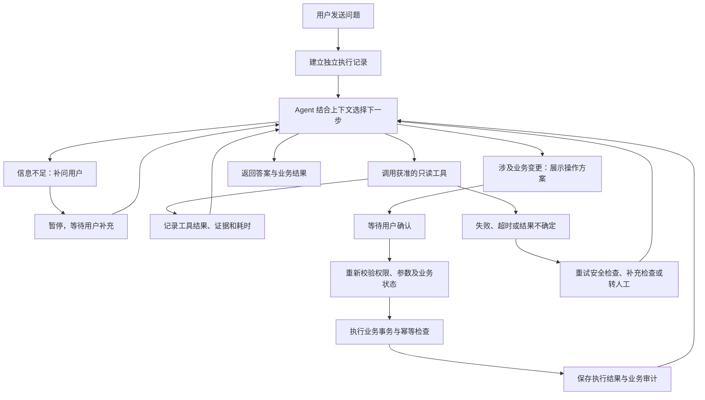

# 售后 Agent 与执行记录设计

状态：设计已确定，待账号、订单与售后业务完成后实现。当前项目没有运行中的 Agent、执行记录接口或执行时间线。本文件的流程为验收目标，不是已完成的运行结果。

## 单 Agent 与业务模块

使用一个售后 Agent 处理多轮需求，按需选择获准工具。取消订单、退换货、物流异常分别维护工具、业务服务和规则，不为每个业务增加独立 Agent。

模块差异不仅是调用工具不同，还包括需要补充的信息、可执行条件、确认要求、状态变化、事务边界及失败后的处理方式。Agent 选择下一步，业务服务决定操作是否合法以及是否成功；关键规则不得只依赖提示词。

| 业务 | 读取的事实 | 确认内容 | 业务服务核验 | 结果 |
| --- | --- | --- | --- | --- |
| 取消订单 | 订单归属、付款与履约状态 | 订单、取消范围及原因 | 当前状态是否允许取消、是否已有申请 | 订单取消结果或待人工处理事项 |
| 退换货 | 订单明细、售后政策、库存、已有申请 | 商品、数量、申请类型及费用说明 | 资格、数量、重复申请、库存及最新状态 | 售后单与后续处理步骤 |
| 物流异常 | 包裹轨迹、承诺时间、已有工单 | 是否提交处理工单 | 包裹归属、重复工单及可用处理渠道 | 物流处理工单及跟踪状态 |

RAG 工具负责检索有版本的政策与说明。订单状态、库存、金额和工单进度从业务接口读取，不从历史聊天或检索片段推断。

## 可查看的执行时间线



时间线展示真实执行事件：做了什么、调用了什么、可公开的输入与输出摘要、耗时、依据、失败及恢复情况。可以展示简短的行动说明，例如“需要核实库存后确定能否换货”；该说明不是内部推理逐字记录，也不作为业务事实。

不采集或展示模型私有推理、原始系统提示词、密钥、Cookie、访问令牌、数据库连接串或未经筛选的完整请求/返回数据。每个工具自行定义允许展示的参数与结果字段，无法识别的字段默认不进入执行记录。

用户可以查看自己会话的服务进度、公开结果、政策引用和待确认事项。客服/管理员在授权范围内查看相应工单的技术明细，包括工具标识、脱敏参数、结果摘要、错误代码、重试次数和模型用量；管理角色不等于可以无条件查看所有原始数据。

## 示例展示

以下仅为展示设计，不是当前项目产生的执行记录：

```text
✓ 已查询订单：找到本次申请对应的商品
✓ 已检索售后政策：显示政策名称、版本与引用
✓ 已核验换货条件：显示业务服务返回的核验结果
✓ 已查询库存：显示可供换货的库存结果
⏸ 等待确认：展示申请商品、数量、类型与处理说明
  [确认提交] [修改方案] [取消]
✓ 已创建售后单：仅在业务提交成功后显示单号
```

工具失败时必须真实显示失败及后续处理。服务端尚未确认的操作不得展示为成功。模型普通文本中声称“已退款”不能改变工具状态或业务状态。

## 事件与归属

每次执行分配 `run_id`，关联会话、发起人及 `request_id`。每个步骤和工具调用分别记录 `step_id`、`tool_call_id`；同一轮调用相同工具时也能区分。记录服务端时间和通过单调时钟计算的耗时。

| 事件 | 由谁产生 | 展示内容 |
| --- | --- | --- |
| `run_started` | 编排器 | 本轮任务开始 |
| `step_started` / `step_finished` | 编排器 | 当前行动、简短说明及耗时 |
| `tool_started` | 工具执行器 | 工具名称与允许公开的输入摘要 |
| `tool_succeeded` / `tool_failed` | 工具执行器 | 实际结果摘要、错误代码与耗时 |
| `waiting_confirmation` | 确认服务 | 待执行操作及不可歧义的确认内容 |
| `confirmation_received` | 确认服务 | 确认或拒绝，以及对应方案版本 |
| `retry_scheduled` / `handoff_requested` | 编排器或业务服务 | 重试条件或人工接管原因 |
| `run_finished` / `run_failed` / `run_cancelled` | 编排器 | 执行终态与业务结果关联 |

这些是应用的结构化事件，不是让模型生成一段 JSON 来冒充已完成的动作。模型只能建议调用工具；执行器返回的事件决定工具是否真正执行成功。

事件按 `(run_id, sequence)` 唯一排序。并行工具可交错完成，用步骤及工具调用标识关联起止事件，不用列表位置猜测。运行状态至少区分执行中、等待用户、等待确认、成功、失败、取消和结果待核实；业务单据状态单独维护。

查询执行记录必须校验角色与数据归属；不能仅凭 `run_id` 访问。接口应在 JWT 与归属校验完成后接入，不在当前公开健康接口下暴露。

## 保存、流式展示与并发

- PostgreSQL 保存权威执行事件；序号分配与事件插入在同一短事务中完成，并有数据库唯一约束。各运行相互独立，不使用跨用户共享的可变 Agent 状态。
- 实时事件使用 SSE 推送。前端通过事件编号去重；断线后读取已保存事件恢复展示，重新连接不等于重新执行业务操作。
- 事件缓冲及单条数据大小有上限；高频文本片段可以合并刷新，不把每个 token 保存为一条业务事件。慢客户端不能无限堆积内存；需要时断开并允许从已保存位置续读。
- 模型与外部工具等待期间不持有数据库会话。事件写入使用独立短事务，业务写入与关键审计事件在同一事务保存，提交后才推送成功。
- 每轮任务、模型调用和工具调用有各自的并发预算、超时、最大步数及最大调用次数。重试消耗本轮预算，避免循环调用。
- 普通展示进度写入失败需记录可观测错误，不冒充业务失败或成功。关键写操作的审计无法提交时，本地业务事务一并回滚；外部操作结果不确定时标记待核实，通过查询或人工处理确认，不能盲目重试。
- 确认凭据绑定用户、订单、参数和方案版本，并设置有效期。点击确认时重新校验当前业务状态；参数发生变化后原确认失效。刷新、重复点击或重连通过幂等机制保证不会重复创建申请。
- 取消运行需要向可取消的工具传播取消信号，并区分“停止后续执行”与“撤销已经提交的业务操作”。取消并不自动撤销外部系统已经完成的动作。

## 实现顺序与验收

1. 账号与订单阶段定义访问权限、业务状态、确认及审计边界。
2. 售后接口阶段实现幂等与确认，把业务结果作为后续工具的权威来源。
3. Agent 阶段同步实现工具执行器、事件保存、SSE 和用户端时间线，不在完成后再补日志。
4. 管理端加入执行详情、失败筛选、人工接管与授权范围内的用量统计。

验收覆盖：成功、拒绝执行、工具失败、超时、重试、等待补充、确认过期、重复确认、用户取消、断线续读、并行工具关联、事件越权、敏感字段脱敏及慢客户端。用真实事件验证显示，不用固定时间线冒充 Agent 执行。
