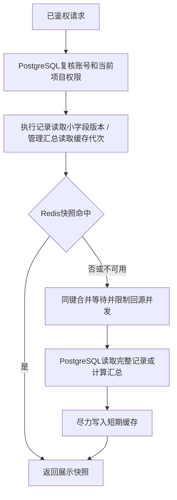

# 读取缓存与数据库分工

PostgreSQL保存账号、登录、消息、纪要、草案、审批、审计和HITL检查点。Redis只保存可重新生成的执行记录快照和管理员汇总统计，不参与权限判断、业务幂等、运行互斥或断点恢复。

## 读取路径



缓存命中仍有数据库权限查询。执行记录每次读取少量版本字段，目的是减少完整JSON传输和记录排他锁争用，不声称缓存消除了全部SQL访问。任何修改/审批始终走数据库重新校验。

| 数据 | 缓存键隔离 | 默认有效期 | 更新方式 |
|---|---|---|---|
| 执行记录快照 | 账号ID、项目ID、run ID、数据库cache_version | 最多3秒 | event/finish/fail/checkpoint_ready/超时回收提交时递增版本，旧键不能供新版本读取 |
| 管理汇总 | 管理员ID、summary代次 | 最多15秒 | 创建沟通、记录管理、草稿/业务操作、Agent保存成功提交后更换代次 |

有效期随机缩短至配置值的80%～100%，避免集中到期。更换汇总代次后，先前正在执行的旧回填只能写入旧代次，无法覆盖新代次。缓存不是强一致性读：并发请求可能返回权限与版本读取时刻的快照；汇总失效通知失败或外部写库时最多保留原TTL，下一次自动重新计算。

## 并发与故障

- 每进程按相同键合并缓存未命中，最多跟踪1024个键；跨进程冷请求仍可能各回填一次，不使用Redis分布式锁代替业务锁。
- 完整记录/统计回源最多8个并发，等待最多250ms，超出返回可重试503。轻量权限/版本查询继续受原HTTP准入与数据库连接池约束。
- Redis单次操作最多150ms；连接异常后本进程熔断5秒，期间绕过Redis受控回源。取消请求传播取消信号，并释放等待锁和回源名额。
- 缓存写入/失效在数据库事务外，Redis异常不回滚已提交业务。缓存损坏为非JSON/非对象时按未命中处理；单个写入值最多256KB。
- 不缓存JWT、密码、Refresh Token轮换、权限结论、幂等回执或原始LangGraph状态。账号停用、会话撤销、项目删除均在命中前复核。
- PostgreSQL不可用时拒绝依赖数据库授权的读取，不使用旧缓存绕过授权。

## 配置与运维

根requirements.txt维护redis依赖；Conda环境安装后使用原有启动器。示例.env启用SF_CACHE__ENABLED，本机配置已启用；不设置时默认关闭。主要配置见.env.example中的SF_CACHE__*。

```powershell
docker compose --env-file .env -f docker/compose.yaml up -d --wait
python scripts/migrate.py
python scripts/start_api.py
```

Compose Redis仅绑定127.0.0.1:16379，缓存内存上限128MB，allkeys-lru淘汰，不持久化。Redis重启丢失缓存不影响业务记录。自建服务可通过host/port/database/password/prefix配置接入；不同部署或数据库必须使用不同prefix。

管理员GET /api/admin/cache返回enabled/available/circuit_open和当前进程hits/misses/fills/errors/bypasses/invalidations计数，不暴露连接凭证或缓存内容；API进程重启后计数重置。GET /api/health/ready仍以PostgreSQL就绪为准，Redis故障属于缓存降级。

迁移0015为project_runs增加cache_version，不删除或重建历史记录。HITL断点继续由PostgreSQL检查点恢复，Redis不保存持久执行任务。

## 验证

tests/test_cache.py覆盖同键24并发、TTL、旧回填与失效竞态、Redis故障熔断、回源上限与取消释放、账号隔离、删除后拒绝访问、执行状态/超时版本变化及管理汇总失效。

```powershell
$env:SUPPORTFLOW_TEST_REDIS="1"
$env:SUPPORTFLOW_TEST_POSTGRES="1"
python -m pytest tests/test_cache.py -q
```

真实检查使用临时PostgreSQL schema和随机verification前缀Redis键，结束只清理自身测试数据，不使用FLUSHDB。并发检查证明功能正确性，不代表生产吞吐量承诺。
