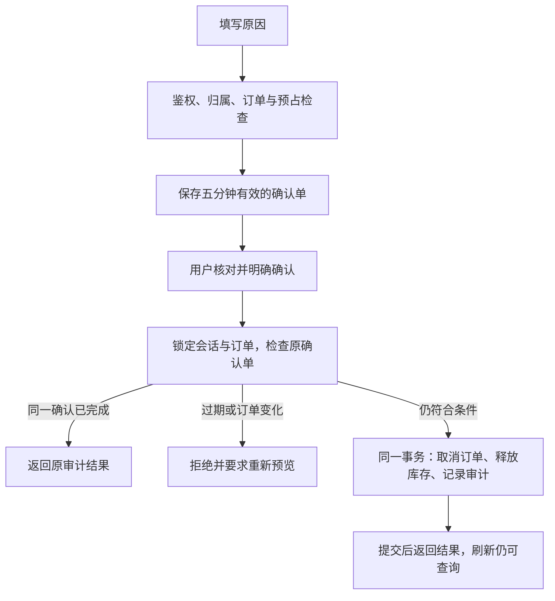

# 取消订单闭环

已实现用户取消自己的订单、管理员取消订单、库存预占释放、幂等结果与审计。演示付款、发货与整单退货退款见[履约与售后](fulfilment.md)，真实渠道尚未接入；已付款演示订单只保存演示退款记录，必须有金额一致的付款凭据。

## 使用

```powershell
conda activate D:\code\env\supportflow
python scripts/migrate.py
python scripts/reserve_demo_inventory.py
python scripts/start_api.py
```

首次初始化可继续运行 `seed_demo_users.py`、`seed_demo_orders.py`；后者会在造单后调用预占步骤。预占脚本只处理启用的普通账号 user 的可取消演示订单，锁定账号、订单与商品，为缺少预占的明细扣减可用库存一次，写入 `inventory_reservations`。重复运行不重复扣减，不重置已取消订单或已释放记录。原始库存没有预占依据时，取消接口会拒绝操作，不会凭明细给库存加数。

打开用户端 `#/orders` 或后台 `#/admin/orders` 的订单详情，填写取消原因，点击检查条件，核对预览并勾选后确认。



## 业务规则

| 当前状态 | 处理 |
|---|---|
| 待付款 | 可取消；释放预占，无需退款 |
| 已付款、演示订单 | 可取消；释放预占，记录 simulated 退款，明确无真实资金退回 |
| 已付款、真实订单 | 拒绝；没有真实退款接入前不能完成此流程 |
| 已发货、已签收、已取消 | 不生成新的取消确认 |

任何物流记录存在、明细金额不完整、预占缺失/已释放/数量不符或商品库存数据异常都会拒绝。执行前再次核对快照与当前数据，不能只信任预览时的结论。

## 接口和恢复

用户路径为 `/api/orders/{id}`，管理员路径为 `/api/admin/orders/{id}`：

- `POST .../cancellation-preview`：`{"reason":"不再需要"}`。返回确认 ID、订单状态、金额、原因、拟释放明细、退款类型和到期时间；只保存确认单，不改变订单或库存。相同会话、原因和快照的有效预览会复用。
- `POST .../cancel`：`{"confirmation_id":"预览返回的 UUID","confirmed":true}`。confirmed 必须是明确的布尔 true，不能用数字或字符串代替。
- `GET ...`：在订单详情的 `cancellation` 中查看已保存的操作者、原因、时间、库存释放和模拟退款结果。历史演示取消状态可能没有审计，页面不会伪造它。

确认 ID 绑定订单、操作者与登录 sid，同时作为幂等键。同 ID 成功重试返回原结果，即使确认有效期已过也不会再次执行；会话仍须有效且仍有订单权限。其他 ID 不能重复取消同一订单，换账号或新的登录 sid 也不能套用旧确认。

网络断开或 5xx 不代表操作一定失败。前端保留原 ID，仅允许手动查询/重试原操作，不自动重发、不创建新 ID；也可刷新订单核对持久化结果。确定的 4xx 冲突要求重新检查，401 仍走会话失效处理。

## 事务与并发

写入采用原生异步 PostgreSQL，每次操作独立短事务；用户核对期间不持有连接或锁。锁顺序为操作者 user → login → order → confirmation → 本订单 reservations → 按 ID 排序的 products。事务内重新校验会话、账号与管理员角色。

库存释放、预占标记、订单状态和 `order_cancellations` 审计在同一事务提交。审计表对 order_id 唯一；同确认的并发重试只产生一个结果。不同订单共享商品时商品行锁避免丢失库存更新。新增发货或修改明细流程必须遵守同一订单行锁及状态检查，不能旁路写状态。

锁等待上限 1.5 秒，连接池、查询取消或锁/死锁预算触发时返回可重试的 503 / DATABASE_BUSY。事务失败或请求取消会回滚。详情读取采用 PostgreSQL REPEATABLE READ READ ONLY，避免状态、明细与取消审计来自不同提交时点。

## 已验证边界

自动测试包含归属/管理员权限、会话绑定与撤销、确认过期、快照变化、物流竞争、库存缺失、失败回滚、未知结果手动重试及审计回显。真实 PostgreSQL 测试验证 12 个并发相同确认只释放一次、不同确认竞争、不同用户共享库存更新、发货抢先、取消请求回滚、锁超时后的原 ID 重试与详情快照一致性。它们是业务正确性验收，不是生产容量声明。

后续 Agent 可以调用查询和取消预览，最终写入仍需要用户明确确认，不能由模型替用户确认。
