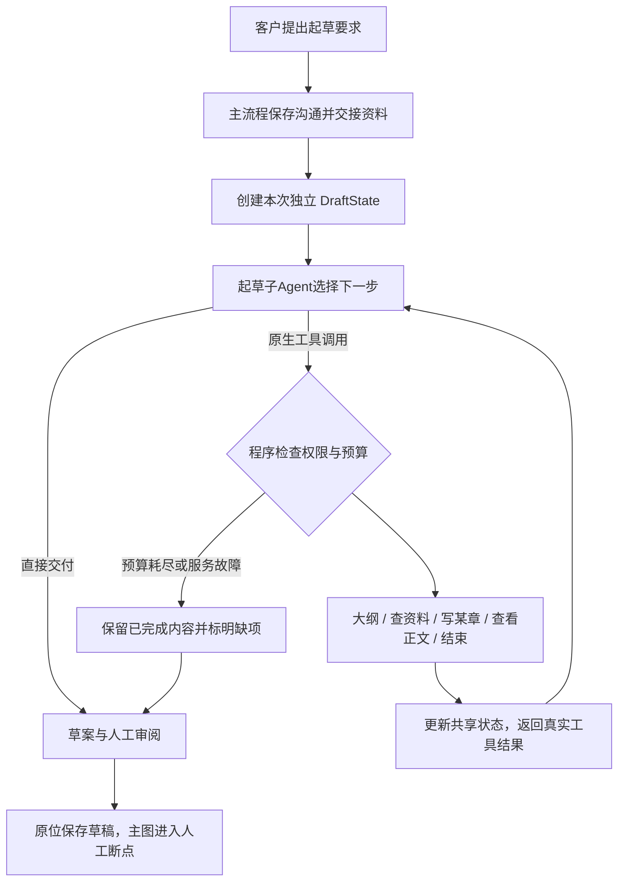

# 独立起草子 Agent 与共享状态

主沟通负责自然交流和可靠保存业务事实。客户本轮要求起草时，generate_prd把已存纪要、原话、本次要求和已有参考交给DraftAgent，等待其返回草案；主流程不再规定起草内部的业务步骤。

图中的循环是模型选择动作、读取观察结果再决策。程序没有“先规划→查资料→按顺序写所有章”的固定调度。Agent可以先写最清楚的部分、写后搜索、检查正文后补另一章，或直接交付简短需求。章节数量不按行业或纪要条目数硬编码选择。

## 统一 State：Pydantic

backend/agents/drafting/state.py中的DraftState是一个真实Pydantic模型，每次起草创建独立实例，输入深拷贝；没有全局会话字典。各工具持有同一实例，统一读取与更新本次资料。

| 字段 | 用途 |
|---|---|
| business_notes / customer_statements / user_request | 只读交接资料；工具不会改写客户纪要 |
| plan | 大纲、统一角色称呼与待确认事项，可选 |
| sections / section_specs / failures | 本次已写正文、章节说明和失败信息 |
| references / searched_topics | 公开参考及本轮已尝试的查询 |
| assumptions / previous_assumptions | 本次自动补充与历史建议，均不当作客户事实 |
| resolved_questions | 本次方案已回答的旧问题，不改变原始纪要 |
| messages | 子Agent私有的原生assistant/tool往返消息，不包含私有推理 |
| questions / status / stop_code / finalization_attempted | 待确认项、完成或部分完成状态与中断原因 |

Pydantic提供运行时校验和JSON序列化，工具参数也由Pydantic模型定义。主沟通LangGraph的节点数据继续使用Python标准库TypedDict；两者职责不同，不需安装TypedDict包。

运行预算、时间与联网授权由程序和数据库实时判断，不相信模型修改State中的值来取得权限。子Agent上下文与主顾问会话分离，模型调用仍共享同一异步客户端、资源名额和累计用量。

## 可调用工具

| 工具 | 真实行为 |
|---|---|
| plan_draft | 提交或调整大纲、角色称呼；已尝试章节不能从计划里悄悄删除 |
| write_prd_section | 只传section_id，从State读取章名和重点；按需补齐默认细节，返回正文摘要或失败信息 |
| web_search | 按服务端公开主题查摘要，不发送客户原话，最多2个不同主题 |
| read_draft | 读取本次已有正文和缺项，无额外模型调用 |
| finish_draft | 结束本次起草，保留未写完章节，返回完整或部分草案 |

工具通过原生tool_calls执行，真实结果作为role=tool消息交回子Agent。不是让模型输出普通action JSON，也不是把“子Agent”作为固定函数名称包装。控制模型可以一次选择多个工具，程序按该顺序执行；结束后同一批次剩余动作不再执行。

预算在实际执行每个工具前扣减。模型一次提出超额动作时，程序只执行额度内的动作，超出部分明确返回未执行，保留已生成的章节，不在收到整批请求时丢弃全部内容。已有章节时允许一次finish_draft在本地收尾，该次不占处理额度且不调用外部服务；若参数无效，也消耗该次机会，不能无限免费重试。

模型也可直接输出完整Markdown，不必为了走步骤而调用工具。大纲最多6章是容量边界，并非必须写6章。同章本次最多尝试一次，重复写作返回已有结果，失败不换编号无限重试；再次起草由客户发起新轮。

## 权限、预算和兜底

- 联网必须同时满足管理员和客户开关，每次出网前重新复核总开关；未开放时不向模型提供搜索工具，伪造调用也不执行。搜索结果只作有来源的建议，不改客户事实。搜索失败返回失败观察，Agent可继续其他工作。
- 默认每轮累计8次模型、8次处理工具、64000token、150秒。控制和写作模型都计入，不额外创建执行名额。每章2400输出token，单次最长60秒，预留外层截止前12秒用于提交与检查点。
- 模型/预算失败保留已写章节、原始纪要和缺项；单章失败反馈给子Agent自行决定后续动作。不能把部分完成宣称成完整方案。权限撤销、版本冲突与外部取消不被普通兜底吞掉。
- 客户要求生成后，缺少的实现细节由Agent主动选定完整方案，不能只给纪要；正文不逐节挂待确认标签，新增设计在自动补充方案中说明且允许调整，客户原始纪要单独附录。模型对业务的理解仍须双方审阅，不能自动成为客户签名。
- 最终仍由原业务事务复核归属、版本和消息回执。主图PostgreSQL检查点与HITL保持，双方确认后才能立项发布。
- DraftState当前是一次执行内的共享状态，尚未把每次工具调用独立做持久化检查点。进程退出后不会自动续写未提交章节；不能把“可序列化”描述成“已经持久化”。

代码边界：agent.py负责独立决策循环；tools.py执行工具；state.py定义共享状态；service.py负责交接、事实附录和标准草案输出；prompts.py定义职责和写作约束。没有重复历史抽取和自动全篇审计。主沟通流程见[需求沟通](requirement-consultation.md)。

## 自动补充与客户覆盖

用户已要求生成时，不再为技术栈、部署方式、字段、异常、校验和设计性验收指标反复追问。Agent结合规模给出一套推荐实现，包括语言/框架、使用端、数据库、架构和部署；不局限Java/Python，也不假装已完成真实测试。用户明确排除的独立业务不能再加回。

plan_draft和finish_draft可填写assumptions，区分technology/workflow/validation/operations/other，每条含主题、具体方案和理由。方案单独显示“自动补充方案（可调整）”，并在最终业务事务中保存到ConsultationState.draft_assumptions，不写入客户已确认的discovery事实。主顾问也能读取这些建议用于后续讨论。

每轮起草读最新客户资料。客户明确technology_preference时，历史自动实现建议不再进入本轮上下文，包括分类为operations的旧邮件库等依赖；新的客户业务规则同样优先于历史建议。生成成功后不机械把旧访谈问题继续列为阻塞项，新文档待确认章节及真实冲突仍保留；生成不完整的缺项仍阻止发布。

大纲允许仅章名，程序补本次章节编号与默认重点。写章使用大纲实际编号，兼容本次章名/序号显示形式；未知编号返回可用编号供模型修正，绝不查找其他项目。安全错误记录只含错误码及字段名，不输出原始模型参数或客户载荷。

分章写作从共享State读取已写章节的节选（每章最多1200个字符，保留开头和结尾），用于沿用已经选择的技术、指标和部署规模；不增加额外的模型审计轮次。请求仍由UTF-8字节预留与累计Token预算限制。客户明确事实优先于先前自动写出的正文。
