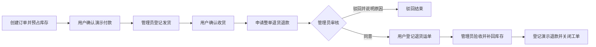

# 订单履约与整单退货退款

当前接入的是本地演示业务：付款、运单和退款均不调用真实渠道。商品资料可由管理员自行录入，但交易仍为演示环境；没有真实支付或物流凭据时不得声称已经完成真实交易。

## 办理路径



第一版一单一个工单，仅支持整单退货全额退款。驳回为终态；不支持部分退款、换货、自动超时关单、真实物流追踪或支付回调。售后关闭后订单保留已签收状态，售后状态单独显示。

用户在 `#/orders` 办理付款、收货、申请与退货寄回，在 `#/returns` 查看自己的售后。管理员在 `#/admin/orders` 发货，在 `#/admin/returns` 查看工单并进入订单详情审核、验收、退款。用户看不到管理入口，服务端也校验角色和订单归属。

## 接口

| 方法与路径 | 执行方 | 业务条件 |
|---|---|---|
| POST `/api/orders/{id}/pay` | 本人 | 待付款且预占有效 |
| POST `/api/admin/orders/{id}/ship` | 管理员 | 已付款、凭据完整、无运单 |
| POST `/api/orders/{id}/receive` | 本人 | 已发货、出库记录与运单完整 |
| POST `/api/orders/{id}/returns` | 本人 | 已收货且未有工单 |
| POST `/api/admin/orders/{id}/returns/review` | 管理员 | 待审核，提交决定和原因 |
| POST `/api/orders/{id}/returns/ship` | 本人 | 已同意，提交承运商与运单号 |
| POST `/api/admin/orders/{id}/returns/receive` | 管理员 | 退货中，验收并补库 |
| POST `/api/admin/orders/{id}/returns/refund` | 管理员 | 已验收并补库，登记退款并关闭 |
| GET `/api/returns` | 本人 | 本人列表，支持状态与分页 |
| GET `/api/admin/returns` | 管理员 | 跨用户列表，支持状态与分页 |

写入必须带 UUID `operation_id` 与布尔 `confirmed: true`，角色、状态、金额及库存均在事务中重新校验。用户先在页面核对再勾选确认；Agent 尚未接入。详情包含付款、退款、售后与操作时间线，不展示私有模型推理。

## 并发与事务

- 写事务依次锁定操作者、有效登录、订单、售后工单、预占记录与按 ID 排序的商品。锁等待最多 1.5 秒；同订单付款、发货、取消及售后互斥。
- 下单扣可用库存，发货将预占标记为出库，不二次扣库存。退货验收只补回一次并递增商品版本；取消只能释放未出库的预占。
- 订单、付款/退款、运单、库存、事件和幂等回执在同一短事务中提交。任何一步失败全部回滚；外部调用不持有数据库事务。
- 操作 ID 按操作者与订单隔离并校验请求指纹；重复同请求返回原回执，改变参数则拒绝。每单付款、退款、工单各有数据库唯一约束。
- 已付款后继续履约或取消必须存在金额相同、演示渠道有效的付款记录。不能仅凭状态生成退款。未知网络结果保留原请求和 ID 供手动重试，锁定表单与订单切换；页内导航也会拦截，退出登录仍可正常清理。

## 已有数据升级

```powershell
python scripts/migrate.py
python scripts/reserve_demo_inventory.py
```

随后重启 API。显式脚本只为 `SFDEMO` 历史初始化订单补付款凭据；已付款取消凭据存在时补退款凭据。历史已发货/签收订单补出库记录，**不再扣库存**。可取消订单缺失预占时才扣减一次。重复运行不覆盖业务状态、价格或库存。新业务订单不得通过该脚本伪造付款。

自动测试涵盖全状态链、驳回、越权、缺失/错误付款凭据、相同 ID 重试、付款/取消与发货/取消竞争、12 路验收退款重试及审计失败回滚。数据库并发测试使用隔离 schema；这验证一致性，不代表生产吞吐承诺。
