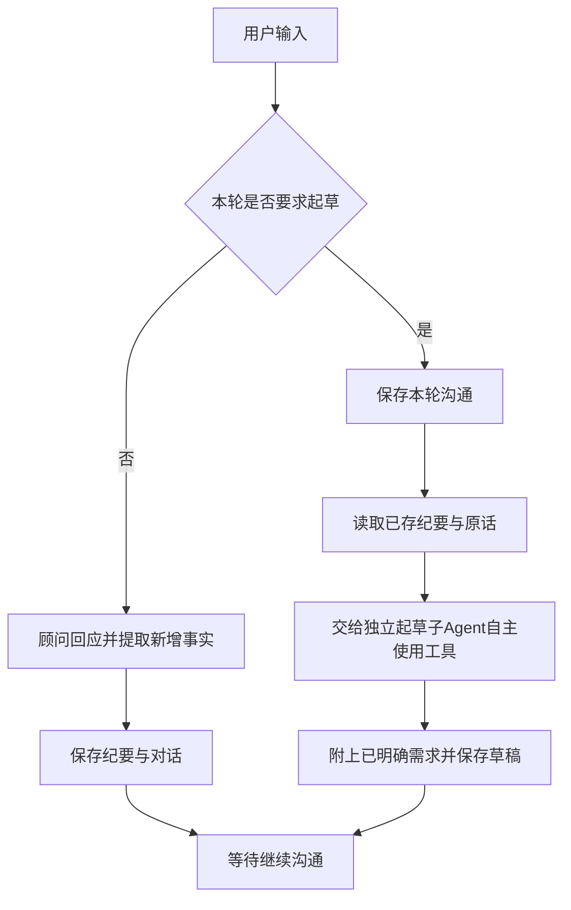

# 需求沟通与按需起草

当前流程：**用户输入 → 提取重要信息 → 保存 → 根据用户要求起草**。不再因为“信息齐全”自动起草，也不在起草时重复抽取或循环审计。

## 沟通与存储

普通轮由顾问按需调用record_consultation，每条facts仅写一次字段、值和原话来源，由程序生成数据库纪要。新增事实仍检查来源；列表累积、明确纠正与已回答问题沿用原规则。回复文字可选，不能因缺少回复丢弃有效信息。技术偏好允许将同一客户消息中的语言、框架、数据库与部署组件合为一个自由文本，仍逐项保留原话来源；当前消息优先于补录的历史技术。标量新值直接替换旧值，冗余删除标量不应使有效修改整轮失败；无新值的非法删除和未知来源仍拒绝。

纪要是PostgreSQL中的权威记录，Redis只缓存可重建的读取快照。每轮对话、已验证纪要和来源在短事务内保存；模型及搜索期间不占SQL事务。纯讨论不触发草案，未知技术细节不导致循环追问。

## 起草触发

- “帮我生成一份草案吧”等完整、明确指令直接执行；界面的重新整理请求同样直接执行。
- 完整命令解析不匹配否定、引用、条件句或询问含义；其他自然表达由本轮顾问的request_quote提供原话依据。不按行业关键词做业务分类。
- 只根据本轮请求触发，不沿用上轮同意信号，不把致谢或补充信息当成再次生成。
- 客户要求起草时，技术选型和实现细节由Agent自动补齐为可调整方案；微信支付真实资质等外部前提保留待确认，不索要凭证或反复追问。客户后续要求优先于自动建议。

## 简化后的节点

| 节点 | 职责 |
|---|---|
| extract | 普通轮自然沟通和记录；明确起草指令读取已存信息，不再调用沟通模型 |
| decide_draft | 根据本轮请求选择继续沟通或起草，不做“是否足够”的模型评估 |
| save_discussion | 起草前保存本轮消息对和有效纪要，取得阶段版本回执 |
| draft_agent | 把已存信息交给独立起草子Agent，主图不编排起草内部阶段 |
| wait_user | 保留顾问自然回复 |
| persist | 保存草案并更新原助手消息，或保存普通轮对话 |
| human_input | 持久化人工断点，等待下轮输入或草案审阅 |

## 断点与业务边界

保留主图PostgreSQL检查点、LangGraph interrupt与Command恢复。新轮按已鉴权数据库快照刷新纪要与状态，旧检查点不能遮蔽已修复的纪要。

同项目执行互斥、独立异步会话、阶段版本和请求幂等保持。起草期间已经保存的对话不会因模型失败被回滚，最终提交不重复写消息或草案。等待人工释放执行名额。

生成草稿和发布分开：客户与负责人仍需通过业务接口分别确认后才能立项。没有持久化执行队列，进程中断不会自动重放模型调用。

## 联网与展示

顾问讨论阶段可按用户开关与管理员总开关查询公开主题，结果只作建议；起草子Agent在执行中也可自主选择最多2个公开主题，执行前再次检查总开关；只用服务端公开查询，不发送客户资料，失败继续已有内容。用户看到真实业务步骤，记录或正文不完整会明确标注，不展示内部参数和私有推理。

实现：backend/agents/consultation/graph.py、nodes.py；起草：backend/agents/drafting/service.py。详见[起草说明](draft-agent.md)。
