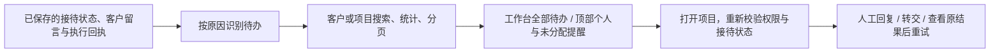
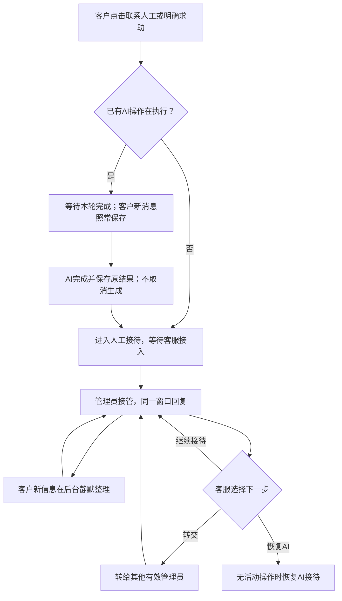
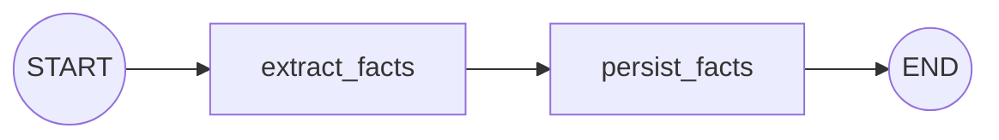

# 人工接待与聊天溯源

## 使用方式

客户在需求沟通中点击“联系人工”，或明确输入“转人工”“我想找客服”等请求，系统立即记录求助。管理员页面顶部的“接待与异常”提醒约每5秒更新，显示未分配或本人负责的待办，以及需要负责人关注的升级提醒；管理工作台的“待处理接待”显示全体客户的待办，约每15秒更新。这不是短信、邮件或离线推送服务。

管理员打开项目，点击接管后，在同一聊天窗口直接回复。客户可继续留言，不需要重新说明之前的情况。管理员能查看其他客户的项目，但只有当前接待人能以客服身份发言；其他管理员需要由接待人转交。接待人停用或失去管理员身份时，会话重新等待接入。关闭网页不会直接恢复AI，但数据库中的接待期限继续生效。

2026-10-30增加主动兜底：无人领取3分钟、客服未回复5分钟或双方15分钟无互动时结束本次求助并恢复AI，按规则预先提醒；只等人工不自动恢复。客服可延长等待，客户可主动恢复AI。已有操作先完成；仅未回复问题才自动接续，并复核原登录。规则和配置见[流程兜底与会话标识](流程兜底与会话标识.md)。

## 后台待处理接待

管理员在管理工作台按客户/项目名称和原因筛选，查看接待人、到期时间、失败摘要与处理建议，点击“查看并处理”进入项目。其他管理员能查看会话，但不能抢走已分配会话或直接替当前客服发言，仍须转交。筛选读取中旧行不可点击，旧查询响应不能覆盖新结果；读取失败显示重试提示，不当作“没有待办”。

| 原因 | 识别与处理 |
| --- | --- |
| 等待接待 | 尚未领取的人工请求；安排客服接管 |
| 等待本轮AI结束 | 已申请交接、原任务尚未结束；先保留结果再接待 |
| 客户留言未回复 | 已有接待人且有未回应客户原话；由当前客服回复或转交 |
| 只等人工 | 客户明确拒绝自动切换；等待人工，可由客户主动恢复AI |
| 执行异常 | 最近公开执行失败、当前文档最新检查失败、事实整理失败、模型不可用或原登录失效；查看已保存结果后决定如何继续 |
| 即将到期 | 已进入人工、未选择只等人工，有效截止时间进入预告窗口；计算包含客服延长时间 |

同一项目可以同时符合多个原因。数量统计覆盖当前客户/项目搜索范围的全部原因，不随原因筛选变化，各原因数量不能相加当作总项目数；分页与原因筛选在数据库执行，不先截取50条再筛选。列表最多每页100条，工作台每页10条、顶部默认50条。

队列只读，不调用模型、不补发消息、不审批，也不负责将超时会话改为AI；实际切换由原巡检或会话操作执行。到期但尚未完成切换的条目仍可能短暂显示，处理操作会再次复核。

历史失败只用于溯源：后续公开执行成功后，不再因旧公开失败列为异常；静默整理成功不能掩盖公开失败。文档检查按每份文档当前版本的最新尝试判断，其他文档的成功不掩盖该文档失败，正文版本改变后不沿用旧版本失败。失败记录本身保留，不因从队列退出而删除。

这是后台查询流程，不是新增Agent节点；状态仍来自PostgreSQL，计算时限读取实际RecoverySettings，Agent收尾与后台整理也沿用同一配置。

## 业务流程

接待模式为 `ai / pending / human`。`pending` 覆盖正在进行的顾问回复、需求生成与文档检查；不会取消这些任务或丢弃其结果。等待期间禁止启动新的AI回复或文档检查，客户留言仍可送达。切换为 `human` 后停止自动回复、自动建议和自动生成；客户主动点击需求生成仍可运行生成操作。普通聊天里写“生成需求”会先交给客服沟通，不会在人工接待时悄悄启动生成。

`human_input` 是原沟通图的等待下一轮断点，和客服接管是两个概念，不能混为一谈。

## 静默整理节点图

复用 `backend/agents/consultation/` 四个文件，不另建智能体目录。主沟通图仍是7个节点；人工接待使用独立的两节点分支：

| 节点 | 工作 | 限制 |
| --- | --- | --- |
| extract_facts | 读取已有纪要、本批客户消息及服务器生成的原话目录，调用原生记录工具；逐项核对来源 | 不接收客服建议作为事实；无回复、搜索、生成或审批工具；格式错误至多重试一次 |
| persist_facts | 短事务合并纪要，保存事实出处并推进处理位置 | 复核账号、归属和业务版本；已处理消息不重复消费；客户纠正可撤销旧事实 |

每批最多8条客户消息、约10000字符；和其他任务共享进程执行额度。信息整理期间仍可聊天。标题、简介和技术偏好同步沟通记录摘要，手动命名不被覆盖。记录来源包含真实消息ID、原文及引文摘要校验值和字符位置，可据此定位原话。当前工作来源最多100条，独立证据表保留已存出处。

此分支没有图检查点：消息与处理位置在PostgreSQL，失败后从未处理消息重新执行整批，不声称恢复已经付费执行的模型步骤。后台任务仍在API进程内，没有新增持久队列。打开项目、会话更新、消息送达和手动重试可触发待处理批次；连续成功批次继续处理。失败后等待客户新消息或管理员点击重新整理，不因页面轮询反复付费重试；任务占用另有30秒保护。模型不可用时保留待整理状态，不影响人工消息送达。

## 数据与并发

| 数据 | 作用 |
| --- | --- |
| conversation_mode / support_id | 当前接待模式和接待人 |
| conversation_version | 接待操作防覆盖计数；与业务project.version分开，避免接管导致进行中的生成保存失败 |
| message_seq / ProjectMessage.sequence | 项目内消息有序编号；持项目行锁递增，数据库唯一索引防重复 |
| sender_id / sender_type / sender_name | 服务端填写真实发言人和发送时名称；客户、客服、AI、系统及来源不明确的旧记录分开 |
| facts_cursor / extraction_until | 已整理位置和当前批次边界 |
| extraction_started_at / extraction_error | 失败冷却与可见状态；原话仍在消息表 |

接待操作与消息发送有独立幂等回执。网络结果不明时使用相同请求编号和参数重试；即使后来恢复AI模式，也优先返回原消息回执。消息立即保存，模型结束时补充一次AI结果，不再追加重复客户输入。客服留言不伪装成用户角色，不进入客户原话审查目录。

项目、账号、登录都逐请求复核。普通账号只能查本人项目与历史；管理员可跨项目查找。实时会话使用带鉴权头的fetch SSE，25秒轮换并复核身份，复用每登录2条/总64条连接上限。断线查询已保存结果，不重新提交消息。

## 聊天记录查询

项目内可打开“查询聊天记录”，按关键词、发言者和日期查询当前项目，或勾选“该客户全部项目”。结果按游标分页，不一次把全量聊天送到浏览器。点击“定位原话与上下文”读取该消息前后最多各10条，跨项目来源仍重新鉴权。

迁移 `0020_human_conversation` 给历史消息补顺序；有运行回执的输入按原操作者区分客户/客服，历史AI回复保留。无可靠作者的历史输入保持“历史记录”，不猜测具体发言人。原文不改写。

主要接口：

| 接口 | 用途 |
| --- | --- |
| POST /api/projects/{id}/messages | 依据接待模式分派AI执行或直接保存人工消息 |
| POST /api/projects/{id}/conversation/actions | 求助、接管、转交、恢复AI、重试整理 |
| GET /api/projects/{id}/conversation | 接待状态、近期消息与最新公开执行 |
| GET /api/projects/{id}/conversation/stream | 同一会话的实时消息、进度及纪要更新 |
| GET /api/conversations/requests | 待办与统计，支持reason、scope、q、offset、limit；默认available，工作台显式all |
| GET /api/conversations/history | 客户/项目范围内的条件查询与游标分页 |
| GET /api/projects/{id}/messages/history | 项目内按消息编号前后分页 |
| GET /api/projects/{id}/messages/{message_id}/context | 定位原话与前后沟通 |

## 模拟执行轨迹

1. 客户说明“员工只能查看本部门订单”，顾问正在回答。
2. 客户点击“联系人工”，状态变为等待交接；管理员可先领取，暂不能插入客服回复。
3. 客户再说“负责人能看全部部门”，原话立刻保存，不启动新的AI回答。
4. 顾问当前回复完成并保存；如果当前正在生成文档，也先保存这份结果。随后接待切换为人工。
5. 管理员直接回复客户；静默整理分支提取客户新增权限要求，不把管理员的“建议增加导出”作为客户要求。
6. 客户纠正旧规则时，记录纠正原话并更新纪要。模型不可用则保留原话和待整理标记，客服继续聊天。
7. 管理员查询关键词“部门”，定位原话和前后沟通；转交其他管理员或在无运行任务时恢复AI接待。

实现验证与实际通过数量见[验收记录](验收记录.md)。模型提取通过来源校验不等于业务语义一定正确，仍供双方核对。
