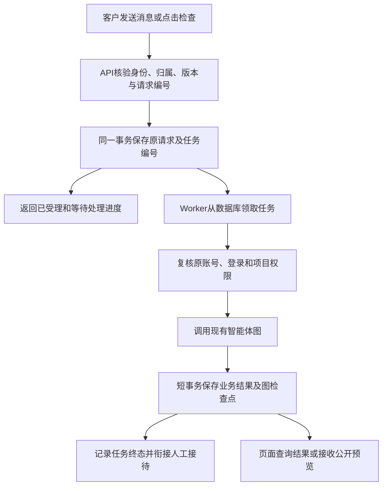
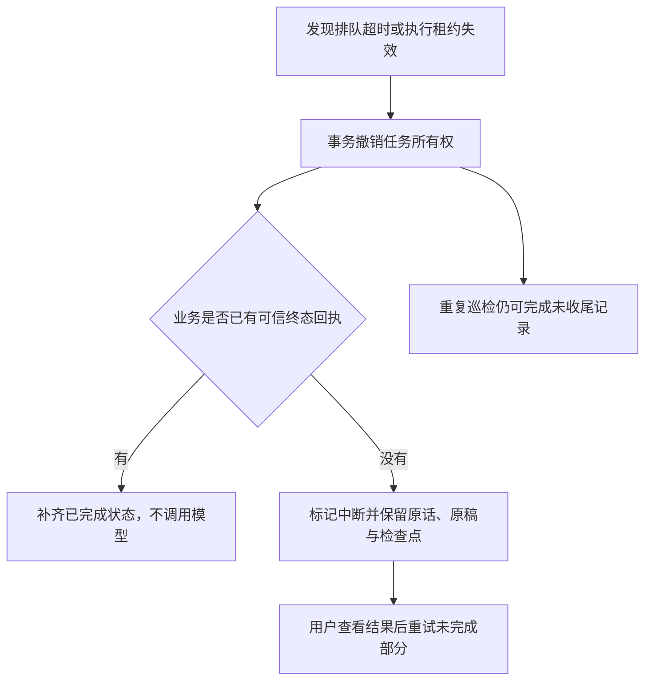

# 持久任务队列与独立执行进程

## 职责与范围

PostgreSQL 的 `agent_jobs` 是任务权威记录，`agent_workers` 记录执行进程心跳。Redis 仍然只保存可丢失的缓存和短时公开预览，不承担唯一任务副本。没有增加消息中间件或改变智能体业务图。

需求沟通在模型判断后可能进入需求生成，无法只按输入文字提前划分。因此整个公开 Agent 轮次、需求生成及重新生成、文档检查，以及人工期间的静默事实整理，都由独立 Worker 执行。API负责鉴权、事务受理、查询与实时连接；应用审查候选、审批、人工聊天仍走原来的短事务，不作为后台模型任务。

实现入口：[任务模型](../backend/models/jobs.py)、[队列存储](../backend/db/job_store.py)、[执行进程](../backend/services/job_worker.py)、[启动器](../scripts/start_worker.py)。

## 受理与执行流程

入队和业务记录同事务，队列满时连同本次消息一起回滚；相同操作者与请求编号仍由原业务幂等记录判定，不重复创建任务。队列仅保存项目、操作者、原登录及运行/检查编号，不复制整段聊天、正文或账号凭证。对话或文档检查在排队/执行期间，记录管理禁止回收对应项目。

任务内部为 `queued → running → completed/failed`。兼容现有业务接口，运行记录在排队和执行期间均显示未完成；事件明确展示“等待处理”和“正在处理”。旧的180秒失联判断不再抢先结束受队列管理的任务。

## 领取、租约与写入隔离

领取使用短事务、PostgreSQL事务咨询锁与 `FOR UPDATE SKIP LOCKED`：全局计数和领取原子完成；同一项目不同时执行两个队列任务。默认全局最多4个运行任务，100个待处理/执行任务，每位操作者最多4个。参数是保护上限，不是多人吞吐验收结论。

Worker领取后分配随机租约令牌，每5秒续约，默认30秒失联。执行过程通过每任务独立的上下文传递令牌；数据库事务先持共享锁核验任务、令牌和有效期，再读写业务或图检查点，提交前再次核对数据库时钟，过期则回滚。失联回收先撤销令牌再处理业务；旧执行的后续数据库操作被拒绝。模型请求前同样复核租约，已在网络中的请求不能保证取消或不计费。

文档检查领取后先校验排队期间正文hash、文档版本及项目版本，资料改变则安全失败，不对旧稿调用模型。

不在模型调用期间持有数据库事务。登录和权限在领取执行及原有业务保存入口复核；队列不会借用管理员、其他客户或新的登录继续执行。

模型工厂仍在单个Worker进程内限制同模型并发；队列的全局执行上限不能冒充供应商RPM/TPM全局限流。默认先部署一个Worker进程，增加进程前需单独验证账号额度与资源承受能力。

## 恢复边界

- API重启：Worker进程与已受理队列继续存在，页面可用原编号查询；API停机期间实时连接断开。
- Worker正常退出：停止领取，默认最多等待165秒让已运行任务收尾，随后取消并如实结束剩余任务。排队任务保留。
- Worker硬退出：未开始任务可由新Worker领取；已开始任务在租约到期后核对业务回执，有已提交结果则补齐，否则安全失败，不自动重复付费执行。
- 仅有中间答复、临时预览或生成前纪要不算最终成功。检查原稿不因故障被替换，已发布正文不变。
- 回收已经撤销所有权但未完成业务清理时再次崩溃，后续巡检继续幂等清理。
- 默认排队最长600秒。队列无Worker时也不会无限接受请求；API巡检或恢复后的Worker处理超时记录。
- LangGraph检查点继续保留节点进度，但本次没有实现任意节点的自动付费重放，不承诺模型请求恰好一次。

人工接管仍等待已受理的当前任务正常结束或失败收尾，接待等待从收尾后计时。人工期间只整理客户事实，不产生AI公开回复。审查生成候选后等待用户决定，不占Worker执行名额。

## 启动与监测

先启动存储并执行 `python scripts/migrate.py`，然后分别启动 `python scripts/start_api.py` 和 `python scripts/start_worker.py`；无需重复建账号。Compose当前仍只管理PostgreSQL与Redis。

`/api/health/ready`检查API存储；`/api/health/worker`单独检查近期有心跳且模型已配置的Worker，无可用进程返回503。健康接口不返回任务内容、租约、登录编号或模型密钥。Redis正常时跨进程转发公开回复预览；Redis不可用时仍可保存和查询最终结果，实时文字可能延后，需求正文仍只显示进度。

队列参数位于 `SF_QUEUE__*`：CAPACITY、PER_USER、WAIT_SECONDS、POLL_SECONDS、LEASE_SECONDS、HEARTBEAT_SECONDS、SHUTDOWN_SECONDS。执行次数、模型用量和时限仍使用原Agent配置，从实际执行开始计算；排队时不消耗模型调用。

升级前停止新请求并确认没有旧版活动任务。回退迁移会拒绝删除仍有排队、运行或未完成收尾的任务表；需先完成清理并备份。已有客户原话、需求书及审批历史不随队列回退删除。

## 模拟轨迹

客户要求生成需求 → API同事务保存消息、运行和任务 → 页面显示等待 → Worker领取并核验原登录 → 原沟通图决定调用独立需求生成图 → 分章完成并保存原需求ID → Worker结束，页面读取完整需求 → 客户另行提交评审。

另一条轨迹：模型请求已发送 → Worker被强制结束 → 新Worker可领取其他排队任务 → 原任务租约到期 → 核对回执后提示原任务中断，旧稿保留 → 用户决定是否重试，不把中断写成成功。

## 验证范围

测试入口为 [队列测试](../tests/test_job_queue.py) 以及既有人工接待、审查、流式与真实PG测试。真实执行结果以[验收记录](验收记录.md)对应批次为准；本节模拟轨迹不是吞吐量或模型内容质量通过证明。Q01至Q04仍单独待验收。
