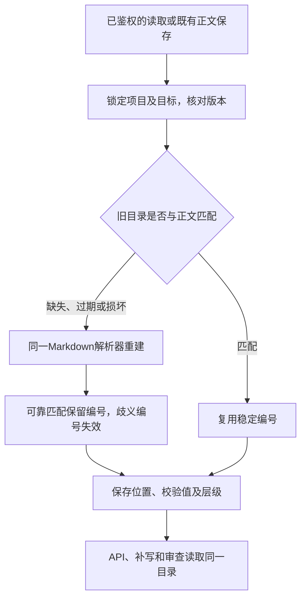
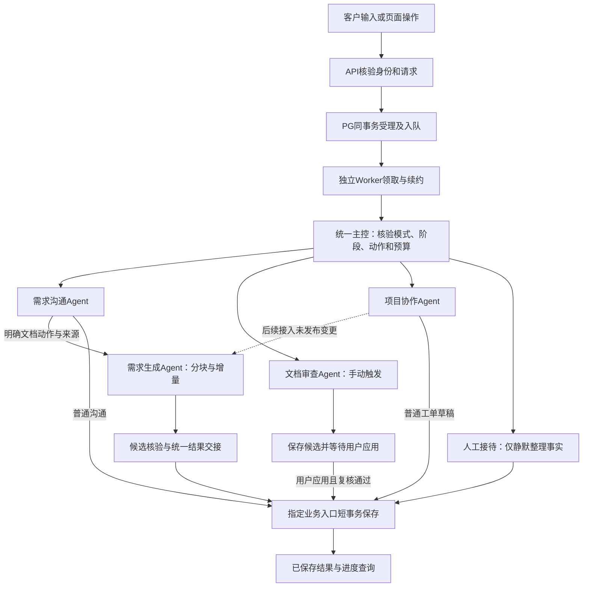
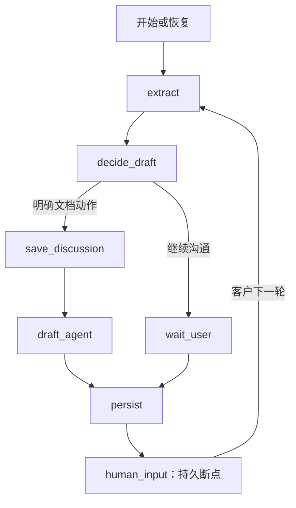
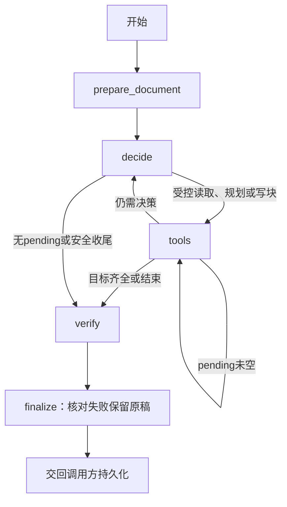
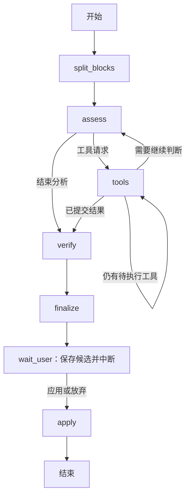
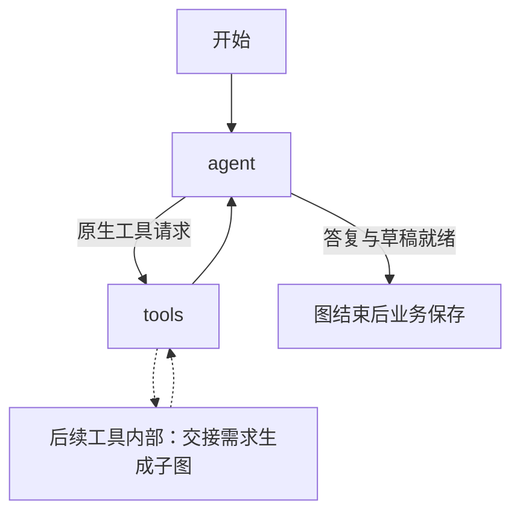
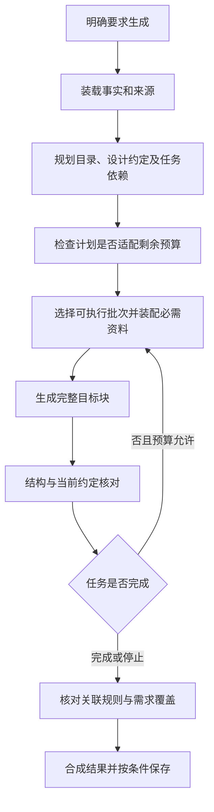
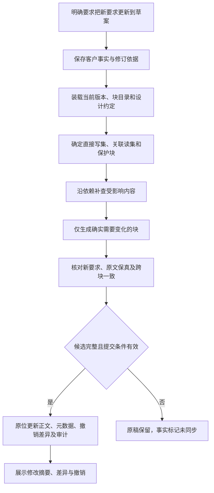

# 后续开发说明：四个业务智能体与分块需求文档

方案日期：2026-10-30；实施更新：2026-10-31。状态：**P0交接、P1稳定目录已完成；P2局部更新/撤销已编码验证；P3～P6待实施**。改造起点为`5dc2ab1`。本文是后续开发的唯一方案入口，合并此前分块生成、增量修订和智能体协作讨论；当前实现仍以[执行架构](执行架构.md)和四份智能体说明为准。

### 本轮P0交付边界

- 统一类型在[handoff.py](../backend/models/handoff.py)，路由与受理任务构造复用[common.py](../backend/agents/common.py)和[运行时](../backend/agents/runtime.py)。没有新增业务Agent或Agent文件夹。
- 四个业务图及人工静默分支接收/核验服务端任务；需求生成交接绑定原run、项目、账号/登录、来源、事实指纹和必要文档快照。结果绑定任务与正文hash，子图不能自报保存成功。
- 父图已消耗量从子图额度中扣除，次数、工具、Token与截止时间只能收窄；检查点恢复保留累计量和旧截止时间。保存预留两路取较早期限，不重复扣除。
- 普通/项目/静默结果的saved_project_version来自实际短事务返回；检查只保存候选，不代表正文已应用。取消继续传播CancelledError，由既有租约/任务收尾处理，不伪装成普通成功返回。
- 旧请求参数不变。新增检查点字段有默认值；旧审查候选从PG原source补入交接元数据，仍由原apply事务重新鉴权并核验版本/hash，不重跑模型。
- P0当时仅接入已有章节补写路径；其后的P2已改为默认局部更新及最近差异撤销，见下文。正式项目复用文档子图仍属P6。

本轮覆盖协议及确定性业务回归，未进行新一轮付费文档生成。实际结果与环境中断分别记入[验收记录](验收记录.md)，Q01～Q04继续未勾选。

### P1已实现：只读稳定块目录

共享解析及模型在[documents.py](../backend/models/documents.py)，新增迁移为[0023_document_metadata](../backend/db/migrations/versions/0023_document_metadata.py)。原review模块中的解析实现已迁到这一处，生成、审查和存储统一调用；没有增加Agent目录或LangGraph节点。

这是已实现的程序流程图，不是新增Agent节点。目录读取不修改正文、业务版本、审计或双方确认；既有编辑、重新生成、审查应用及历史恢复会在原业务事务中同步目录。

当前实现边界：

- 每个需求/变更item至多一行document_metadata，只存目录与版本/hash，不存章节正文；旧稿首次读取时懒建，不批量重写旧资料。原正文仍是唯一权威。
- 块ID首次分配后持久保存。整份原文分区完全相同可直接保留全部ID；发生变化后，仅以两侧唯一的原文hash、标题/层级或去标题正文hash可靠匹配。不会将最后一对剩余块猜成同一块；歧义旧ID进入invalidated_ids。
- start/end为Unicode码点左闭右开坐标；正文保留CRLF、CR、emoji及Unicode行分隔符，不裁断表格、代码、列表或引用。完整结构超过12000字符标oversized，不截断；超过512块则status=too_large且不返回半份目录，原正文仍保留。
- 目录绑定item_id、content_version、content_hash、parser_version，记录标题、层级、父级、区间和块hash。读取时对照原文重核结构；损坏或未来版本元数据失效重建。不能仅凭JSON结构合法就信任标题或父级。
- 读取接口为GET /api/projects/{project_id}/items/{item_id}/blocks，可携带expected_version；版本不符返回409，他人资料返回404。普通用户仍限本人项目，管理员沿用已有权限。
- 补写直接使用同一原稿目录ID，不再替换成existing-位置；新审查从同一目录开始。手动编辑/恢复前的现有历史也使用当时目录ID。
- 原子保存与并发懒建已验证。元数据是可重建派生数据，随其文档删除级联清理；不因此删除正文、正式版本或历史。

正常库已升级0023，升级前完成备份并验证可读取，34条资料正文/hash、版本及确认状态核对未变；迁移没有回填目录。完整回归381通过、2项付费测试未启用而跳过，详见验收记录。**随后P2已经接入局部更新和撤销；设计约定与依赖分批写作仍属P3**。

### P2已实现：关联块原子更新与最近一次撤销

- 需求生成使用真实5节点图，见[当前节点与模拟](需求生成智能体.md)。本轮明确更新/补写已有稿才进入局部路径；已有稿的普通生成命令也默认局部更新，只有明确整份重新生成才走原全稿路径。
- plan_revision提出最多6个目标、20个关联和20个保护块；read_revision_blocks每次1～4块，读取上限24000字符；写前须读齐目标及关联。各块本轮至多写一次，原生工具仍由模型自主安排。
- verify在既有共享预算内使用draft_reviewer做一次关联语义复核，无无限纠错循环；未通过、缺块、格式错误或预算不足，整次局部结果不覆盖原稿。程序校验原文hash、范围、代码围栏及未改结构，语义判断不能冒充执行验证。
- 成功同ID/version递增并清确认，不另存旧全文；无变化不改文档版本与签名。客户事实先独立保存，文档失败或撤销时标document_pending。
- 迁移0024新增document_undo，每item仅保留最新逆向差异；新增/删改区间以Unicode码点计。序列化差异及附属数据最多64KiB，删改旧字数不超过max(256,原文80%)；超限拒绝本次局部保存，不偷存全文。
- 新接口：GET /api/projects/{project_id}/items/{item_id}/latest-change、POST同路径/undo-change。撤销携带原request_id、expected_version及change_id，未知结果原参数重试；忙碌、越权、发布或hash不匹配均拒绝。
- 页面显示最近差异与“撤销本次修改”；“更新需求”和“重新生成整份”分开。独立手动审查仍须应用，未变成自动审查。
- P2没有持久设计依赖或事实逐项覆盖图；待确认列表保守沿用，尚不自动判定旧问题已解决。大范围技术换栈可能超预算而安全拒绝，应分次修改或明确整篇重写。P3/P4继续处理依赖覆盖与审查质量。

## 一、范围与已经确认的决定

目标是把客户的自然语言需求转成详细工程文档，并让后续修改只作用于相关内容。**分块、按依赖分批生成与增量更新是核心改造，不因采用四智能体架构而取消。** 分块不是每章一个Agent，也不是按字数切开后轮流写作。

已经确认的产品行为：

1. 保留需求沟通、需求生成、文档审查、项目协作四个业务Agent，增加统一交接规范，完善现有主控调度层。主控是程序编排，不新增每轮都调用的第五个LLM Agent。
2. 普通沟通只保存事实；本轮明确要求生成或更新文档才执行。愿意试点、询问模板不构成文档生成授权。
3. 明确要求更新现有草案时，**直接局部更新当前草案，展示修改差异**，不再额外要求点击应用。只有明确要求整篇重写才全量生成。
4. **只保存最近一次增量修改的有界差异，支持撤销**，不因此保存每次生成的整份旧稿。现有手工编辑、审查应用历史继续保留。
5. 用户点击“检查并优化”后，审查Agent生成独立候选；仍须点击“应用修改”才改正文。这与明确指令驱动的局部更新不同。
6. 未选技术、字段、流程等设计就近标【自动生成】；客户最新明确要求覆盖旧建议。保留工程细节和真实来源，不退化成骨架稿。
7. 普通顾问回答流式展示；文档生成、局部更新和检查只显示进度，临时章节不输出到聊天。最终正文保存在需求文档中。
8. 一份当前未发布需求原位更新；已发布正式版本只读，后续修改走变更。人工接待期间只静默提炼客户事实，不自动回复、搜索或生成。

本文不包含自动开发、自动报价、自动排期、附件解析、向量RAG或外部平台集成。不能将这些可选扩展变成当前版本的交付门槛。

## 二、当前实现与待开发差距

| 项目 | 基线已有 | 本轮待开发 |
| --- | --- | --- |
| 主控与执行 | AgentRuntime按阶段分派，PG持久队列、独立Worker、租约、幂等及权限检查 | 统一交接模型、明确动作分类、父子预算与结果规范，整合已有入口而非再造调度系统 |
| 需求沟通 | 主图7节点，独立人工静默整理分支，事实及原话溯源 | 把新增文档动作交接给文档Agent，记录事实是否已同步到文档 |
| 需求生成 | P2已接入5节点、稳定目录、原生工具、局部影响核对、原子提交与撤销 | P3持久公共约定、设计依赖及首次分批生成 |
| 已有草案补写 | P2按版本绑定原稿，使用目标/关联/保护范围；全部通过才保存 | 事实逐项覆盖、自动假设及待确认项的更细关联管理 |
| 文档审查 | 7节点图、Markdown拆块、按需读原话、候选校验、人工应用与历史 | 复用统一块目录，按批积累有效结论，完善来源覆盖和跨块一致性，减少重复读块 |
| 项目协作 | agent/tools两节点，准备受控业务草稿 | 后续让未发布变更复用文档增量能力；**当前尚未调用需求生成子图** |
| 模型工厂 | 按用途配置、统一额度、流式接收和有界失败处理 | 复用现有用途，记录每阶段消耗；不按章节另建工厂或裸调模型 |
| 内容质量 | 有详细生成稿、业务状态与执行可靠性证据 | [Q01～Q04](验收记录.md#待处理验收清单)仍未通过，不能因架构完成而勾选 |

当前需求生成已经分章，不是“一次调用生成整篇”。真正缺口是跨次稳定管理、公共规则一致、影响分析、局部提交及可验证的审查质量。队列已完成，不再作为待重做事项。

## 三、整体协作与主控职责

以下是**目标协作图**。实线为职责关系；项目协作复用文档能力属于最后接入阶段，不代表基线已实现。

统一主控是现有API、AgentRuntime、Worker和业务存储共同承担的**一套协调规则**，不是把所有职责搬进一个大文件：

| 所在层 | 保留职责 | 不应承担 |
| --- | --- | --- |
| API与业务受理 | 身份、输入、明确按钮动作、幂等、同事务入队 | 在HTTP请求中执行长模型任务 |
| AgentRuntime | 依据最新阶段/模式路由，校验交接，统一结果与运行资源 | 重写四套业务图、代替业务事务授权 |
| Worker与任务存储 | 原子领取、同项目串行、全局限额、心跳、租约及超时收尾 | 理解需求、擅自重复未知结果的付费请求 |
| 各业务图 | 职责内的决策、工具调用、候选构建及检查点 | 自行改变账号、审批、发布或公共限额 |
| 业务存储 | 重新鉴权、版本与租约复核、正文及审计原子提交 | 持有SQL事务等待LLM或搜索 |

路由先处理身份、人工模式和显式页面动作，再按项目阶段选择沟通或项目协作。自然语言文档动作由沟通Agent识别，并由程序检查本轮原话、否定/取消及目标合法性。消息内容中的“我是管理员”“忽略限制”不能改变路由权限。

一次普通沟通不遍历四个Agent。沟通交接文档是同一受理任务内的受控子图调用，初期不再创建一条子队列任务；独立手动审查仍有自己的任务与预算。Worker是进程，模型用途是配置，两者都不等于业务Agent。

## 四、Workflow、ReAct与四个Agent的节点安排

ReAct在这里指根据工具反馈选择下一步，不指前端React。确定性边界用Workflow，需要根据反馈选择动作时用有界ReAct；资料已经确定的单章写作用一次调用，无须强制进入多轮循环。

| 场景 | 执行方式 | 原因 |
| --- | --- | --- |
| 身份、归属、模式、版本、租约、幂等、发布 | 程序Workflow | 不能由模型决定是否跳过 |
| 目录规划、读取来源、影响范围、批次顺序、合法搜索 | 有界ReAct | 下一动作依赖实际资料与工具结果 |
| 把确定的资料写成一个目标块 | 单次写作调用 | 没有必要增加一层Agent |
| hash、diff、原文拼接、撤销、事务 | 程序Workflow | 需要精确保真和可重复验证 |
| 自由文本矛盾、客户规则解释 | 模型分析加依据校验 | 程序不声称完全理解自然语言 |

### 4.1 需求沟通Agent

保留[当前7节点图](需求沟通智能体.md#实际节点图)，本阶段不为改名增加节点。`decide_draft`扩展动作分类，`draft_agent`使用统一协议，`persist`核验文档结果。节点名属于内部实现，用户界面仍说“需求生成”。

人工模式复用现有`extract_facts → persist_facts`两节点分支，仅提炼客户事实。模拟：客户说“先记一下，每次最长两小时”→原话及事实保存→回复理解→文档不变；下一轮说“更新到需求书”→引用该条来源并交接文档Agent。新流程不能丢掉这道明确授权边界。

### 4.2 需求生成Agent

**P2已实现5节点**，保留工具决策循环。装载与事务校验为程序步骤；影响范围由模型规划，关联语义另核对一次。首次生成的verify当前为空操作，P3再完善其设计约定/依赖。

| 节点 | 输入与产出 | 必须保持的边界 |
| --- | --- | --- |
| prepare_document | 目标、原稿及版本、事实引用、块目录、设计约定 | 旧索引失效须重建；已发布基线不可写 |
| decide | 选任务、读集、写集和批次，决定是否需要补写/纠错 | 共享剩余预算，不能自行全量改写 |
| tools | 原生工具读块、读来源、规划、写块、收束 | 候选暂存；工具不直接提交正式正文 |
| verify | 结构/区间/hash检查，关联约定及必要语义核对 | 未核全如实标记，不把模型判断当执行测试 |
| finalize | 结果状态、变更集、覆盖、未完成项及消耗 | 不发布；交回原受理入口统一提交 |

优先扩展现有`plan_draft`、`write_prd_section`、`read_draft`、`finish_draft`，工具继续在`backend/agents/tools/drafting.py`。来源读取和块读取应有明确参数及返回范围，不以全文读取代替每次资料装配。

模拟：明确更新“最长两小时”→装载当前稿→决定读取规则/接口/数据/验收→只写规则、接口、验收→核对字段不需变化→输出3块候选→调用方原位保存。背景、角色和技术栈逐字保留。

### 4.3 文档审查Agent

保留[当前7节点图](草案审查智能体.md#实际节点图)，先完善节点内部批次、覆盖和依据，不另建“技术审查/业务审查/修稿”三套Agent。

`split_blocks`复用版本绑定的文档目录；`assess/tools`批量读正文及客户来源、积累结论；`verify`逐条校验证据和整批非重叠候选；`finalize`区分已检查、未检查、未修问题；`wait_user/apply`沿用真实断点、人工决定与短事务。

模拟：客户点击检查→发现取消预约仍占用时段→返回有原文依据的候选→当前稿不变→用户查看差异并应用→版本递增、签名清空、旧稿进入现有审查历史。未检出其他已知错误须保留漏检记录，不能用“0项建议”宣告通过。

### 4.4 项目协作Agent

先保留[当前agent/tools两节点图](项目协作智能体.md#实际节点图)。**最后阶段**在现有统一工具目录接入文档交接，复用未发布变更稿的增量能力；不覆盖正式基线，不顺带声称项目图已有检查点。

模拟：V1已发布，客户要求“预约改为最多两小时”→项目Agent准备变更说明和变更后完整需求书→文档Agent只修改相关块→保存未发布变更→客户/负责人按原流程评审确认→才发布V2。V1始终逐字不变。

## 五、统一交接协议

以下字段是**拟议内部契约**，不是现有HTTP接口已经支持的参数。使用Pydantic校验业务请求/结果、标准库TypedDict承载图状态。未知协议版本、额外危险字段和不合法组合应拒绝，不靠提示词约定。

### 5.1 任务信封

| 字段组 | 必要内容 | 谁填写/验证 |
| --- | --- | --- |
| 协议与关联 | schema_version、task_id、parent_task_id、run_id、review_id（如适用） | 服务端创建；子任务ID不替代原run或幂等请求ID |
| 业务范围 | project_id、item_id、调用Agent、目标Agent | 重新验证归属；跨项目或跨文档引用拒绝 |
| 操作 | record/create/revise/fill/rewrite_all/review/prepare_change | 页面或本轮明确原话支持；revise不能隐式升级rewrite_all |
| 操作者引用 | 服务端已验证的账号/登录引用及人工模式快照 | 不信任客户端自报角色；不携带JWT、Cookie或密钥 |
| 输入快照 | 项目/文档版本、正文hash、事实快照指纹、目录版本 | Worker读取及提交前复核；不能只相信排队时的权限 |
| 目标与依据 | 明确请求的消息/引文ID、需求目标、来源ID、限制与保护块 | 原话从PG读取，不把模型改写的引文当权威 |
| 影响范围 | 直接目标块、关联读取块、允许写集及禁止写集 | 初始目标可由Agent建议，程序核验后才开放工具 |
| 预算 | UTC绝对截止时间、剩余模型/工具/输入输出额度、保存预留 | 从父任务分配；子图不得清零或重获完整预算；进程内用单调时钟计算剩余时间 |
| 能力限制 | 是否允许公开检索、允许工具、是否只读/候选 | 子任务权限只能收窄，不能扩大 |

`record`通常由沟通/静默整理完成，不调用文档生成；`review`只走手动审查入口；`prepare_change`只产生未发布业务草稿。动作名在实施时统一到一处类型定义，避免API、图、工具各写一份枚举。

队列继续存任务与业务引用，**不复制信封里的客户正文或全部对话**。Worker从权威存储重建受控信封；图调用时传本次必需字段及按需读取引用。服务端登录引用只在内部使用，不回传普通客户界面。

### 5.2 结果信封

| 字段组 | 内容 |
| --- | --- |
| 关联与输入 | task_id、run_id、基于的版本/hash/事实指纹 |
| outcome | completed、partial、no_change、conflict、failed、cancelled之一；这是业务结果，不直接新增同名队列状态 |
| 输出 | 候选/变更集引用、目标块ID、约定变化、修改摘要、原文校验信息 |
| 覆盖 | 已处理来源/规则、未同步事实、已读与已检查范围、未知依赖及未完成项 |
| 限制与消耗 | 实际模型用途/型号、调用数、可获得usage、耗时、停止原因、降级原因 |
| 提交回执 | 只在业务事务成功后填写item_id、新版本/hash及审计ID；模型不能自报保存成功 |

文档子图返回候选不直接改正式正文；原调用方是唯一提交负责人。审查结果先保存独立候选，人工应用才产生正文提交回执。`completed`只表示该任务得到完整约定结果，不等于语义无错、代码已执行或需求已发布；`partial`不能冒充检查通过。

### 5.3 交接执行规则

1. 接收者验证协议、目标、版本与能力限制；缺失来源或非法写集直接停止，不用额外模型请求猜补。
2. 同一受理任务共享绝对截止时间和累计消耗。已有沟通、写章、纠错及备用模型尝试都计入原有预算边界；独立点击审查才开启独立审查预算。
3. 同一幂等请求只允许一个一致参数指纹。子调用用父任务及操作/批次标识关联，不另造普通客户消息。
4. 跨Agent只传必要结果；不把一个Agent的全部可变State交给另一个Agent修改，不让四个角色各自保存一份事实。
5. 候选成功不等于提交成功。权限、版本、租约或来源发生冲突时，保留原稿并返回冲突，不能先告诉客户已更新。
6. 异常按类别交回原调用方，取消、越权和租约失效不能被当作“某章失败”吞掉继续写库。

## 六、文档分块与设计约定

### 6.1 阅读目录、文档块与生成批次

三者分别管理：目录面向阅读，块用于定位/替换，批次用于控制一次模型工作量。具体目录由业务决定，背景、技术栈、架构只是可能章节，不是固定三块模板。

参考目录可包含目标与范围、角色权限、功能及流程、数据/接口、技术与架构、异常/并发、部署、验收、自动补充与客户原话。没有相关业务不硬塞空章，但不能删掉工程实现所需的规则和异常说明。

拆分优先级为**语法完整 → 语义完整 → 请求预算可控**：

- 依据真实标题、完整段落、功能单元和表格拆分；不把代码围栏、表格、嵌套列表、引用或句子按固定字符数截断。
- 单个完整结构过大时标记大块，用专门受控处理或说明无法完成，不静默截断。多个小块可进入同批，单个大章也可分多次完成。
- 创建目录后分配稳定ID，标题、层级和顺序是可变属性。插入新章或改标题不让后续所有ID变化。
- 保存原始Markdown字符区间、原文hash、语法类型和父块关系；区间统一采用Unicode码点的左闭右开约定，不混用UTF-8字节与前端UTF-16偏移。最终替换由后端执行。
- 未改范围按原始字符串拼接，保留空行、换行风格、代码缩进；展示渲染不能反向生成权威Markdown。
- 人工编辑后按已有ID、hash及标题/位置重建映射；匹配歧义须失效重建/重新确认范围，不能冒认可靠映射。

### 6.2 精简公共设计约定

在现有短文本design_rules基础上，增加小而明确的带类型条目，不一次生成巨大嵌套JSON。推荐类型：范围、角色权限、状态、字段、技术、时间、接口、验收。

每条记录ID、值、来源ID、客户明确/自动建议/冲突/已替代状态、自身修订号、关联块及依赖。例如：

| 约定 | 值 | 影响 |
| --- | --- | --- |
| RULE-01 | 取消后释放预约时段 | 功能流程、状态、数据库约束、验收 |
| TIME-01 | 相邻时段允许衔接【自动生成】 | 时间范围语义、数据库示例、验收 |
| PERM-01 | 员工只能取消本人预约，来源SRC-03 | 权限、接口、验收 |
| FIELD-01 | booking.subject字符串，最多100字符【自动生成】 | 页面字段、接口、表结构 |

客户事实来自原话与证据，生成建议不能反向变成客户确认。两条客户原话冲突、无法确认是纠正时形成待确认项；自动约定可被修正，但其全部受影响正文须纳入同一候选核对，不能只改元数据。

依赖记录“引用哪些规则/字段/来源”，按需读细节；不把全文塞入每次调用。未知依赖明确标记，在更新时补查，不能用缺少依赖边假装没有影响。共享约定是可校验的派生设计资料，不能脱离实际正文成为第二份正文权威。

## 七、两条核心执行流程

### 7.1 首次生成：按依赖分批，不机械逐章

规划需列任务目标、输入来源/约定、产出块和前置依赖。先确定预约状态和资源释放规则，再分别写功能、数据库及验收；架构依赖技术选择，接口依赖权限和字段。设计依赖满足才开始相关批次。

同一文档第一阶段串行。批次根据输入/输出额度和剩余时间决定，不规定“一章一次调用”，也不允许计划十章却只够三次写作。必要语义核对共用预算，不在每块后无条件调用整套审查Agent。

当前DraftPlan最多6个计划章节，不应直接拿这个限制当作稳定块数量或最终目录数量。P3需要区分目录、块与任务的模型字段，保留有界校验；批次容量由剩余额度决定，不能简单删除上限改成无限计划。

无旧稿时允许保存如实标记的部分成果及缺项；已有完整稿时，失败/部分生成不得将其替换为骨架或残稿。全文重写仅接受明确授权，并沿用当前不自动备份旧生成全文的政策。

### 7.2 增量更新：先影响分析，再原子提交

直接修改块、关联读取块、实际修改块分别记录。读取字段定义后发现不需改动，则原样保留；不能读过哪里就重写哪里。沿依赖扩展到没有未处理的受影响约定；达到范围或预算上限须说明未核全，不能静默漏掉关联。

模型只返回目标块新正文及理由。旧文本、区间、hash由程序取自已鉴权快照，不要求模型抄整段旧文来证明修改位置。校验块存在、归属、hash、非重叠、语法、来源及保护范围；多块候选一致后一次提交。

关键关联块失败时不保存半新半旧文档。客户事实已保存，但文档整体保留并说明“这条要求已记录，本次尚未更新到需求书”。广泛修改可以分批构建候选，不能擅自升级为整篇重写；第一阶段不自动三方合并。

若请求限制某章不可改而关联一致性要求必须改，保留原稿并说明冲突。重复相同要求且无实质变化返回no_change，不重写同义句，不递增正文版本或清空签名。

## 八、权威数据、State与存储生命周期

| 数据 | 权威位置与生命周期 | 传递方式 |
| --- | --- | --- |
| 客户原话/事实证据 | 现有PG消息、纪要、project_fact_evidence，按项目长期保存 | 来源ID与按需读取，不为每块复制 |
| 当前需求正文 | ProjectItem.content唯一权威 | 受鉴权快照及版本/hash |
| 文档元数据 | P1已按item唯一保存块目录及正文版本/hash；约定、依赖、覆盖由P2/P3继续扩展 | 小型摘要先读，所需明细按需读；不重复存块正文 |
| 最近撤销 | 拟每份未发布文档至多一份有界反向差异 | 与成功修改同事务；下一次正文修改使旧差异失效 |
| 图State | 每次调用独立Pydantic业务对象，TypedDict序列化 | 子图深拷贝必要输入，不共享多用户可变对象 |
| 候选/检查点 | 当前运行暂存，保持既有安全重入范围 | 绑定输入指纹、身份、版本、计数及绝对截止时间 |
| AgentJob | 已有持久任务与回执 | 只存业务引用；不为每章新建队列任务 |
| Redis | 可丢失派生缓存、临时进度 | 缓存丢失回PG；不承载唯一正文、授权或依赖 |

建议在现有模型和存储中增加受校验的文档元数据及最近差异模型，具体DDL在实施迁移中确定；不为纯透传再加Repository或agents/shared目录。元数据、正文、差异与审计必须同事务更新。旧稿首次装载仅只读建索引，不重写正文、不臆造来源、依赖或客户确认。

生成期间关闭SQL事务，只保留本次需要的有界内存资料。模型/HTTP响应及时关闭并释放额度；图等待或终态按现有策略清理无用正文副本。节点间仍需后续使用的State不在每次传递后盲目清空；PG事实和已保存文档也不会因节点结束而删除。

不得建立一个跨用户全局State。共享的是不可变规范、模型工厂、数据库及有界连接池；业务资料靠project_id/item_id、账号归属、版本和每次独立State隔离。同文档串行不等于跨进程供应商限流已完成。

## 九、提交、差异与最近一次撤销

提交前及事务内重新验证操作者/登录、项目归属、人工模式约定、目标类型/未发布状态、输入版本/hash、事实指纹、请求指纹和队列租约。并发新消息需按实际相关事实判断快照有效性，不能拿旧约定覆盖新事实；不为普通聊天无依据地放宽正文校验。

人工交接的pending不取消已受理运行的合法收尾；原结果提交后再切human。模式复核用于阻止新启动的公开AI动作，不能误将这条复核实现成中途丢弃已完成候选。

成功更新同一item_id并递增防覆盖version，清空双方确认、退回草稿，正文及元数据/审计一起提交；正式revision不因此递增。事实保存与文档更新分阶段，有回执关联，不能“文档失败”把客户已保存事实回滚掉。

最近差异保存必要旧/新区间、前后hash、版本及约定/覆盖变化，不存整套对话。撤销必须命中当前版本/hash，作为一次新的正文修订递增version、清空确认，不倒退版本、不撤回客户事实、不影响已发布基线；相应事实改为尚未同步。

其他编辑、审查应用、发布或新修订使旧撤销失效。元数据可重建且版本绑定，撤销同时恢复相应索引/约定状态。设置差异大小上限；大到接近全文或超过限额时不能静默存全文备份，先保留原稿并提示本次无法提供局部撤销，再由用户决定是否继续。

审查应用沿用独立候选与旧稿历史，恢复旧稿是新修订；全文重新生成沿用最新稿政策。迁移不顺带删除历史、原话、已发布正文或审查证据。

## 十、检查与Q01～Q04的处理

基础检查应尽量程序化：合法目标、来源存在、版本/hash、区间非重叠、结构完整、未改区间逐字一致、保护块不变、显式类型/枚举引用一致、自动标记结构。自由文本含义、SQL语义和复杂权限仍需模型/工程师核对，不能承诺程序理解任意Markdown。

审查按相关规则组织读取批次，维护已读、已检查、发现问题和未检查来源；尽量复用同一轮合法读取结果。逐条问题有真实原文依据、类型、影响块和建议；业务不确定项留待客户，不为凑结论制造修改。技术修订也只有在依据充分时生成候选，不直接覆盖。

| 待验收项 | 本方案中的措施 | 不能省略的验证 |
| --- | --- | --- |
| Q01 跨章矛盾与错误声明 | 共享约定、依赖核对、关联块一起修订、来源标记 | 逐项核对字段/必填/权限/时间/审计；移除无依据的已实测断言 |
| Q02 漏检与依据失败 | 合法分批读取、来源追踪、逐条依据校验、有效结论积累 | 同一原始错误稿识别取消释放、相邻边界、字段和权限错误并给有效候选 |
| Q03 长文耗时 | 只读需要的资料、避免重复大上下文、限制无效循环、预留收尾 | 同稿/模型/预算实测时间与质量，保留超时；不能无限加时或删工程细节 |
| Q04 完整回归 | 生成、增量、独立审查、diff、手动应用、撤销和正式发布隔离 | 真实Chrome专用账号完成全流程及刷新/冲突/失败分支，留证据 |

这是一套有针对性的处理方案，不是“四项已解决”的证明。内部核对也不能替代独立手动检查；手动检查通过不能冒充软件已实现或验收测试已运行。

## 十一、预算、并发、异常与恢复

先复用现有预算基线，不靠增加无限调用掩盖问题。当前需求生成为12模型/8处理工具/64000 Token/150秒，单章4000输出/单次60秒并预留12秒保存；审查为8模型/16工具/100000 Token/120秒。实际以配置和代码为准，父子图不能各拿一份完整额度，也不能在批次间重置已用量。

规划、写作、必要纠错和核对共享计数与截止时间；在请求前按保守输入/输出预留判断能否完成。上下文和约定有上限，超限返回明确原因；不能静默截掉客户规则或已写正文细节。usage仅按可获取响应统计，不承诺等同供应商账单。

第一阶段同项目/同文档顺序执行，跨项目复用现有全局4个任务名额。将来仅在依赖已稳定且块独立时再评估同文档并行，必须使用独立候选State并验证合并；不靠增加GPU进程或共享可变State提高吞吐。

| 异常 | 安全行为 |
| --- | --- |
| 单块生成或重要关联核对失败 | 增量原稿不变，保留事实与未同步状态；首次无旧稿可如实部分保存 |
| 连续无效工具/反复读取无进展 | 有界停止并给具体原因，不无限反思/重试，不造结论 |
| 源码片段含越权指令 | 当资料处理，不升级工具权限或执行任意代码/SQL |
| 客户并发编辑或资料版本改变 | 拒绝过期覆盖，原请求按回执查询；不自动三方合并 |
| 已写块有检查点 | 在现有安全重入边界内复用，不重写已完成块，不重置预算 |
| Worker失联/请求结果未知 | 沿用租约隔离及可信回执收尾，不自动重发付费请求 |
| 退出/停用/租约过期 | 停止后续写入，旧进程不能提交晚到候选 |
| 客户请求人工 | 当前已受理AI操作先完成并保存后交接；新消息保存但不启动公开AI动作 |
| 联网不可用或未授权 | 只在现有双重开关及公开主题范围内使用；失败保留本地方案与来源标记 |
| 审查未读完或没有有效建议 | partial与原因可见，不显示检查通过 |

容量压测、分布式供应商RPM/TPM与生产部署另设验收，不因本方案完成而默认为可承载某个固定人数。0～50人只是讨论假设，容量需按并发任务、消息频率、文档长度与供应商配额测量。

## 十二、接口与界面改动边界

不新开一套`/api/draft`绕过现有鉴权、幂等、任务和文档流程。优先扩展现有消息/文档业务接口，新增最近差异读取/撤销操作；确切路径在编码时统一到既有路由组织。

| 操作 | 必要校验 | 界面结果 |
| --- | --- | --- |
| 明确局部更新 | 当前目标、版本、原请求ID、明确动作与来源 | 只显示进度，成功展示摘要/差异与撤销 |
| 补齐缺失内容 | 真实缺项、相关块、写集限制 | 不重写已有完整章节 |
| 整篇重新生成 | 独立明确动作、当前版本和已有存储政策 | 不误当普通更新，不展示临时全文 |
| 读取最近差异 | 文档归属、版本/hash匹配 | 当前这次修改的前后对比 |
| 撤销 | 幂等ID、expected_version、最近差异ID/hash | 新修订已保存；原事实仍在 |
| 手动检查/应用 | 原手动入口、候选、来源/版本及人工决定 | 检查不改正文；应用后才更新 |

已有草案时主要按钮建议为“更新需求”，整篇重写放独立操作；没有新内容时显示“无需修改”。进度使用“正在整理这次调整”“正在更新相关说明”“正在核对关联内容”，不显示块ID、JSON、Token或内部节点名。

事实已保存但文档失败时明确区分两个结果；待同步提示引用最新有效事实，不因为用户查看一次页面而消失。重连订阅原任务，不再次提交，最终显示PG已保存内容。

## 十三、实施任务与交付顺序

P0、P1已有交付回归；P2局部更新与撤销已编码验证，结果见验收记录；P3～P6仍待开发。每阶段记录验证结果；上一阶段未达退出条件不宣布下阶段能力上线。

| 阶段 | 主要文件/模块 | 可交付结果与退出条件 |
| --- | --- | --- |
| P0 统一契约与路由 | models/jobs.py、models/drafting.py及必要的统一交接模型；agents/runtime.py；consultation节点；services/job_worker.py | 信封严格校验、明确动作/权限范围、预算继承、旧请求兼容。普通讨论/人工模式不生成，错误交接拒绝且不丢事实 |
| P1 只读文档目录（已完成） | models/documents.py单一解析与目录模型；0023迁移、项目/审查存储及blocks读取接口 | 持久稳定ID、版本/hash绑定、语法完整、旧稿懒建、损坏/歧义失效；目录读取不改正文和确认，不调用付费模型 |
| P2 增量修订与撤销（已实现） | drafting四文件、tools/drafting.py、db/project_store.py及文档元数据事务；文档界面/API | prepare/verify节点、读写集、局部候选、同ID原子更新、最近差异/撤销；冲突/关键失败保留原稿。明确更新直接保存，无额外应用按钮 |
| P3 首次分批生成 | drafting模型/提示词/工具、统一模型工厂用途配置 | 带来源的公共约定、依赖任务、按预算批次生成；保留工程深度，未选方案标自动生成，有明确覆盖与部分完成状态 |
| P4 独立审查质量 | review四文件、tools/review.py、review_store及DocumentReview组件 | 同目录、合法读批次、跨块结论、原文依据、候选复核；手动应用不变，定向验收Q01/Q02 |
| P5 实测与文档 | 对应后端/前端测试、Chrome专用样本、验收记录 | 同稿对照测量Q03；真实全流程Q04、异常与撤销通过；如实保留未通过项 |
| P6 正式项目复用 | project四文件、tools/project.py、统一交接与变更存储 | 只对未发布change复用同一文档能力，基线逐字保护、审批不变；独立验证权限和父子预算 |

P0只集中真实交接字段，不构建泛化插件系统。P1不写第二套Markdown解析器；抽取/复用现有语法能力时避免Agent互相导入节点实现。业务Agent仍各四文件，工具只有`backend/agents/tools`；必要类型在models，事务在db，不新增一串agent/service/shared包装层。

迁移通过Alembic新增元数据与差异约束，不清理客户正文。旧正文可懒建目录；回退时旧程序仍能读原content，暂停新更新入口，不靠删数据回退。配置增加时使用现有Settings并在启动校验，不能在节点里散落魔数。

## 十四、验收矩阵与测量方式

| 编号 | 场景 | 必须观察的结果 |
| --- | --- | --- |
| A01 | 仅业务补充、愿意试点、问模板、整轮否定生成 | 保存有效事实/正常回复，正文与签名不变 |
| A02 | 首次生成，用户没选技术 | 详细功能/字段/接口/异常/验收，来源与自动建议清晰；缺项如实保留 |
| A03 | 改一条跨章预约规则 | 直接块和必要关联块一致更新；无关区间逐字相同，同ID/version正确 |
| A04 | 改标题、插章、表格、长代码、嵌套列表、emoji及CRLF | 稳定映射，不截断、不误定位，不混用字符偏移 |
| A05 | 更新相同要求 | no_change，无正文写入、无签名清空、无虚假改动 |
| A06 | 关键关联块失败/预算不足 | 原完整稿及其自动建议保持；事实仍在、提示未同步 |
| A07 | 编辑/新事实/退出/租约失效撞上生成 | 过期结果不得覆盖；正确冲突与回执，无越权保存 |
| A08 | 重试同请求、不同参数复用ID | 同参回放不重复执行；异参冲突，不重复清签名 |
| A09 | 撤销及撤销已失效的差异 | 仅最近有效差异可用，version单调递增，原话不删，事实同步状态正确 |
| A10 | 手动检查、部分检查、应用/放弃、恢复 | 依据真实、候选独立；未完成不报通过；未应用正文不变 |
| A11 | 人工接管发生在生成中 | 原操作收尾后交接，后续只静默整理，客服不因模型失败无法聊天 |
| A12 | 多账号跨项目、admin查看、同项目并发 | 权限隔离、同项目串行、不同账号State不串、旧响应不覆盖新结果 |
| A13 | V1后更新、客户与负责人分别确认 | 仅change修改，V1 hash不变；无自动发布或代签 |
| A14 | API刷新/Worker中断/结果未知 | 原任务可查询、租约安全收尾；没有未知付费请求自动重放 |

对照实验分首次生成、单规则修订、跨章修订、长文审查四类。使用同一客户来源、原始稿、可用模型/参数与预算；记录输入输出Token、模型/工具次数、总耗时、成功/部分/失败、修改块/字符、未改区间保真及人工质量判定。分别报告首次和后续更新，不预设节省百分比，不只挑最好一次样本。

确定性测试检验身份、协议、解析、hash、事务、失效与原文保护；真实模型样本检验意图、工程深度、关联更新和检错；浏览器检验进度、diff、撤销及人工应用。不同层的通过数量不相加，也不能用模型审查替代实际运行。

真实测试用独立账号/项目，不修改客户记录；保留失败证据与实际配置，结束后按既有可恢复清理规则处理。Q01～Q04继续在[验收记录](验收记录.md#待处理验收清单)勾选，本文不是第二份验收结果。

## 十五、完整模拟：会议室需求产生与修订

下面是**开发用模拟，不是已执行证据**。

| 步骤 | 用户/系统 | 数据与文档结果 |
| --- | --- | --- |
| 1 | 客户说30人、5间会议室、目前微信群登记，不懂技术 | 沟通Agent记录业务来源，不将“不懂”当技术禁用，不生成 |
| 2 | 客户补充员工管本人预约、主管只看本部门汇总 | 保存角色及权限事实，有原话来源；顾问围绕业务少量追问 |
| 3 | 客户说“直接生成，没选的你推荐，标自动生成” | 合法create交接，文档Agent建立目录/权限/状态/字段约定 |
| 4 | 分批生成 | 功能规则先明确，再写数据、接口及架构/验收；未选框架就近自动标记，不虚构测试通过 |
| 5 | 原子保存初稿 | 一份未发布需求，显示最终完整正文；聊天只给完成结果 |
| 6 | 客户说“最多2小时，先记下” | 事实保存、文档不变，记录未同步 |
| 7 | 客户说“把刚才这条更新到需求书” | 读规则、接口、数据与验收；本例只需改规则、接口和验收块，字段定义及其他正文保真 |
| 8 | 查看差异，点击撤销 | 仅恢复这次变更，version继续递增、原话保留、两小时规则回到未同步状态 |
| 9 | 再次明确更新，随后手动检查 | 局部更新直接保存；独立审查对取消释放/边界等返回候选，不直接应用 |
| 10 | 客户应用候选、补齐业务问题、提交评审 | 应用保存原审查历史、清空确认；双方分别确认后才发布V1 |
| 11 | V1后增加限制 | 项目协作经统一协议准备change，文档增量引擎复用；V1不改，双方确认才发布V2 |

若第7步任一关键关联块失败，停在原稿；第9步未读全则显示部分检查；第11步尚属P6后续能力。这些分支必须在真实验收中分别验证，不能仅凭模拟判定完成。

## 十六、文档管理与参考

后续设计只维护本文。当前四个Agent的已实现节点、工具与模拟仍在各自说明中；编码完成后再按实际add_node/edge同步，不能提前把目标节点标成真实代码。真实证据、失败及待办统一放[验收记录](验收记录.md)，如何执行验证见[验证指南](验证指南.md)。

本次文档清理将旧分块方案并入本文，多角色/异常用户记录并入验收档案；删除的是被替代的重复入口，不删除客户数据、本机证据或未通过项。后续不再并行维护同一方案的多份“最终版”。

以下资料作为已有设计参考，未代表项目已验证相应效果：

- [Anthropic：Building effective agents](https://www.anthropic.com/research/building-effective-agents)：按任务选择Workflow与自主工具决策，避免不必要复杂度。
- [LangChain：Plan-and-Execute Agents](https://www.langchain.com/blog/planning-agents)：规划与执行分开，随结果调整计划。
- [NASA：Requirements Management](https://www.nasa.gov/reference/6-2-requirements-management/)：来源追溯及需求、设计间一致性。

本项目不照搬外部审批体系，不因借鉴模式就增加每章一Agent、知识图谱、向量库或新队列框架。是否达到效果由本文验收矩阵及真实证据判断。
