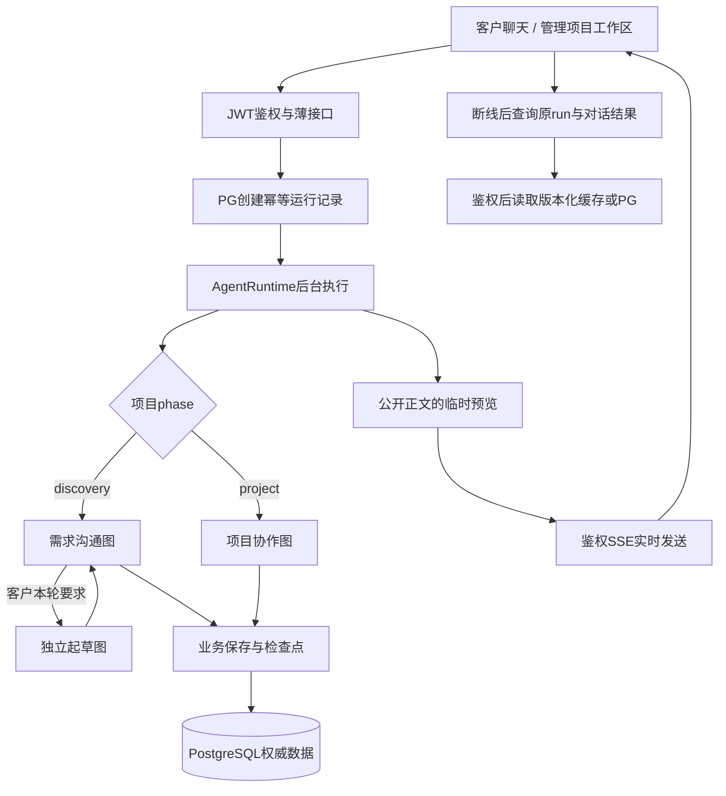
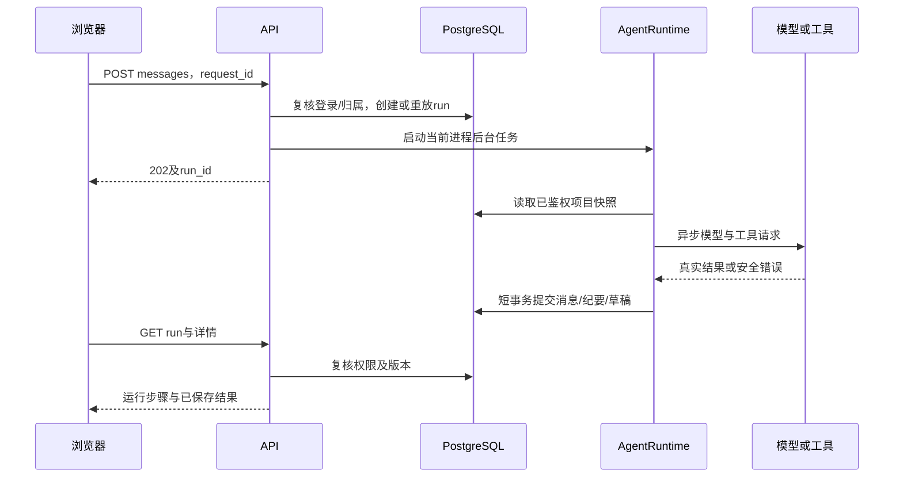
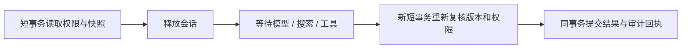

# 智能体执行架构

## 三个业务智能体与统一运行时

起草子图是需求沟通内的工具交接，不额外占后台名额。正式项目图当前自行准备变更稿，不自动调用该子图。

| 能力                | 需求沟通             | 起草                         | 项目协作             |
| ------------------- | -------------------- | ---------------------------- | -------------------- |
| 实际节点            | 7                    | 3                            | 2                    |
| 模型用途            | consultation         | draft_planner / draft_writer | consultation         |
| PostgreSQL图检查点  | 有                   | 有，逐工具同步               | 当前无               |
| LangGraph interrupt | human_input          | 无独立人工节点               | 无                   |
| 搜索                | 两级开关、每轮一次   | 两级开关、最多两个主题       | 当前工具表未提供     |
| 可提交业务结果      | 对话、纪要、待审草案 | 返回草案给主流程             | 对话、纪要、待审草稿 |
| 可审批或发布        | 不可                 | 不可                         | 不可                 |

具体节点与模拟分别见[需求沟通](需求沟通智能体.md)、[起草](起草智能体.md)、[项目协作](项目协作智能体.md)。

## 一条请求的实际生命周期

请求创建成功但响应未知时，用原request_id与相同参数重试；不能换ID假定未提交。浏览器刷新只继续查询已有run，不应再发送生成请求。

聊天优先通过携带标签页鉴权头的fetch读取SSE实时快照；正文生成时逐步展示，完成后以PG保存结果为准。连接、重连、账号隔离及临时预览边界见[模型管理](模型管理.md)。工具的结构化参数、内部规划和私有推理不会发送到预览。

## 持久数据与事务

[session.py](../backend/db/session.py)实现 `AsyncEngine → async_sessionmaker → AsyncSession`。API生命周期持有连接池，每次操作创建独立短事务，成功提交，异常或取消回滚。业务代码不能在线程中执行SQL，也不能在模型请求期间持有事务。

沟通起草有分阶段提交：先保存本轮原话与有效纪要，子图返回后原位更新助手消息并保存草案；discussion_run_id/last_run_id用于识别已提交结果。最终业务结果保存后，等待图检查点就绪再结束run。

正式项目的ProjectTools先暂存本轮notes/drafts，成功答复后统一finish。失败不能留下只保存一半的本轮草稿。

数据库内主要分工：

| 数据                                     | 权威来源      |
| ---------------------------------------- | ------------- |
| 账号、可撤销登录、refresh轮换摘要        | PostgreSQL    |
| 沟通、项目、基线、资料、消息、执行与审计 | PostgreSQL    |
| HITL及起草检查点                         | PostgreSQL    |
| 短期run快照与后台汇总                    | Redis，可重建 |

## 并发与预算

以下是每进程默认值，实际以配置为准，不是生产吞吐量承诺。

| 层次             | 默认限制                                 | 超出时行为               |
| ---------------- | ---------------------------------------- | ------------------------ |
| HTTP准入         | 64并发，等待250ms                        | 返回可重试繁忙           |
| Agent后台执行    | 4个                                      | 拒绝新执行，不无界排队   |
| PostgreSQL连接池 | 5基础 + 5溢出                            | 等待至pool_timeout后失败 |
| 缓存完整回源     | 8并发，等待250ms                         | 返回可重试503            |
| 物理模型并发     | 用途配置，示例2                          | 有界等待后MODEL_BUSY     |
| 正式项目单轮     | 5模型 / 8工具 / 40000 Token / 90秒       | 不提交未完成的本轮草稿   |
| 起草共享单轮     | 12模型 / 8处理工具 / 64000 Token / 150秒 | 保留已写内容并标部分完成 |

起草单章默认最多4000输出Token，单次模型60秒，总截止前留12秒保存。主顾问和起草的控制/写作调用共享本轮计数；generate_prd交接也计一次处理工具。已写内容的一次本地finish收尾不额外占处理工具额度，不能无限重试。

程序以UTF-8字节保守预留请求输入，响应成功时按usage计量，无usage时使用预留兜底。累计值不是供应商账单；失败、截断和云侧结算须结合供应商记录核对，不承诺云费用硬上限。每章输出上限也不是文档字数目标。

同项目运行互斥由PG行锁和唯一约束约束，不能用Redis TTL锁替代。跨进程不共享HTTP、缓存回源或模型信号量，多实例部署不能靠增加进程规避云账号RPM/TPM。

## 图检查点与进程恢复的区别

| 场景                                       | 当前行为                                 |
| ------------------------------------------ | ---------------------------------------- |
| 浏览器刷新，API仍在执行                    | 继续查询run，结果不丢                    |
| 沟通等待客户                               | human_input中断，下一轮Command恢复原线程 |
| 同一次起草显式重入                         | 核对指纹，复用已保存章节和累计计数       |
| 业务已提交、检查点尚未完成                 | 通过业务回执识别并补齐后续保存           |
| 模型请求已发送、工具检查点未提交即进程退出 | 不能保证出网请求恰好一次                 |
| API进程重启                                | 没有自动调度器；原内存任务不自动继续     |
| 运行记录超过180秒未结束                    | 在读取/新请求等路径加锁复核并回收为失败  |

线程命名为consultation:run_id与draft:run_id，起草与主沟通不会混用同一线程。PostgreSQL检查点不公开原始提示词、私有工具消息或原始状态给客户。

## 模型与工具边界

工具统一位于[agents/tools](../backend/agents/tools)，只处理已授权项目资料、公开搜索和草稿，不开放任意SQL、任意代码执行或审批动作。

联网服务当前为DuckDuckGo HTML摘要，不是Tavily接口，也不是网页全文爬虫。公开参考提供来源，不变成客户业务事实；搜索失败可继续本地处理。模型返回普通文本action JSON不会被当作原生工具调用。

执行事件保留type、实际模型、purpose、工具、耗时及可用用量。客户聊天只显示易懂步骤；“6次调用”等展示计数不能直接当作模型请求次数。不存在的Skill/MCP不会制造事件。

## 后续扩展位置

有实际需求再增加持久任务队列、分布式模型限流、附件解析、向量检索、外部项目接口等能力。不能在图示或文档中把扩展点写成已实现功能。

接口总装配在[api/router.py](../backend/api/router.py)，业务版本文件位于api/v1，但当前公共路径从/api开始。版本、归属、幂等和状态机以[project_store.py](../backend/db/project_store.py)为准。
