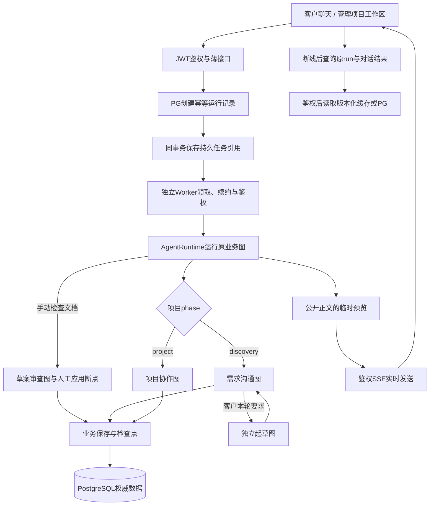
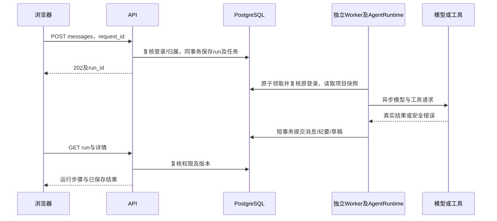
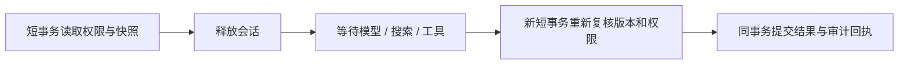

# 智能体执行架构

## 四个业务智能体与统一运行时

起草子图是需求沟通内的工具交接，不额外占后台名额。正式项目图当前自行准备变更稿，不自动调用该子图。

生命周期另外启动FlowGuard，每15秒有界巡检接待期限、失联执行和业务待办。规则切换不调用模型；自动接续复用原消息和原登录，终态回执与中间答复严格区分。接待巡检在API停机后于启动时补偿；模型任务由独立Worker与持久队列执行，不自动重放结果未知的付费请求，见[流程兜底与会话标识](流程兜底与会话标识.md)。

会话入口先检查接待模式。人工消息直接在短事务保存，不依赖模型配置或执行名额；人工求助等待已有顾问、生成或检查完成才生效。人工期间客户新消息由两节点静默整理分支处理，后台失败不阻断聊天；客服建议不混入客户事实。实时更新统一走项目会话流，聊天历史按条件分页查询。接待状态版本与业务版本独立，避免交接破坏原执行保存，见[人工接待与聊天溯源](人工接待与聊天溯源.md)。

用户还可对已保存的需求书/变更手动运行[草案审查智能体](草案审查智能体.md)：独立review线程、7节点、PG检查点和人工应用断点。检查生成候选，不直接更新正文；与顾问任务共用后台总名额。应用/恢复通过短事务校验与审计，不调用模型，也不执行审批。

| 能力 | 需求沟通 | 起草 | 项目协作 | 草案审查 |
| --- | --- | --- | --- | --- |
| 实际节点 | 7 | 3 | 2 | 7 |
| 模型用途 | consultation | draft_planner / draft_writer | consultation | draft_reviewer |
| PG图检查点 | 有 | 逐工具同步 | 当前无 | 有，独立review线程 |
| LangGraph interrupt | human_input | 无独立人工节点 | 无 | wait_user |
| 搜索 | 两级开关、每轮一次 | 两级开关、最多两个主题 | 当前未提供 | 当前未提供 |
| 业务结果 | 对话、纪要、待审草案 | 返回草案给主流程 | 对话、纪要、待审草稿 | 问题、局部候选、差异、历史 |
| 可审批或发布 | 不可 | 不可 | 不可 | 不可，应用仅更新草稿 |

具体节点与模拟分别见[需求沟通](需求沟通智能体.md)、[起草](起草智能体.md)、[项目协作](项目协作智能体.md)、[草案审查](草案审查智能体.md)。

## 一条请求的实际生命周期

请求创建成功但响应未知时，用原request_id与相同参数重试；不能换ID假定未提交。浏览器刷新只继续查询已有run，不应再发送生成请求。

聊天优先通过携带标签页鉴权头的fetch读取SSE实时快照；正文生成时逐步展示，完成后以PG保存结果为准。连接、重连、账号隔离及临时预览边界见[模型管理](模型管理.md)。工具的结构化参数、内部规划和私有推理不会发送到预览。

## 持久数据与事务

[session.py](../backend/db/session.py)实现 `AsyncEngine → async_sessionmaker → AsyncSession`。API与Worker各自在生命周期持有连接池，每次操作创建独立短事务，成功提交，异常或取消回滚。业务代码不能在线程中执行SQL，也不能在模型请求期间持有事务。

沟通起草有分阶段提交：先保存本轮原话与有效纪要，子图返回后原位更新助手消息并保存草案；discussion_run_id/last_run_id用于识别已提交结果。最终业务结果保存后，等待图检查点就绪再结束run。

正式项目的ProjectTools先暂存本轮notes/drafts，成功答复后统一finish。失败不能留下只保存一半的本轮草稿。

数据库内主要分工：

| 数据                                     | 权威来源      |
| ---------------------------------------- | ------------- |
| 账号、可撤销登录、refresh轮换摘要        | PostgreSQL    |
| 沟通、项目、基线、资料、消息、执行与审计 | PostgreSQL    |
| HITL及起草检查点                         | PostgreSQL    |
| 短期run快照与后台汇总                    | Redis，可重建 |

## 并发与预算

以下是每进程默认值，实际以配置为准，不是生产吞吐量承诺。

| 层次             | 默认限制                                 | 超出时行为               |
| ---------------- | ---------------------------------------- | ------------------------ |
| HTTP准入         | 64并发，等待250ms                        | 返回可重试繁忙           |
| Agent后台执行    | 全局4个；队列总量100、每操作者4个         | 有界排队，满时受理回滚   |
| PostgreSQL连接池 | 5基础 + 5溢出                            | 等待至pool_timeout后失败 |
| 缓存完整回源     | 8并发，等待250ms                         | 返回可重试503            |
| 物理模型并发     | 用途配置，示例2                          | 有界等待后MODEL_BUSY     |
| 正式项目单轮     | 5模型 / 8工具 / 40000 Token / 90秒       | 不提交未完成的本轮草稿   |
| 起草共享单轮     | 12模型 / 8处理工具 / 64000 Token / 150秒 | 保留已写内容并标部分完成 |

起草单章默认最多4000输出Token，单次模型60秒，总截止前留12秒保存。主顾问和起草的控制/写作调用共享本轮计数；generate_prd交接也计一次处理工具。已写内容的一次本地finish收尾不额外占处理工具额度，不能无限重试。

程序以UTF-8字节保守预留请求输入，响应成功时按usage计量，无usage时使用预留兜底。累计值不是供应商账单；失败、截断和云侧结算须结合供应商记录核对，不承诺云费用硬上限。每章输出上限也不是文档字数目标。

同项目运行互斥由PG行锁和唯一约束约束，不能用Redis TTL锁替代。跨进程不共享HTTP、缓存回源或模型信号量，多实例部署不能靠增加进程规避云账号RPM/TPM。

## 图检查点与进程恢复的区别

| 场景                                       | 当前行为                                 |
| ------------------------------------------ | ---------------------------------------- |
| 浏览器刷新，API仍在执行                    | 继续查询run，结果不丢                    |
| 沟通等待客户                               | human_input中断，下一轮Command恢复原线程 |
| 同一次起草显式重入                         | 核对指纹，复用已保存章节和累计计数       |
| 业务已提交、检查点尚未完成                 | 通过业务回执识别并补齐后续保存           |
| 模型请求已发送、工具检查点未提交即进程退出 | 不能保证出网请求恰好一次                 |
| API进程重启                                | 独立Worker继续，原编号查询恢复          |
| 队列执行失联                              | 租约到期先隔离旧进程，再核对业务回执     |
| 无队列的旧运行超过180秒                    | 沿用原有加锁复核与失败收尾               |

线程命名为consultation:run_id与draft:run_id，起草与主沟通不会混用同一线程。PostgreSQL检查点不公开原始提示词、私有工具消息或原始状态给客户。

## 模型与工具边界

工具统一位于[agents/tools](../backend/agents/tools)，只处理已授权项目资料、公开搜索和草稿，不开放任意SQL、任意代码执行或审批动作。

联网服务当前为DuckDuckGo HTML摘要，不是Tavily接口，也不是网页全文爬虫。公开参考提供来源，不变成客户业务事实；搜索失败可继续本地处理。模型返回普通文本action JSON不会被当作原生工具调用。

执行事件保留type、实际模型、purpose、工具、耗时及可用用量。客户聊天只显示易懂步骤；“6次调用”等展示计数不能直接当作模型请求次数。不存在的Skill/MCP不会制造事件。

## 后续扩展位置

持久任务队列与独立Worker已实现，详见[任务队列与Worker](任务队列与Worker.md)。有实际需求再增加分布式模型限流、附件解析、向量检索、外部项目接口等能力。不能在图示或文档中把扩展点写成已实现功能。

接口总装配在[api/router.py](../backend/api/router.py)，业务版本文件位于api/v1，但当前公共路径从/api开始。版本、归属、幂等和状态机以[project_store.py](../backend/db/project_store.py)为准。

## 小规模状态与读取边界

运行规模按0～50名用户规划，人数是假设，不代表50份需求可同时生成；队列默认全局4个执行名额。

- 公共共享：模型客户端、连接池、并发额度。操作者、项目快照和本轮业务数据不放进全局共享状态。
- 沟通图：`state.py`中的`ConsultationPayload`校验可序列化的本轮状态。`persist`事务成功后清空已保存的需求正文、提取结果、补丁和替换稿副本，再进入人工等待；恢复仍读取最新授权项目快照。
- 需求生成：保留本次独立`DraftState`，工具共享同一对象；父子图传递明确输入及结果，不共用客户事实可变字典。
- 项目图：准备的`drafts/notes`随图State传递，工具操作相同列表，成功收尾统一保存。
- 审查图：候选稿和报告保存成功后，等待态不再携带章节全文、工具消息和候选补丁副本。应用所需的原稿、版本、hash与候选保留在业务记录中。

写入数据库不意味着原Python对象立即释放。任务结束移除任务与预览引用；Worker关闭时先停止领取并有界等待，随后关闭模型客户端。API退出不取消其他进程任务。缓存删除失败不能占住执行名额或覆盖已经提交的业务结果。

`GET /api/projects/{id}`及资料列表只查询140字符正文摘要，不加载全部正文或运行事件。单条资料接口读取完整正文；处理过程由run接口按需读取，返回`cache_version`防止较旧响应覆盖新状态。后台Agent也用摘要快照，仅正式项目的当前基线按需读取全文。

终态检查点每次收尾分批清理，默认成功保留1天、失败保留7天，每类最多25条线程；只在同项目任务结束时做有界清理，长期不再访问的项目不会触发后台定时扫描。配置为`SF_AGENT__CHECKPOINT_SUCCESS_DAYS`、`SF_AGENT__CHECKPOINT_FAILURE_DAYS`及`SF_AGENT__CHECKPOINT_CLEANUP_LIMIT`。保留沟通线程、执行中需求生成线程及ready/running审查线程；刚应用或放弃审查的幂等回执也受成功保留期保护。清理检查点不会删除客户原话、当前需求书或审批记录。

事实来源另存`project_fact_evidence`，不随工作纪要的100条来源上限裁剪。`/fact-sources`分页查询来源，单条来源读取时校验原消息hash、原文区间和引文hash。字符位置按Python Unicode字符计数，不是UTF-8字节或JavaScript UTF-16偏移。此机制用于内部追溯和检测修改，不宣称数据库管理员无法篡改。
