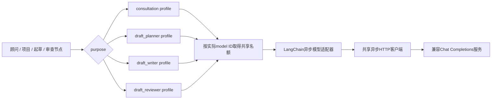
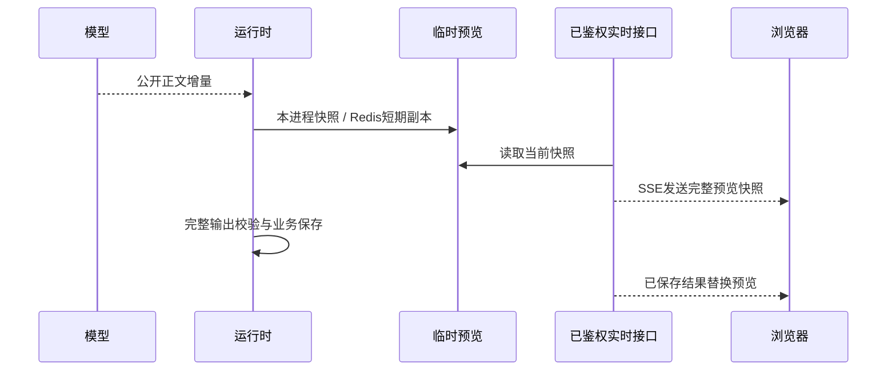

# 模型用途与统一工厂

2026-10-30新增可选用途备份：`SF_AGENT__FALLBACKS__<用途>__MODEL`。默认不配置、不自动切换；显式配置且预算允许时，未开始公开输出的短暂故障最多切换一次，共用剩余时间并记录实际尝试。已有输出、权限配置错误不重放或静默切换，见[流程兜底与会话标识](流程兜底与会话标识.md)。

## 当前分工

[ModelFactory](../backend/core/llm/factory.py)在API生命周期中创建，内部使用LangChain的ChatOpenAI适配同一个兼容端点与密钥，按purpose选择模型。适配器按用途复用，所有请求共享应用持有的异步HTTP连接；Agent不直接取得模型对象绕开并发限制。

| purpose       | 调用位置                           | .env.example示例 |
| ------------- | ---------------------------------- | ---------------- |
| consultation  | 需求顾问、补充回复、正式项目智能体 | qwen-plus        |
| draft_planner | 起草决策、大纲与结束选择           | qwen-plus        |
| draft_writer  | write_prd_section写Markdown章节    | qwen-flash       |
| draft_reviewer | 手动审查、选择块和提出精确修改、局部复核 | qwen-plus |

这四个purpose不等于四个业务智能体一一绑定：项目协作当前也用consultation。用途model为空时继承SF_AGENT__MODEL（代码默认qwen-max）；示例配置不是全部环境的强制组合。审查默认temperature=0。

## 调用与并发图



同一model ID的用途别名使用同一信号量，容量取这些配置的最小值；不同model ID各有名额。所有用途仍受Agent执行总量、连接池、本轮预算和截止时间约束。信号量只在当前API进程生效，云账号额度由供应商执行。

## 配置示例

```dotenv
SF_AGENT__BASE_URL=https://dashscope.aliyuncs.com/compatible-mode/v1
SF_AGENT__API_KEY=
SF_AGENT__MODEL=qwen-max
SF_AGENT__CONSULTATION__MODEL=qwen-flash
SF_AGENT__CONSULTATION__CONCURRENCY=2
SF_AGENT__DRAFT_PLANNER__MODEL=qwen-flash
SF_AGENT__DRAFT_PLANNER__CONCURRENCY=2
SF_AGENT__DRAFT_WRITER__MODEL=qwen-flash
SF_AGENT__DRAFT_WRITER__CONCURRENCY=2
SF_AGENT__DRAFT_REVIEWER__MODEL=qwen-flash
SF_AGENT__DRAFT_REVIEWER__CONCURRENCY=2
SF_AGENT__DRAFT_SECTION_OUTPUT_TOKENS=4000
```

每用途还支持wait_seconds、temperature、supports_tools、supports_json，使用相同的SF_AGENT__用途__字段形式。当前不会按用途分别设置base_url或api_key。

模型必须具备当前任务所需的原生tool_calls能力。声明不支持工具/JSON时，在发送前拒绝不兼容请求；应用不以普通文本JSON模拟工具调用。不支持的模型名、工作区权限及供应商限流需在实际环境验证。

配置由Pydantic Settings读取根.env，SF_嵌套环境变量覆盖。配置冻结并缓存，修改后需要重启API；模型名可以展示，API密钥与供应商异常原文不可展示。

## 错误与额度

| 错误                                      | 当前处理                                                    |
| ----------------------------------------- | ----------------------------------------------------------- |
| MODEL_BUSY                                | 本地模型名额等待超时或供应商429，保留已有数据并返回安全提示 |
| MODEL_CONFIGURATION                       | 401/403/404等配置或授权问题，不隐式换模型                   |
| MODEL_CAPABILITY                          | 用途声明不支持所需能力，调用前拒绝                          |
| MODEL_TRUNCATED                           | finish_reason=length视为未完整输出，章失败不假称完整        |
| MODEL_RESPONSE_FAILED                     | 网络或响应格式问题，错误信息不泄露原始载荷                  |
| TOKEN_BUDGET / MODEL_BUDGET / TOOL_BUDGET | 由Agent工作流控制，不能通过换purpose重置                    |

成功响应保留真实model/purpose和供应商可用用量。请求前预留与成功后累计见[执行架构](执行架构.md)。失败时不保证拿到完整计费信息，应用记录不能替代供应商账单。

## 详细草案的请求策略

- 初次使用完整AGENT说明，保留直接写完整稿能力。
- 已有大纲后使用精简CONTINUE进行工具决策，不再每次重复发送全部写作要求。
- 每次write_prd_section仍使用完整SECTION/RULES，并读取统一State与前文有界节选。
- 单章默认4000输出Token；增加章节空间没有提高64000共享预算和150秒时限。
- 章节截断、语义矛盾、漏标来源是不同问题。不能把所有失败都归结为网络，也不能靠降低文档深度掩盖截断。

当前提供用户手动触发的[分块审查](草案审查智能体.md)，不在每次起草后自动执行。没有自动模型降级、跨供应商故障切换或无限重试。选型正确性与来源归因仍需对真实样本评审。

## 流式回复与断线恢复

顾问回复、补充回复、正式项目答复及起草章节使用受控的astream；起草规划和JSON请求仍读取完整响应。相同模型的名额覆盖整个读取过程，正常结束、异常或取消均关闭响应并释放名额。适配器禁用SDK自动重试，不在已显示部分正文后悄悄重发模型请求。



- 前端发送后立即显示发送/思考状态；普通顾问回复逐步显示纯文本。需求生成、重新生成及章节补写只显示当前章节进度，不在聊天里展示中间正文；隐藏正文增量不触发反复滚动。完成并保存后在需求文档中查看，聊天保留完成说明。内部仍按原方式受控接收模型流，生成逻辑与断点不变。
- 只发送公开content，不发送reasoning字段、工具参数或规划内部文本。工具需要先执行时，用户先看到处理状态，再看到回复。
- 预览限40000字符，Redis最多约每120ms更新一次、180秒过期；不按Token写PG。每次模型请求重置预览，结束运行后清理。Redis故障时同进程预览仍可用；跨进程可退回已保存状态。
- 实时接口为GET /api/projects/{project_id}/runs/{run_id}/stream，通过fetch携带当前标签页的Authorization与X-Session-ID，不在URL放令牌。单连接25秒后重新订阅，每秒复核登录、有效期和项目权限。
- 每进程最多64个实时连接、同登录最多2个；流响应开始后释放普通HTTP准入名额。模型名额与后台任务额度独立，不因浏览器打开连接而额外占用。
- SSE发送完整快照而非必须逐条重放的Token事件，刷新/重连继续订阅原run；暂时不可用时退回查询。不会重新POST消息或重新发起生成。切换账号、记录或离开页面取消旧读取并丢弃晚到数据。
- 到达输出长度、超时或连接不完整不能当作成功；临时预览不作为正式消息或图检查点。已完成章节和已有沟通仍按原业务保存机制保留。

流式边界验证见[test_streaming.py](../tests/test_streaming.py)和[test_model_factory.py](../tests/test_model_factory.py)。

相关测试：[test_model_factory.py](../tests/test_model_factory.py)、[test_config.py](../tests/test_config.py)、[test_draft_sections.py](../tests/test_draft_sections.py)。

## 请求超时与检查提交

每次请求把节点给定的timeout_seconds传入SDK请求选项，覆盖适配器初始化时的默认30秒；外层asyncio.timeout仍按当前剩余预算取消请求。该选项不进入供应商的JSON业务参数。供应商读超时返回MODEL_TIMEOUT，与结构校验或普通请求失败分开，不暴露上游原文。

审查模型若只给普通文字，没有原生工具调用，会在剩余预算内最多追加一次指定finish_review的结论提交；工具入参仍走原文、客户原话、精确替换和局部复核，不直接采用普通文字。调用的是具名工具，不依赖tool_choice=required；阿里文档说明Qwen对required不能保证始终调用工具，参考[阿里官方函数调用说明](https://www.alibabacloud.com/help/zh/model-studio/qwen-function-calling)。

## 小规模运行的当前配置

2026-10-28，本机沟通、规划、正文生成和审查均改为 qwen-flash；原生工具调用已独立探测。四个用途使用同一模型时共享最小并发额度，不能按用途叠加名额。余额或授权错误仍明确报告，不在一次执行中暗中切换模型。模型切换不会重置运行预算。
