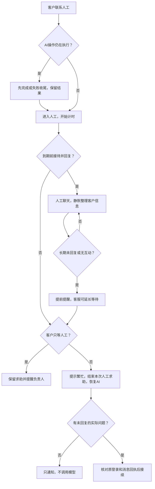

# 流程兜底与会话标识

## 执行位置

`backend/services/flow_guard.py::FlowGuard` 是生命周期内的后台巡检服务，不是新增智能体或图节点。API启动时及之后每15秒扫描一批，默认40个项目，通过游标轮转。它不依赖浏览器在线；每个项目在短事务内加锁并重新检查，状态切换和消息领取通过行锁及回执防重。这不是供应商模型调用恰好一次的保证。

截止时间、接待状态、提醒和待回复消息在PostgreSQL。停止服务先关闭巡检，再关闭Agent和数据库。API停机期间不会执行计时动作，启动后按已存时间补偿；模型执行另由[持久队列与独立Worker](任务队列与Worker.md)负责，API退出不取消独立执行进程。

## 人工超时流程

| 情形 | 默认规则 |
| --- | --- |
| 无客服领取 | 真正进入human后180秒；超时提示繁忙，结束求助并恢复AI |
| 领取后未回复 | 首条未回复消息开始计时；接管前的消息从接管时计时。120秒提醒，300秒恢复AI |
| 忘记交还 | 双方900秒无互动后恢复AI，提前60秒预告 |
| 客服仍在处理 | 将当前截止时间后延300秒；延长期有效时不能重复叠加 |
| 明确只等人工 | 不自动恢复；提示繁忙并保留请求，负责人可见；客户可主动恢复AI |
| AI正在回复、生成或检查 | 不因人工计时取消任务，在既有执行上限内完成或失败收尾 |

客户补发消息不重置未回复期限；客服实际回复才确认之前消息。普通业务描述“业务系统不要AI审核功能”不能误判为拒绝接待。纯“转人工”等控制消息不触发自动回复或付费提取。

无人领取到期提示：“当前人工客服繁忙，暂时无人接待，已由AI助手继续为您服务。您也可以稍后再次联系人工。”其他超时使用对应说明，发言人是系统。

## 整条流程的兜底

| 环节 | 实际处理 |
| --- | --- |
| 消息接收 | 即时保存原话，未知结果用原request_id查回执；自动接续复用原消息，不复制用户输入 |
| 信息整理 | 格式错误至多纠正一次，失败标待整理；被动扫描不无限付费重试 |
| 顾问调用 | 时间和次数有界，只有显式配置的备用模型可接管尚未公开输出的短暂故障 |
| 需求生成 | 保留已完成章节和原稿，不用中间聊天答复冒充生成成功 |
| 检查优化 | 原稿、问题、候选保留；中断标未完成，应用前重新核对权限和版本 |
| 失联执行 | 队列任务租约到期先隔离旧执行并核对回执；无队列的旧记录沿用180秒保护，不盲目重跑付费生成 |
| 评审、受理、开发、交付验收 | submitted/in_progress/awaiting_acceptance默认24小时未处理时发一次同项目提醒；状态改变后重新计时，不自动确认、发布或关闭 |
| 浏览器断线 | 重新订阅原执行和消息，不重发业务 |
| 原登录被撤销 | 停止自动接续，保留原话，提示重新登录并进入后台待关注 |
| 模型未配置 | 保留待回复消息并提示AI也暂不可用；配置修复、重启后可继续检查 |

读取执行详情、下一轮互斥检查、失败收尾、检查点就绪和巡检统一调用 `ProjectStore._recover_run`。沟通图必须有匹配的 `consultation.last_run_id` 且确有已保存AI消息，才判定终态成功；仅有run.answer、流式片段或前置沟通保存不够。晚到结果仍须通过原任务状态、权限和版本校验。

当前不是“进程崩溃后自动重放任意Agent”：保留检查点及已提交结果，失联执行安全收尾；未开始的待回复消息可重新领取。等待客户、应用候选和双方确认属于正常等待，不按running超时清理。

## 模型备份

`SF_AGENT__FALLBACKS__<用途>__MODEL` 显式设置且次数预算允许时，短暂限流、响应失败可切换一次到备用模型。主备共用同一请求剩余时间；同模型共享最小并发额度，实际尝试计入业务图次数并记录实际模型与fallback_from。

已有公开流式文字后不重放；权限配置错误、能力不匹配、输出截断不静默切换。未配置备用就安全失败，不自行选模型。备用须由管理员预先验证权限、工具/结构化能力和费用，仍使用当前端点与密钥；只统计可获得的响应用量，不保证供应商不会对未知失败请求计费。

## 各种ID的职责

| 标识 | 代表什么 | 保存、传输和用途 |
| --- | --- | --- |
| user_id | 一个账号 | users.id，项目owner_id和消息sender_id记录归属 |
| session_id / sid | 一次登录 | auth_sessions.id、JWT的sid、X-Session-ID；sessionStorage仅保存定位ID，匹配sid专属HttpOnly刷新Cookie |
| project_id | 一条沟通记录或项目 | 消息、纪要、文档、接待期限按它隔离 |
| run_id | 一次Agent执行 | 执行状态、事件、回执和临时预览 |
| thread_id | LangGraph进度位置 | 沟通复用已存consultation线程，生成为draft:run_id，检查为review:review_id；不能替代项目鉴权 |
| request_id | 一次提交去重编号 | 未知结果按原编号/参数重试，不等于登录或模型线程 |

session_id用于登录恢复、续期、退出撤销、标签页身份匹配、同sid刷新串行化和实时连接配额。只有sid不能获得权限，仍需有效凭证及数据库复核。

消息内部的 `login_session_id` 供超时后自动接续核对原登录，不返回聊天接口，不是新凭证。原登录撤销后不借用管理员或其他标签页身份执行；重新登录仍可按账号归属查看原项目。计时按project_id保存，不随登录更换或页面刷新重置。

## 配置与验证

`SF_RECOVERY__*` 对应RecoverySettings，默认值见 `.env.example`。ENABLED控制主动巡检，项目请求仍核对接待状态。批量巡检有轮转延迟，不保证精确到秒；提醒必须早于截止时间。

后台“待处理接待”共用此配置计算到期提示，Agent包装业务存储做事实整理或执行收尾时保留实际配置，不退回默认3分钟。队列查询为只读，具体分类、搜索和分页见[人工接待与聊天溯源](人工接待与聊天溯源.md)。

迁移 `0021_flow_recovery` 给历史人工会话等待宽限，保留可识别的明确“只要人工/不要AI”选择，不改写原消息或正式正文。

测试入口：`tests/test_flow_recovery.py`、`tests/test_human_conversation.py`、`tests/test_model_factory.py`。PG测试使用独立schema，验证并发巡检、登录撤销、控制消息、客服延长、无浏览器在线、终态回执、已有输出不重放以及逾期不自动审批。
