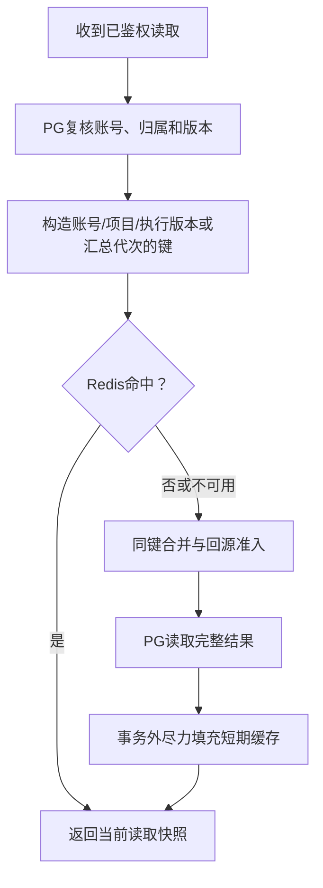

# PostgreSQL与Redis缓存

## 分工

PostgreSQL是账号、会话、权限、项目、消息、基线、草稿、运行回执、审计和图检查点的唯一权威来源。Redis保存可重建的读取快照和可丢弃的流式预览，不参与业务锁、JWT轮换、幂等或HITL恢复。

## 读取流程图

缓存命中也有SQL权限/版本查询，目标是减少大JSON传输和统计重算，不能声称全部数据库查询被消除。PG不可用时不能拿旧缓存绕过授权。

| 数据     | 键隔离                         | 默认TTL  | 变化处理                                       |
| -------- | ------------------------------ | -------- | ---------------------------------------------- |
| run快照  | 账号、项目、run、cache_version | 最多3秒  | 事件、保存、失败、检查点就绪及超时回收递增版本 |
| 管理汇总 | 管理员、summary代次            | 最多15秒 | 业务提交后更换汇总代次                         |

流式预览单独使用`prefix:live:run_id`键，180秒过期，每次生成替换当前完整文本快照，不使用随机TTL或权威run版本。仅实时接口在PG鉴权后读取，本进程有运行时副本；最多40000字符、约120ms合并更新，运行结束删除。预览不是已保存的消息，也不用于幂等和断点恢复。Redis不可用时，同进程仍能展示预览，其他进程退回权威运行状态。详见[模型管理](模型管理.md)。

TTL随机缩短到80%至100%。旧回填只写旧版本/旧代次，不能覆盖新键。缓存读取仍是当时权限和版本快照，不是全系统线性一致读；失效通知失败或外部写库可使旧汇总保留至TTL。

## 有界回源与故障

- 当前进程对同键未命中合并等待，最多跟踪1024个键；不同进程仍可能各回填一次。
- 完整记录或统计回源默认8并发、等待250ms，超出返回可重试503。
- Redis操作150ms超时，异常后本进程熔断5秒，期间受控回源PG。
- 缓存读写在SQL事务外，Redis失败不回滚已提交业务。
- 非JSON/非对象数据按未命中处理，写入快照有256KB限制。
- 账号停用、会话撤销、项目删除在命中前复核；取消请求仍释放等待和回源名额。

## 配置与维护

代码默认cache.enabled=false，.env.example启用。主要项为SF_CACHE__ENABLED、HOST、PORT、DATABASE、PASSWORD、PREFIX、RUN_TTL_SECONDS与SUMMARY_TTL_SECONDS，完整范围见[config.py](../backend/config.py)。

Compose Redis绑定127.0.0.1:16379，128MB内存、allkeys-lru、不持久化。不同部署或数据库使用不同prefix。重启Redis可以丢失全部缓存，PG业务数据不受影响。

管理员GET /api/admin/cache可查看当前进程命中、未命中、填充、错误、熔断等统计，不暴露缓存正文或凭证；API重启后计数归零。/api/health/ready以PG就绪为准，Redis故障按缓存降级处理。

## 模拟读取

1. 客户A查询自己的执行R，PG校验身份和cache_version=7。
2. 键不存在，同键请求在当前进程合并，回源得到完整R并写短期缓存。
3. 新事件提交时，PG版本升至8。
4. 即使第2步的旧填充晚到，它也只写版本7键；新查询读版本8。
5. Redis断开后，查询走有界PG回源；不能凭缓存读取其他客户或已删除的项目。

这只是流程示例，不是压测吞吐量结论。真实并发验证方法见[验证指南](验证指南.md)，实现见[cache.py](../backend/db/cache.py)与[project_store.py](../backend/db/project_store.py)。
