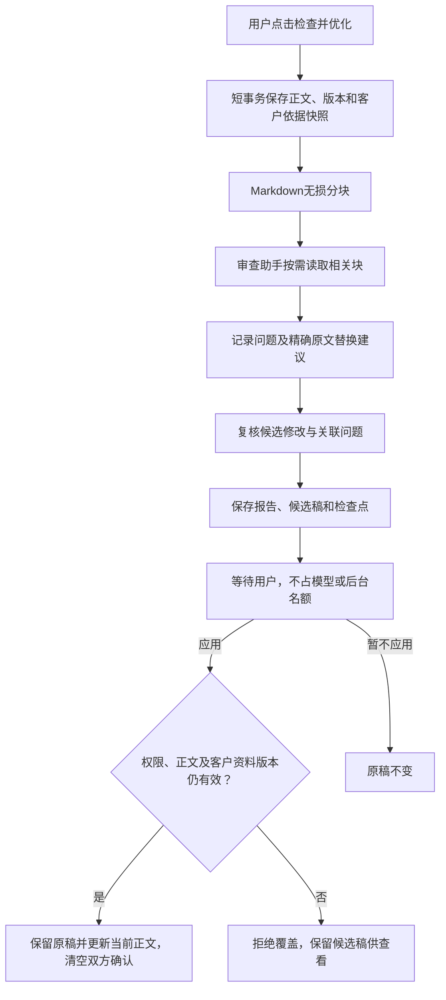
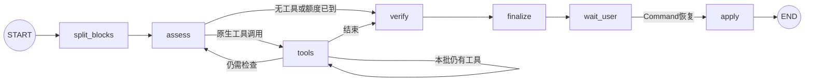

# 草案审查智能体

## 用途与入口

用户在需求书或变更窗口点击“检查并优化”，得到按Markdown块定位的问题和局部优化候选稿。用户查看差异并点击“应用修改”后才更新正文；检查本身不会审批、立项或发布。

入口在`backend/api/v1/reviews.py`，总路由仍是`backend/api/router.py`。真实模型用途是`draft_reviewer`，可独立配置阿里兼容端点下的模型，默认温度0。工具只在`backend/agents/tools/review.py`。

## 业务流程

审查失败、预算不足或局部复核失败不会删除原稿。已正确修订的局部内容可以作为候选保留；其他未修正问题单独展示，不能把未修改的问题混入本次补丁的复核目标并否定全部补丁。

## 实际节点图

实际有7个节点。`read_blocks`等是tools节点内的工具，不单独冒充图节点。边界规则由图和存储确定；读取哪些块、发现哪些问题、提出哪些修改由模型按事实决定。

| 节点 | 职责 |
| --- | --- |
| split_blocks | MarkdownIt解析真实顶层标题，长章节按三级标题或完整Markdown块再分，保留源码切片 |
| assess | 读取客户依据、目录、已读块和真实工具观察，选择原生工具 |
| tools | 一次执行一个工具，验证来源、精确片段与重叠；本批完成后再决策 |
| verify | 对已有候选修改做一次定向模型复核，未涉及的问题单独保留 |
| finalize | 程序组装候选正文、未读章节、未修正问题和差异，不修改当前正文 |
| wait_user | 真实interrupt；PG检查点就绪后标ready并释放后台执行名额 |
| apply | 使用本次请求的最新身份和参数，事务内应用或放弃，写幂等回执 |

## Markdown块与版本

正文仍是`ProjectItem.content`这一份权威Markdown。分块是检查任务内的无损结构化快照，不额外维护一套可独立编辑的正文。

- 每块保存ID、标题、层级、顺序、原文和UTF-8内容指纹。
- 优先按一级/二级标题分块，长章节再按三级标题划分；没有子标题时在完整顶层段落、列表、表格和代码块之间继续分组。
- 拼接所有块必须逐字还原快照；SQL/Mermaid中的`#`和引用内的标题不会被当作顶层章节。
- 跨次检查优先按原文指纹、唯一标题和唯一剩余块匹配ID；身份不明确时分配新ID，不靠标题强行合并不同内容。
- 单个不可拆的巨大表格/代码块超过读取上限时可能保留为未检查，报告不能假称全覆盖。

第一版保守使用整篇文档版本保护；不同块之间也不会自动合并并发修改。标题、正文、待确认项、项目版本或客户沟通改变，都可能使旧候选失效。

每轮自动提供单块不超过1200字符、合计不超过6000字符的完整短块，并据此记录已读；长块仅提供60字符预览，须由工具读取。一次模型响应可依次记录问题、提出补丁、结束检查，避免每步都往返。

## 工具与依据

| 工具 | 校验 |
| --- | --- |
| read_blocks | 每批1至4块、合计最多24000字符；返回完整原文，成功后记录已读 |
| record_findings | 目标块必须已读，evidence须为其中一块的连续原文；逐条接纳有效问题并返回失败原因，不因一条错误丢弃整批；client_mismatch还需真实客户原话中的source_quote |
| propose_changes | 关联已有technical/client_mismatch问题；old_text唯一且精确匹配，不允许交叉替换，整批验证后才接纳 |
| finish_review | 结束检查，可一并提交findings/changes；仍逐项走相同依据与补丁校验，不能绕过保护 |

问题分technical、client_mismatch、decision、suggestion。客户最新要求明确时直接按其修订候选，不重复问已经明确的问题；客户要求本身矛盾或需要业务决定时才形成待确认项。

普通自动方案保留【自动生成】。由客户明确原话纠正旧自动方案时，可以移除那一处旧自动标记；来源快照与修订历史保留。字符串匹配证明依据存在，不保证模型语义推断正确。SQL和设计经模型检查不等于已执行验证。

服务器按原文坐标倒序应用不重叠片段，未修改内容原样拼接。前端差异来自这些实际替换片段，以纯文本显示，不执行HTML或SQL。

## 模拟执行

下面是教学模拟，不是实测成绩。

| 步骤 | 动作 | 状态变化 |
| --- | --- | --- |
| 1 | 用户要求主管仅看汇总，点击检查 | 保存正文版本及客户要求 |
| 2 | split_blocks | 得到权限、状态、数据库、验收等独立块 |
| 3 | read_blocks批量读取相关块 | 标记已读，取得精确原文 |
| 4 | record_findings | 发现主管越权和约束未排除取消状态，附原文依据 |
| 5 | propose_changes | 只改权限段和约束片段，不重写背景或其他章节 |
| 6 | verify / finalize | 复核本次补丁，保存完整候选和报告 |
| 7 | wait_user | 模型工作结束；刷新仍可打开候选 |
| 8 | 用户应用 | 原文版本及客户资料仍有效才写库，旧稿进入历史 |
| 9 | 用户恢复旧稿 | 旧内容成为新的修订，版本计数继续递增，不倒退编号 |

## 存储、权限与幂等

`document_reviews`保存快照、块、报告、候选和事件；`document_revisions`保存每次替换前的全文。迁移0017只新增表和索引，不清理旧数据。普通编辑也保存替换前正文，第一次保存历史无需补造旧版本。

- 所有入口校验项目归属及资料类型，普通用户仅本人项目，管理员按既有权限访问。
- 同一资料最多一个running检查，由PG部分唯一索引和项目锁约束；超过180秒的陈旧运行在读取或新检查时标失败。
- 任务创建、查询、决定、历史及恢复分别是资源接口；请求未知结果使用原request_id和原参数重试。
- 应用前校验正文version、源version、项目version、正文hash，并拒绝项目仍有顾问运行；事务内写历史、正文、状态和审计回执。
- 已提交资料应用/恢复后退回draft并清空双方确认；正式版本不可覆盖，通过新变更处理。
- 应用失败的图停在apply节点，后续合法决定可以继续；已提交成功但响应/检查点未知时，先重放业务回执，不重新调用模型。
- 恢复同样有版本校验和审计；不复活旧确认签名，也不自动发布。

## 额度与失败边界

默认与其他Agent共用每进程4后台执行名额。审查默认8次模型机会（预留最后一次复核）、16次工具、100000预算、120秒，预留8秒收尾。所有purpose仍按实际model ID共享模型并发限制，不具备跨实例云账号额度保证。

首次检查按需执行，不在每次起草后自动触发。不把每一段都独立调用模型；无修改时跳过修订复核。等待用户和应用/恢复均不调用模型。模型未遵循工具、上下文过大、未知资料、超时或预算耗尽都如实标部分完成或失败。

文档检查同事务进入持久队列，由独立Worker执行；API重启不取消它。领取时先复核排队期间正文、项目版本及hash是否变化，变化则不调用模型。已就绪的人工候选可从PG恢复；Worker失联先撤销租约，再保留原稿并收尾，结果未知不自动重复付费检查。客户端离开关闭轮询，不代表取消服务端已接受检查。

相关实现：[graph.py](../backend/agents/review/graph.py)、[nodes.py](../backend/agents/review/nodes.py)、[state.py](../backend/agents/review/state.py)、[工具](../backend/agents/tools/review.py)、[存储](../backend/db/review_store.py)。验证见[test_document_review.py](../tests/test_document_review.py)、[前端测试](../frontend/tests/document-review.test.mjs)和[验收记录](验收记录.md)。

## 会议室案例修复

客户原话与历史纪要分开对待：纪要可能误把默认技术写成客户选择，client_mismatch必须引用实际用户消息，不能引用“客户已说明的信息”等草案段落标题。原话没有指定的技术保持自动建议属性，选择技术不等于选择每项实现理由。

相同无效工具请求连续失败两次即停止，避免耗尽预算反复提交。模型超时、请求失败、次数或用量不足均保留明确中断原因；无有效结论时显示“本次检查未完成”，0条有效建议不代表草案没有问题。详细字段校验留在工具观察，用户只见易懂说明。

读取正文每次只允许1至4块。超过上限时工具明确要求拆批，不把数量错误误报为原文依据错误；失败事件也不显示“已读取相关章节”。模型可以在同一次回复中安排多个读取调用，每次仍计入共享工具预算，不能为一次超量请求无界加载全文。

所有块已读完后不再向模型提供read_blocks，已有工具结果仍保留供引用。倒数第二次模型机会通过原生finish_review提交已核实结论，最后一次留给候选修订复核；普通文字补救也使用同一可用工具列表。未读、未修或没有有效建议时继续如实提示，不能为了结束而制造问题或虚报通过。

若只返回普通解释文字，assess在预算内最多做一次具名finish_review提交补救；不把解释文字直接转成已通过结果。工具批量提交的结论仍先验依据，再验补丁，随后经过verify；缺项或失败继续标明。单次工具决策输出上限2400，局部复核1200，避免复制整章造成超时和截断。

历史技术字段没有用户原话支持时归入unverified_historical_notes，不作为已确认客户选择。公开摘要由有效报告状态保护：空报告不呈现模型未经依据验证的“客户均已确认”说法，已完成但无建议也说明不代表工程验证通过。旧报告在读取时适用此显示保护，原始检查历史不改写。

## 长历史原话与等待态

审查开始建立客户原话目录：有运行回执的消息以`ProjectRun.prompt`为稳定来源，无运行关联的旧用户消息以`ProjectMessage`为来源；助手消息不进入目录。目录记录来源ID、SHA-256、字符数及100字符预览，固定本次审查范围。初始完整原话最多6000字符，目录最多2000条，超出时明确标记部分检查，不丢弃数据库原话。

`read_customer_sources`是tools节点内的原生工具，可按目录ID读取、按原文关键词查找并通过offset继续读取。每批最多4条/20000字符，累计额外读取最多60000字符；该上限是一次执行预算，已经移除“最近60条”及总原话超过60000字符就拒绝启动的限制。读取复核身份、项目归属、目录成员及内容hash。

`assess`只带未读目录前20条、最近读取的少量原话与工具观察。`verify`只带候选问题实际引用的客户原话，不重复发送全部历史。报告保存已核对来源及尚未读取的来源ID；仍有未读原话或目录超量时，`partial=true`并明确说明，不能显示为完整通过。

模拟轨迹：客户早期说“取消后释放时段” → 后续补充80条信息 → 点击检查 → 建立全部85条来源目录 → 工具查找“取消后”并读取早期原话 → 用真实引文记录跨章冲突 → 保存局部候选及来源覆盖情况 → 清空运行临时正文 → interrupt等待用户。应用时仍复核身份、项目/正文版本与原文hash。
