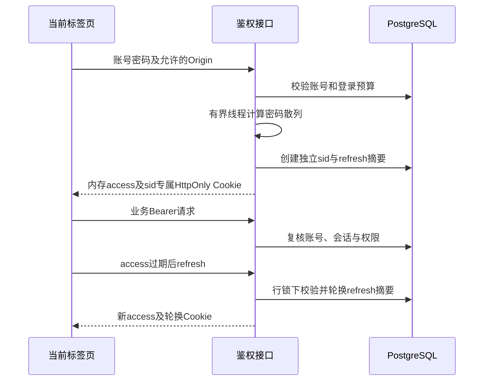

# JWT、登录续期与多标签页

## 账号与权限

系统自有账号使用JWT access/refresh，不是完整OAuth授权服务器。JWT始终启用；没有公开注册或固定默认密码。

| 角色  | 当前权限                               |
| ----- | -------------------------------------- |
| user  | 本人沟通、项目、文档及客户确认/验收    |
| staff | 当前仍仅本人记录，不是跨客户负责人     |
| admin | 后台与跨项目管理、负责人确认和业务处理 |

角色和登录有效性从PostgreSQL复核，不信任客户端传来的角色。越权项目资料统一返回404；客户页面不显示后台入口，但隐藏菜单不能替代后端授权。

## 登录与续期流程图



Access默认600秒，refresh默认闲置7天、单次登录最多30天。HS256签名与issuer、audience、用途、sub/sid/jti/iat/exp均校验。退出、停用或改密撤销数据库登录后，旧access不能只凭签名继续访问。

Refresh仅存HttpOnly/SameSite Strict Cookie，路径/api/auth，数据库保存摘要而非原始令牌。旧refresh重放撤销对应登录；改密撤销该账号全部登录。严格轮换下，服务端提交但响应丢失可能需要重新登录，不能盲目重放。

## 多标签页账号隔离

- 每次登录分配sid，Cookie名为sf_refresh_加sid。
- 当前access只在标签页内存；sessionStorage仅保存非秘密sid定位ID，不保存JWT。
- HTTP业务请求只带当前标签的Bearer，服务器不从其他账号Cookie猜身份。
- 页面刷新通过当前sid的Cookie恢复；无sid时登录页可选择浏览器里仍有效的登录。
- 同sid跨标签使用Web Locks串行刷新；BroadcastChannel只广播撤销标识。
- 不同sid独立；复制标签页可能复制sid，因此共享同一登录的退出会互相影响。
- 切换账号取消旧请求、丢弃旧响应并重建受保护页面，不能把旧用户操作续期后发成新用户请求。

这是业务上下文隔离。共享浏览器配置的人可以选择其中保留的登录，标签页不是不互信用户之间的安全沙箱。

sid不等于聊天记录或Agent线程：project_id隔离业务，run_id标识一次执行，thread_id恢复图进度。接待期限保存在项目中，不因刷新登录重置。消息内部login_session_id只用于自动接续时复核原登录，不返回前端、不替代凭证，详见[流程兜底与会话标识](流程兜底与会话标识.md)。

## 来源、并发与密钥

登录、refresh、logout和已有会话查询校验Origin，默认开发代理保持同源。前端依赖现代浏览器Web Locks；缺少能力时明确拒绝不安全的并发刷新。

公网HTTP会缺少Web Locks，并可能缺少randomUUID，这与演示人数无关。业务请求编号已统一用原生UUID或getRandomValues兼容生成；没有取消登录互斥，也不能仅靠修改COOKIE_SECURE解决浏览器能力限制。具体HTTPS、IP证书及临时回环演示方案见[服务器部署](服务器部署与演示.md)。

账号→登录是固定加锁顺序。密码计算使用Argon2及有界线程名额，默认4个；不在散列计算期间持有SQL事务。登录速率预算保存在PG，默认每账号20次/分钟，每客户端200次/分钟。

签名密钥默认持久化于Git忽略的storage/auth/jwt.key，多实例共享密钥和数据库。生产通过HTTPS并开启SF_AUTH__COOKIE_SECURE；SF_AUTH__ALLOWED_ORIGINS填写精确来源JSON数组，代理IP使用实际受信任链，不能任意信任转发头。

## 首次账号创建

```powershell
conda activate D:\code\env\supportflow
python scripts/migrate.py
python scripts/create_user.py admin --role admin --display-name 管理员
```

密码通过隐藏输入且至少12字符。已有管理员无需重复创建，其他账号可在后台开通。测试账号不属于正式初始化。

## 接口索引

| 接口                      | 用途                                               |
| ------------------------- | -------------------------------------------------- |
| POST /api/auth/login      | 密码登录，可替换当前标签选中的登录                 |
| POST /api/auth/refresh    | Origin、X-Session-ID及对应Cookie，轮换续期         |
| POST /api/auth/sessions   | 查询浏览器内可恢复登录，只返回公开账号信息与定位ID |
| POST /api/auth/logout     | 撤销当前登录，不是退出所有账号                     |
| GET /api/auth/me          | 当前账号信息                                       |
| POST /api/auth/password   | 核验旧密码并撤销该账号全部登录                     |
| GET/POST /api/admin/users | 管理员列表与开通账号                               |

相关实现：[auth服务](../backend/services/auth.py)、[auth存储](../backend/db/auth_store.py)、[安全代码](../backend/core/security.py)、[HTTP适配](../backend/api/v1/auth.py)。相关测试：[test_auth.py](../tests/test_auth.py)、[test_security.py](../tests/test_security.py)。
