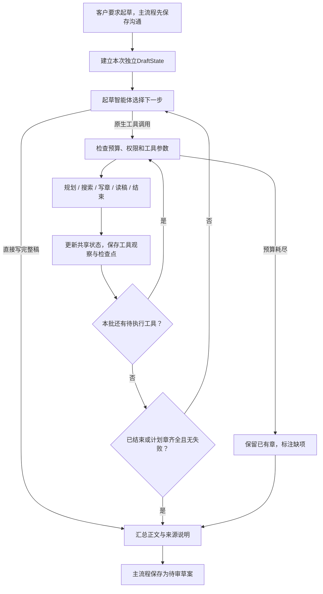
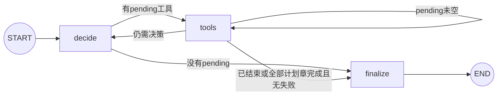

# 起草智能体

## 目标与实现

将已保存的客户业务信息转成**面向工程师的详细需求与开发设计草案**。需要展开功能步骤、角色权限、字段和接口、状态、异常补偿、并发一致性、技术架构、部署与验收，不把正文降成业务摘要。

| 文件                                                     | 职责                                                        |
| -------------------------------------------------------- | ----------------------------------------------------------- |
| [graph.py](../backend/agents/drafting/graph.py)          | decide/tools/finalize图、检查点恢复、输入指纹及最终草案交接 |
| [nodes.py](../backend/agents/drafting/nodes.py)          | 本次资源、预算、节点行为和正文组装                          |
| [state.py](../backend/agents/drafting/state.py)          | 独立Pydantic DraftState及TypedDict图状态                    |
| [prompts.py](../backend/agents/drafting/prompts.py)      | 初始决策AGENT、后续调度CONTINUE、分章SECTION/RULES          |
| [tools/drafting.py](../backend/agents/tools/drafting.py) | 全部起草工具实现；不在业务文件夹另放tools目录               |

主顾问交接纪要、客户原话、本轮要求及参考，不重新让模型抽取一遍完整历史。子智能体自行选择动作，LangGraph负责条件路由与逐步持久化。

## 业务流程图

这张图是业务解释，不是规定“先搜索再写章”的固定流程。工具可以同批安排，按模型指定顺序执行，本批仍有动作时不额外调用决策模型。单章普通失败也进入观察；权限、版本或取消错误直接拒绝新稿，不走部分成功。模型也可不规划、不搜索而直接交付正文。

## 实际节点图

只有3个实际节点。plan_draft、web_search、write_prd_section、read_draft、finish_draft都是 **tools节点内执行的工具**，不是图上5个独立节点。

| 节点     | 动作                                                                                           | 结束条件                                  |
| -------- | ---------------------------------------------------------------------------------------------- | ----------------------------------------- |
| decide   | 首次用AGENT；有大纲后用精简CONTINUE；读取State和最近完整工具往返，选择原生tool_calls或直接正文 | 没有工具时转finalize                      |
| tools    | 每次处理一个pending动作，累计额度，记录真实观察，逐工具写检查点                                | 批次未执行完先继续tools，不吞掉排队动作   |
| finalize | 必要时本地complete，组装已完成正文、缺项和待确认                                               | 原有partial不会被提升为完整；不审批或发布 |

全部规划章节已经写入、没有失败、pending已清空时，程序直接汇总，避免模型重复请求已经完成的章节。无大纲、缺章或失败时不能套用这条完成条件。

## 状态如何共享

每次起草创建一个独立的Pydantic `DraftState`，输入深拷贝，全部工具读取同一实例，不使用跨用户全局状态。

| 状态                                                | 内容                                            |
| --------------------------------------------------- | ----------------------------------------------- |
| business_notes / customer_statements / user_request | 只读客户资料和本轮要求                          |
| plan / section_specs                                | 大纲、统一角色称呼、design_rules跨章约定、已尝试章的规范ID与重点 |
| sections / failures                                 | 完成正文与失败代码，章失败不抹去其他章          |
| assumptions / previous_assumptions                  | 本次自动设计与历史建议，均不等于客户事实        |
| references / searched_topics                        | 公开参考与已查主题                              |
| questions / resolved_questions                      | 本次真正待确认及已解决的旧问题                  |
| messages / status / direct_body / stop_code         | 原生工具往返、完整/部分状态、直写正文与中断原因 |

TypedDict `GraphState`传递input_key、draft、pending、counters、expires_at、web_enabled、body、partial；序列化状态进入PostgreSQL检查点。完整私有消息保留在检查点，模型控制请求只携带最近一组完整assistant/tool往返和当前权威State。

写章请求带当前大纲、客户资料、自动建议与已写章的有界首尾节选（每章合计至多400字符）。plan.design_rules最多8条、每条180字符，用于共享核心表名与字段、角色、状态、时间类型、接口路径和统计口径。写过章节后，工具拒绝改变已有有效角色或设计约定，避免后章悄悄推翻前章；即使先写独立章再规划，也受此限制。旧检查点没有该字段时默认空列表。

这些约定在本次独立State和检查点中传递，不跨项目共享，也不增加一次模型调用。客户最新要求仍优先，自动约定不能冒充客户确认。模型可能在规划或正文中写出矛盾，所以它是上下文约束，不能当作语义或SQL正确性的自动证明。

程序仅剥除章首与包装章名完全相同的一级/二级标题，保留其余标题和正文；分章提示同时要求避免重复章名。

## 工具协议

| 工具              | 输入与作用                                                             | 限制                                           |
| ----------------- | ---------------------------------------------------------------------- | ---------------------------------------------- |
| plan_draft        | sections、role_terms、design_rules、pending_questions、assumptions等，组织或调整大纲 | 1至6章；已尝试章不能被替换或删除，写章后已有角色/约定冻结 |
| write_prd_section | 已规划时只需section_id；无大纲写独立章还需title                        | 同章本轮至多尝试一次，未知编号返回可用ID       |
| read_draft        | 空参数，读取已有正文与失败项                                           | 不新增模型审查调用                             |
| web_search        | 公开主题topic，查通用参考                                              | 两级开关、执行前复核、至多两个不同主题         |
| finish_draft      | questions、resolved_questions、assumptions等，结束并汇总               | 有已写章才可用；可本地收尾一次，不执行后续动作 |

章名、数字序号等只在**当前大纲内**映射到规范ID，不访问其他项目。重复写章返回已有处理结果，不再次出网。工具参数失败返回安全字段名或错误码，不输出原始参数、供应商原文或凭证。

## “自动生成”与客户选择

- 客户已明确的技术、权限、范围及规则保持原意；后续补充优先于旧自动方案。
- 用户未选的框架、配套组件、字段、接口、状态、参数和部署方案，在对应表格来源列或方案段落就近标 **【自动生成】**。
- SQL/配置可作为工程参考示例，标 **【自动生成，待工程验证】**；不能声称已测试，不能填真实密钥或固定生产密码。
- 重要默认设计进入assumptions，最终汇总每条由程序加【自动生成】，客户事实另附原文；自动建议不写入discovery。
- 自动建议不是阻塞性问题。真实客户内部条件、外部授权或冲突规则才保留待确认；接口文档和未选技术通常不阻止草案生成。

标记与语义仍有边界：程序保证文首来源说明、汇总标记及事实分区；正文每段的准确归因依赖模型遵守提示，可能漏标或误解。详细草案进入人工评审，不能据“执行成功”直接认定所有SQL和业务规则正确。

## 模拟执行：从会议室需求生成开发稿

下面是一条合法的模拟轨迹，实际模型可以选择不同章数、顺序或工具组合。

客户已指定：Python、PostgreSQL、员工只能修改/取消自己未开始的预约、行政不能代约、主管只见本部门汇总。未选：Web框架、前端、部署及实现细节。

| 步骤 | 实际节点 / 工具               | 状态变化                                                                        |
| ---- | ----------------------------- | ------------------------------------------------------------------------------- |
| 1    | decide → plan_draft           | 规划overview、features、design、acceptance四章；assumptions只记录未选的默认方案 |
| 2    | tools完成规划，decide读取结果 | 根据规范ID，一次安排四次write_prd_section及最后的finish_draft                   |
| 3    | tools：write overview         | 保存第一章，写一份检查点                                                        |
| 4    | tools：write features         | 读取共享资料和前文节选，生成字段、接口、状态与异常                              |
| 5    | tools：write design           | 保留Python/PostgreSQL，给FastAPI、前端、部署等补充来源标记                      |
| 6    | tools：write acceptance       | 写可执行验收方法与设计基准，不虚构已通过结果                                    |
| 7    | tools：finish_draft           | 本地汇总，完整则completed，有缺项则partial                                      |
| 8    | finalize                      | 返回正文、自动建议、原始要求和真正待确认项，主流程事务保存                      |

本例子图有2次决策和4次写作，共6次模型请求；规划与四次写章共5次处理工具。主流程generate_prd交接另计一次工具，沟通模型按当轮真实情况另计。已有章的那次本地finish不额外占处理工具额度。此计数示例不是所有执行的固定耗时或固定用量。

期望的片段如下；它是说明格式的模拟输出：

| 决策     | 草案内容                 | 来源         |
| -------- | ------------------------ | ------------ |
| 后端语言 | Python                   | 客户已指定   |
| 数据库   | PostgreSQL               | 客户已指定   |
| Web框架  | FastAPI                  | 【自动生成】 |
| 前端     | Vue 3                    | 【自动生成】 |
| 预约区间 | 半开区间与数据库冲突约束 | 【自动生成】 |

## 中断、预算与兜底

默认共享上限：12次模型请求、8次处理工具、64000 Token、150秒；单章默认4000输出Token、单次模型最长60秒，截止前预留12秒保存。实际输出还受剩余额度约束。CONTINUE减少重复发送写作说明，**SECTION仍保留完整深度要求**。

写章使用聚合后的专用要求，保留字段、接口、状态、权限、异常、并发、技术部署、验收及来源/安全边界，不重复附带规划提示全文。大纲只传章节定义，不重复传一份assumptions；已写章只传最多400字符的首尾节选，完整正文始终保存在State与PG中。

决策输入明确列出缺章及剩余模型、工具、时间和用量，并给出保守的写章容量估计。该估计不是额度保证；实际出网前仍校验完整UTF-8输入预算。规划输出上限2500，写章输出上限保持不变。Agent仍自主决定工具与批次，没有增加一条固定写章流水线。

后续决策的outline只发送章节与规划待确认项，角色、跨章约定、当前自动方案已经由共享context提供，不重复复制整个plan。历史建议与当前方案完全相同的条目只从请求副本去重，State和检查点原值不改；不同的历史建议保留为未确认参考。该精简不提高总预算，也不压缩最终正文。

起草前保守隔离没有原话依据或被最新纠正否定的旧技术推断，包括约束里的错误语言限制；历史存储不被此步骤覆盖。原话去重保留最后一次出现的位置，避免客户重复纠正被错误当成早期消息。生成完整性仍按计划章节与失败项检查，缺章保持partial，不能以摘要替代。

- 第三章超时：记录该章失败，把观察交回智能体；时间和额度足够时可写其他章，最终保留已写正文及缺项。当前轮不重新请求同一章。
- Token、工具或总时限耗尽：不继续发送新请求，不把部分稿标成完整。
- 权限撤销、资料版本变化、外部取消：不能包装成普通部分成功。
- 同run恢复：线程为draft:run_id，检查操作者、项目、版本、输入指纹；恢复已写章节、计数与绝对截止时间，不重置额度。
- 检查点使用durability=sync逐工具提交；正在出网但还没提交检查点的请求，重入时仍可能再次发送，不能承诺模型请求恰好一次。
- 不存在API重启后的通用自动任务调度。用户另起一次生成是新run；成功后原位更新当前未发布草案，不累积副本；失败保留已有完整稿。

真实结果和已知局部问题见[验收记录](验收记录.md)。相关测试：[分章与工具](../tests/test_draft_sections.py)、[子图恢复](../tests/test_draft_graph.py)、[事务交接](../tests/test_drafting.py)。

## 已有草案的章节补写

客户明确要求补齐或更新已有章节时，不再把整个任务当成从零起草。服务器按项目、归属、版本及可编辑状态直接查询最新需求草稿，子图State保存原文分块、章节目录、原稿ID/版本和原待确认项。

模型仍自主选择write_prd_section/finish_draft，使用existing_sections里的原章节ID；本轮只替换实际写成功的章节，其他分块原样拼接。补写失败保留原稿；补写成功在短事务中再次检查原稿版本，直接更新同一个资料ID，双方确认清空，不另存一份旧生成正文。用户已经发布的需求书不能这样覆盖，需走变更流程。

用户未选择的技术继续标【自动生成】；“不用再确认”“补齐技术章”不是对整套默认技术的明确选择。客户最新原话优先于可能被错误提取的历史纪要。真实业务待确认项保留，只移除成功补齐章节对应的生成占位提示。

## 每个项目只维护最新生成稿

未发布的初始需求书以项目为单位唯一，数据库部分唯一索引防止并发生成重复记录。第一次生成建立草案；重新生成完成后更新原ID的标题、正文和待确认项，递增防覆盖版本，回到draft并清空双方确认。用户与管理员读取同一份当前稿。管理员已有初始需求时，“查看最新需求”打开当前记录，不继续新建副本。

本次重新生成不完整时保留已有稿件及其自动建议，不用退化纪要覆盖完整开发稿。撤回或驳回后可以编辑当前稿再提交。初始需求正式发布后，后续业务调整走change，正式基线不能被重新生成覆盖。

此规则针对生成的需求草案记录；聊天、运行断点、轻量审批日志和独立文档审查的恢复历史各有用途，不声称整库只存一份文本。重新生成与Agent补写不再为旧生成正文创建DocumentRevision；手工编辑/审查恢复机制不在本次移除范围内。

迁移0018按创建时间及ID保留最新未发布稿，清理重复旧稿及其关联审查、历史正文与审查断点，旧幂等请求返回“已被最新需求替代”，不会重新创建旧稿。已经发布的项目清除过期未发布初始草案，保留正式基线与变更记录。执行迁移前必须确认无活动任务并做好备份；结构降级不能恢复已清理数据，需使用迁移前备份。
