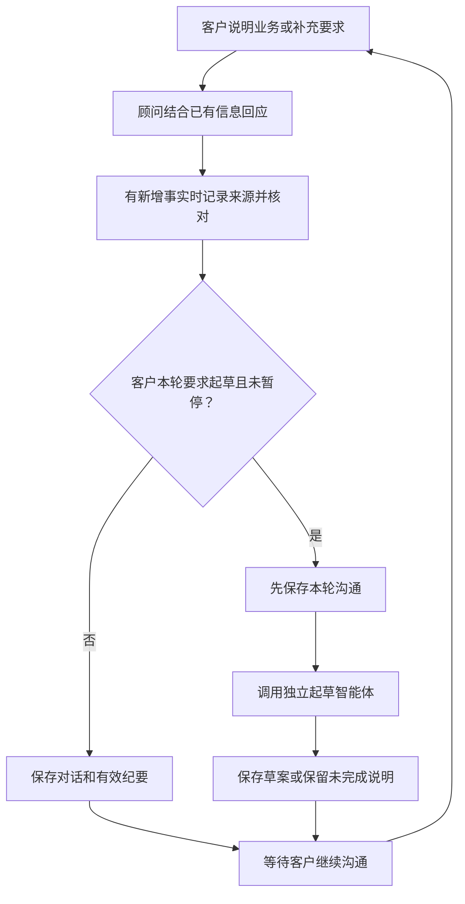
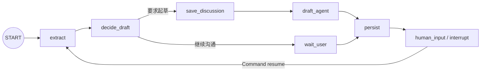

# 需求沟通智能体

## 职责与代码

面向不懂软件实现细节的客户，先理解业务、自然解释和讨论，再累计业务事实。只有客户本轮要求起草，才交给独立起草智能体。没有“字段填满即通过”的问卷，也没有独立 Assess 节点。

| 文件                                                    | 职责                                     |
| ------------------------------------------------------- | ---------------------------------------- |
| [graph.py](../backend/agents/consultation/graph.py)     | 7个节点的装配、检查点读取与 Command 恢复 |
| [nodes.py](../backend/agents/consultation/nodes.py)     | 顾问调用、纪要处理、起草交接与分阶段保存 |
| [state.py](../backend/agents/consultation/state.py)     | TypedDict 图状态、来源目录与事实补丁校验 |
| [prompts.py](../backend/agents/consultation/prompts.py) | 顾问与补充回复职责                       |
| [consultation.py](../backend/models/consultation.py)    | 业务状态、来源、参考与断点表模型         |

输入包括本轮原话、最近对话、已存纪要、参考、操作者及运行回执。输出为自然回复、已验证的纪要补丁，以及客户要求时产生的待审草案。

## 业务流程图

联网是可选工具：管理员总开关与客户本轮开关都启用时，顾问可以按需要查询公开资料；没有联网也能继续沟通和起草。

## 实际节点图

图中7个方框就是实际注册节点。图没有正常 END 边；运行到 `human_input` 时由 LangGraph 中断返回，后台执行释放名额，等待下一轮恢复。节点名 `extract` 为历史检查点兼容保留，其当前职责包含顾问回应与工具处理，不表示每轮另起一个抽取模型。

| 节点            | 实际动作                                                                                         | 主要边界                                            |
| --------------- | ------------------------------------------------------------------------------------------------ | --------------------------------------------------- |
| extract         | 明确起草命令直接读取已有资料；普通输入调用顾问，按需处理 record_consultation、公开搜索及补充回复 | 纯解释可以不记录事实；错误来源不覆盖原纪要          |
| decide_draft    | 检查本轮要求与暂停状态，选择两条边                                                               | 信息充分不等于自动起草；发起起草须为项目客户        |
| save_discussion | 起草前提交消息对、纪要、discussion_run_id，运行仍为 running                                      | 起草失败不丢客户刚补充的信息                        |
| draft_agent     | 调用 generate_prd，接收完整稿或部分稿                                                            | 不审批、不立项；权限/版本错误不能当普通内容缺项吞掉 |
| wait_user       | 保留顾问回复，等待继续讨论                                                                       | 不强制用户每轮回答问题                              |
| persist         | 同事务保存最终回复、纪要与草案，设置最后运行回执                                                 | 起草分支原位更新本轮助手消息，不重复追加同一轮      |
| human_input     | interrupt 返回等待信息；收到 Command 后重置本轮计数并使用最新鉴权快照                            | 等待期间不持续调用模型，不占后台执行名额            |

## 状态与来源

图上传递的 `GraphState` 只有 `route/payload`；payload 保存工作流恢复所需内容。业务权威数据仍在 PostgreSQL：

| 数据                                                      | 保存位置 / 用途                                       |
| --------------------------------------------------------- | ----------------------------------------------------- |
| discovery                                                 | 客户业务背景、流程、角色、范围、约束与开放技术偏好    |
| consultation                                              | 来源、参考、建议、暂停/起草状态、检查点线程及运行回执 |
| messages / runs                                           | 对话、对应执行、真实事件与状态                        |
| consultation_checkpoints / consultation_checkpoint_writes | LangGraph 检查点和逐步写入                            |

`record_consultation` 使用事实值及原话来源生成补丁。程序检查来源片段或连续引文确实存在，以及新增值与来源条目对应；这是**来源与格式校验**，不能证明模型对原话的语义理解必然正确。

列表有序去重累积；明确纠正通过 `remove_facts`，已解决问题通过 `resolved_questions` 处理。技术偏好可以组合客户同一消息中的语言、框架、数据库等分项，客户本轮更新优先。无效记录标记 `memory_pending`，保留对话并说明纪要尚未更新。

## 一轮中可能使用的工具

- `record_consultation`：整理本次事实和意愿，不发布需求。
- `web_search`：只接收服务端枚举公开主题。顾问每轮至多处理一次搜索，再用结果回应。
- `generate_prd`：代码中的子智能体交接入口，由 draft_agent 节点调用，不是等待模型任意写 SQL 的接口。

搜索发生在 extract 内部，不是额外 LangGraph 搜索节点。它不要求逐次人工批准，也不把行业资料自动变成客户事实。

## 模拟执行：会议室预约访谈

以下是解释代码的模拟，不是测试报告。

**第一轮输入**

> 30名员工、5间会议室，现在靠群聊预约，经常冲突。后端用Python，数据库用PostgreSQL。框架和部署还没选，先记录，不生成。

| 顺序 | 节点                | 期望结果                                                                     |
| ---- | ------------------- | ---------------------------------------------------------------------------- |
| 1    | extract             | 顾问自然回应，调用记录工具保存角色、痛点和客户指定的技术；必要时只问关键问题 |
| 2    | decide_draft        | 本轮未要求生成，route=wait_user                                              |
| 3    | wait_user → persist | 保存消息及有效补丁，项目仍为 discovery                                       |
| 4    | human_input         | 写入等待断点，当前后台任务结束；草案列表仍为空                               |

**第二轮输入**

> 无需审批，预约成功即生效；员工只能修改和取消自己尚未开始的预约。请补齐其余实现细节，生成工程师能用的详细草案。

| 顺序 | 节点                           | 期望结果                                                 |
| ---- | ------------------------------ | -------------------------------------------------------- |
| 1    | human_input → extract          | 恢复原沟通线程，读取最新纪要，记录新增规则与本轮起草意愿 |
| 2    | decide_draft → save_discussion | 先提交本轮原话及事实，运行保持 running                   |
| 3    | draft_agent                    | 独立子图选择工具、生成详细正文；未选设计标【自动生成】   |
| 4    | persist → human_input          | 保存待审草案，原位更新助手回复，等待客户查看             |

此时不发布V1，客户和负责人都没有被自动确认。业务审批通过普通接口完成，见[项目协作](项目协作智能体.md)。

**第三轮输入**

> 前端改为Vue 3，部署到现有内网服务器；先记录，不要重新起草。

预期仅更新客户偏好并等待，不自动新增草案。后续客户再次要求生成时，新偏好覆盖旧的自动建议。

## 失败与恢复

- 来源校验失败：原纪要保持，原话进入对话，提示纪要尚待更新，不反复让客户重新填写全部资料。
- 起草发生普通模型/网络故障：已提交的沟通保留；部分章节可成为透明部分稿，或保留旧稿并显示本次未完成。
- 业务已提交但随后检查点失败：通过 discussion_run_id/last_run_id 等回执识别已有保存，恢复时避免重复消息和草案。
- `human_input` 恢复使用本轮鉴权后的 PostgreSQL 快照，不能用旧检查点遮蔽客户最新资料。
- 刷新页面只恢复查询运行结果，不承诺API进程崩溃后自动重新调度任务。完整界限见[执行架构](执行架构.md)。

相关验证：[test_consultation.py](../tests/test_consultation.py)、[test_advisor.py](../tests/test_advisor.py)、[test_drafting.py](../tests/test_drafting.py)。
