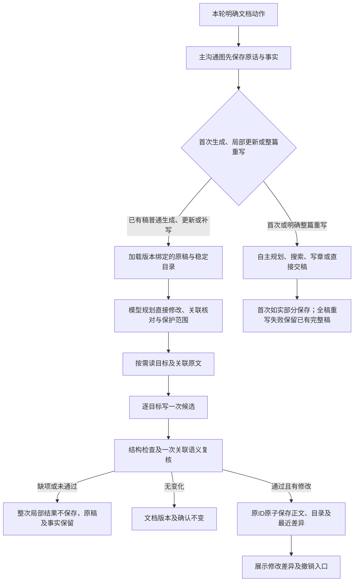
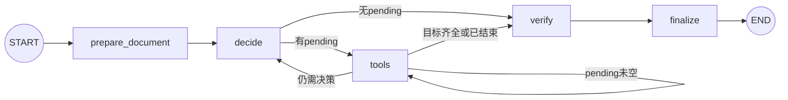

# 需求生成智能体

当前为prepare_document、decide、tools、verify、finalize五节点LangGraph子图。P0交接、P1稳定目录、P2局部更新与最近差异撤销已实现；带来源的持久设计约定、依赖分批首次生成仍属于[后续开发P3](后续开发说明.md)。用户界面称“需求生成”。

## 目标与文件

把客户业务信息转成工程师可评审、拆任务的详细需求与开发设计稿。保留角色、步骤、字段与接口、状态、异常补偿、并发、技术架构、部署和验收。首次生成仍自主规划与分章；已有稿默认只修相关内容，不降成纪要。

| 文件 | 职责 |
| --- | --- |
| [graph.py](../backend/agents/drafting/graph.py) | 五节点装配、条件路由、检查点与结果交接 |
| [nodes.py](../backend/agents/drafting/nodes.py) | 装载保护、预算、决策、核对、原文拼装 |
| [state.py](../backend/agents/drafting/state.py) | 独立Pydantic DraftState与TypedDict图状态 |
| [prompts.py](../backend/agents/drafting/prompts.py) | 首次AGENT/CONTINUE/SECTION与局部REVISION提示 |
| [tools/drafting.py](../backend/agents/tools/drafting.py) | 唯一工具实现，不另建Agent工具文件夹 |
| [documents.py](../backend/models/documents.py) | 唯一Markdown解析、稳定目录、精确差异与逆向恢复 |
| [project_store.py](../backend/db/project_store.py) | 授权及版本复核、原子提交、最近差异和撤销 |

## 业务流程图

这是职责解释，不是写死章节顺序的流水线。模型根据观察自主选工具；程序决定权限、预算、拼接和提交。文档生成/更新期间只显示进度，临时正文不输出到聊天。

## 实际节点图

| 节点 | 实际行为 | 边界 |
| --- | --- | --- |
| prepare_document | 局部模式核对原稿hash，标记原话附录和明确禁止修改块 | 首次生成无额外模型；不能解锁客户保护 |
| decide | 首次AGENT、有大纲CONTINUE、局部REVISION_AGENT；选择原生工具 | 读取当前State与最近工具观察，共享剩余预算 |
| tools | 一次执行一个pending工具并同步检查点 | 批内优先处理已有动作；写章本轮一次 |
| verify | 局部模式校验范围、读集、保护、代码围栏，调用draft_reviewer一次复核 | 缺块/失败/未通过则partial；首次和整篇重写目前不额外检查 |
| finalize | 精确组装、生成completed/partial及no_change结果 | 不审批、不发布；交回主图persist保存 |

verify目前没有回decide的纠错边；失败安全停止，不自动扩大预算。plan_revision等是tools节点内的工具，不是额外图节点。

## 每次运行的状态与共享

每次调用创建独立DraftState并深拷贝必要资料；工具读取同一次运行的共享实例，不使用跨用户全局可变State。GraphState携带draft、pending、input_key、counters、expires_at、web_enabled、body、partial进入PG检查点。

| 状态 | 作用 |
| --- | --- |
| business_notes / customer_statements / user_request | 客户事实与本轮要求只读 |
| handoff / handoff_counters | 服务端任务范围、来源、版本/hash与继承预算 |
| plan / sections / section_specs / failures | 首次大纲、候选正文、尝试记录及真实失败 |
| original_blocks / replacement / original_questions | 版本绑定原稿、稳定目录及原待确认项 |
| revision_plan / read_ids / fixed_protected | 本次目标、关联、保护与已读证据 |
| incremental / verified / verification_attempted / no_change | 局部模式与单次复核状态 |
| assumptions / previous_assumptions / references | 自动建议与公开资料，不变成客户确认 |

原稿由短事务加载；模型和搜索期间没有SQL事务。draft:run_id线程与父图隔离，逐工具durability=sync。恢复核对项目/账号/登录/版本/输入指纹、累计消耗与原截止时间。未知外部请求不具备恰好一次保证。

## 工具与作用范围

| 模式 | 工具 | 约束 |
| --- | --- | --- |
| 首次/明确整篇重写 | plan_draft | 1～6章；role_terms及最多8条design_rules；写章后不能改变已有有效设计 |
| 首次/明确整篇重写 | write_prd_section / read_draft / finish_draft | 同章一次；已写首尾节选最多400字符；可本地收尾 |
| 局部更新 | plan_revision | targets最多6、related最多20、protected最多20，使用真实原ID；写后不重规划 |
| 局部更新 | read_revision_blocks | 每批1～4块，单批及核对资料总量受24000字符限制，超限不截断 |
| 局部更新 | write_prd_section | 仅目标可写；先读齐目标和关联；返回完整目标块，保留原标题、行尾及不改句段 |
| 局部更新 | finish_draft | 所有目标就绪后核对；无变化须有已读证据及核对通过 |
| 两种模式 | web_search | 两级开关、执行前复核、最多两个公开主题；不发送客户原文 |

局部模式不暴露read_draft或plan_draft来绕过范围。语义影响范围是模型判断，不能承诺自动发现所有跨章关联。原话附录由节点和保存事务双重保护。用户要求大范围变化超出本轮容量时，保留原稿并提示分次处理。

## 精确保真、保存与撤销

目录与解析唯一来源是documents.py，按真实Markdown标题及完整语法块切分。坐标是Unicode码点左闭右开，保留CRLF、CR、emoji、表格和代码。持久目录绑定item/version/hash；普通编辑歧义匹配保守失效。明确局部替换有可靠原区间证据时，同名目标及未改块可保留ID；改变分区导致无法可靠对应时，不猜测新块身份。

提交复核操作者、登录、目标归属、原版本/hash与租约；实际替换键必须等于目标集合、目标及关联均已读、保护不重叠，候选必须等于原块精确拼接。未改块还必须保留原结构边界；不能用未闭合代码或缺换行吞掉下一章。正文、目录、最近差异及轻量审计同事务提交，失败整笔回滚。

- 成功更新同item_id，version递增、双方确认清空、退回draft；不递增正式版号。
- no_change不改文档、不清确认、不覆盖之前有效的最近差异；本轮原话及项目沟通记录仍保存。
- document_undo每item仅一条最近逆向差异，含新旧区间、hash、版本、必要旧目录及问题元数据，不额外保存整份旧生成稿。
- 差异及附属数据序列化最多64KiB；旧删改字符不超过max(256,全文80%)。过大就拒绝本次局部更新，不能静默改存全稿。
- 撤销要求expected_version、change_id、当前正文hash及原问题列表匹配，且无活动任务；恢复精确原文，version继续递增，清确认并删除这一条差异。
- 撤销不删除客户事实，标document_pending；其他编辑、审查应用/恢复、整篇重新生成和正式发布清除旧撤销。仅提交评审/单方确认等不改正文的动作仍可在重新核对当前版本后撤销。
- 未知结果保留原request_id与原参数重试；参数变更冲突，晚到响应不能覆盖更新版本。

接口为GET /api/projects/{project_id}/items/{item_id}/latest-change及POST同级undo-change。用户和管理员读取同一份当前文档；普通用户只限本人项目。手动审查仍保存独立候选并等待“应用修改”，其历史政策不变。

## 模拟一：首次详细生成

客户指定Python、PostgreSQL、员工只能改本人未开始预约，其他技术未选。

| 步骤 | 节点/工具 | 结果 |
| --- | --- | --- |
| 1 | prepare_document → decide | 读取已保存事实及继承预算 |
| 2 | tools: plan_draft | 自主规划目标/功能/技术/验收4章，共用设计规则 |
| 3 | decide → tools | 安排4次write_prd_section和一次finish_draft |
| 4 | tools逐章写作 | 细写操作、接口、数据约束、异常和验收；未选框架/前端/部署标【自动生成】 |
| 5 | verify → finalize | 首次verify目前无额外模型；汇总正文、原话与真实缺项 |
| 6 | 父图persist | 保存当前稿；完成不表示SQL已运行或语义完全正确 |

本例2次决策加4次写作=6模型，父图沟通与交接另计。首次已有分章能力，但P3依赖分批及持久公共约定尚未接入。

## 模拟二：关联修改、无变化与撤销

客户说“把最长2小时改成3小时，数据校验和验收同步”。

1. 父图先提取并保存“最长3小时”，再交接当前文档快照。
2. prepare_document核对原文及保护；decide用plan_revision选择规则、数据校验、验收3块，背景/原话不动。
3. read_revision_blocks读齐3块；write_prd_section分别写一次；verify核对三块候选与客户事实。
4. 全部通过则一次提交3处，背景和原话逐字保留；页面可展开前后差异，没有第二次应用按钮。
5. 任一关联块超时或复核未过，整次不改旧文档；事实已保存并提示尚未同步。
6. 若再次确认原文已满足要求，targets为空，读证据后核对通过返回no_change，确认不清空。
7. 点击“撤销本次修改”，同事务恢复“2小时”，文档version继续增加；客户“3小时”的原话与事实仍在，提示可再次更新。

## 限制与后续验收

默认共享12模型/8处理工具/64000 Token/150秒，单章4000输出、单次60秒，预留12秒保存。父图消耗计入同一预算，不在每章重置。局部verify只调用一次，额度不足安全停止，不无限反思。

本轮待确认列表保守保留，不自动决定旧业务问题已解决；尚无事实逐项覆盖/持久依赖图。原始自动假设元数据和正文标记的全局关联更新由P3继续完善。客户最新要求优先，未选方案就近标【自动生成】；模型仍可能漏标或误解，不能以运行完成代替工程验收。

已发布基线不可覆盖；正式项目change复用该子图仍属P6。Q01～Q04继续见[验收记录](验收记录.md#待处理验收清单)，不因此自动通过。相关测试：[局部更新与撤销](../tests/test_incremental_documents.py)、[稳定目录](../tests/test_document_index.py)、[交接协议](../tests/test_handoff.py)、[首次分章](../tests/test_draft_sections.py)。
