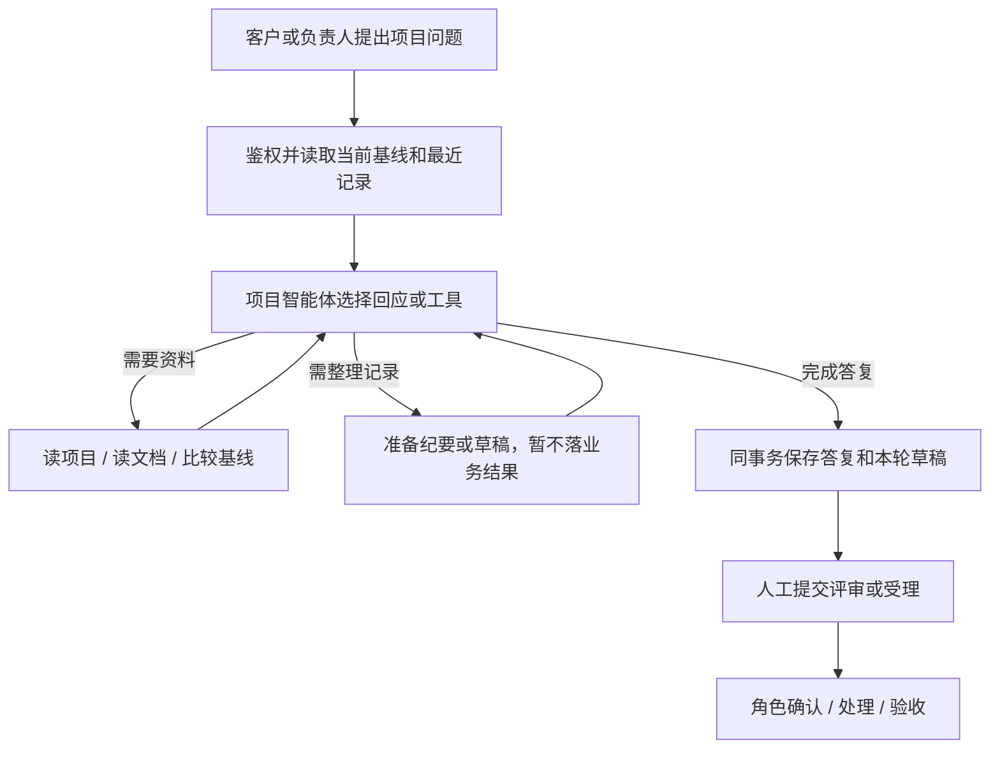
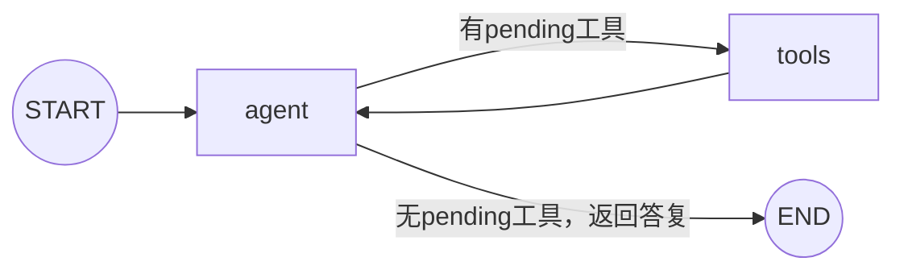
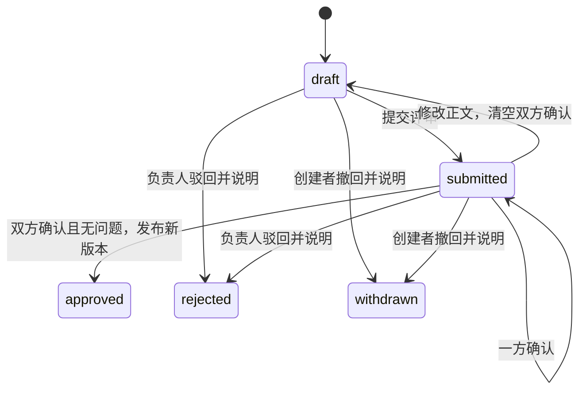
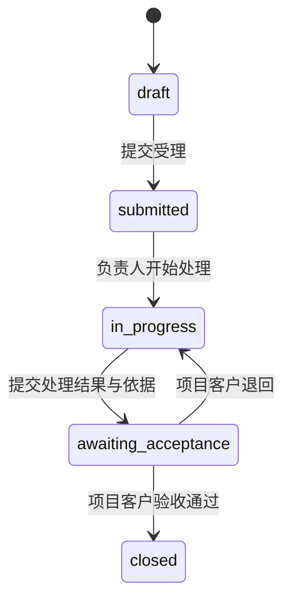

# 项目协作智能体

本文描述当前agent/tools两节点图。通过统一协议复用文档分块增量引擎属于[后续开发说明](后续开发说明.md)的P6，当前尚未接入；正式基线仍不可覆盖。

## 职责与实现

项目发布初版需求后，runtime按phase=project进入此智能体。它解释当前项目资料、整理新增/修改/删除要求、比较需求基线，并准备变更、故障或咨询草稿；负责人还可准备开发任务与交付记录。

| 文件                                                   | 职责                                        |
| ------------------------------------------------------ | ------------------------------------------- |
| [graph.py](../backend/agents/project/graph.py)         | agent/tools两节点装配、初始上下文及最终提交 |
| [nodes.py](../backend/agents/project/nodes.py)         | 模型决策、原生工具执行、真实事件与累计额度  |
| [state.py](../backend/agents/project/state.py)         | 本轮TypedDict状态                           |
| [prompts.py](../backend/agents/project/prompts.py)     | 项目顾问职责和权限约束                      |
| [tools/project.py](../backend/agents/tools/project.py) | 当前项目资料、差异、纪要和草稿工具          |

当前图没有独立检查点和interrupt节点；审批、交付与客户验收由普通业务接口及数据库状态机完成。不要把人工按钮画成模型可以执行的工具。

## 业务流程图

前半段是智能体；H、V属于后续人工业务，模型不能直接执行。

## 实际节点图

| 节点  | 动作                                                                                            |
| ----- | ----------------------------------------------------------------------------------------------- |
| agent | 携带当前基线、最近15条记录摘要、最近12条对话及本轮输入，调用模型；最后一轮禁用工具以结束答复    |
| tools | 顺序处理本批tool_calls，把真实结果作为role=tool消息回交模型；参数/资料/权限错误返回安全失败结果 |

State包含messages、rounds、calls、pending、answer、tokens。工具准备的drafts和notes存于本轮ProjectTools实例；图完成且答案有效后，ProjectStore.finish才提交消息、草稿和纪要。

## 可调用工具与权限

| 工具                  | 作用                                                      | 不代表什么                     |
| --------------------- | --------------------------------------------------------- | ------------------------------ |
| read_project          | 读取当前项目、基线及近期记录摘要                          | 不读取其他客户项目             |
| read_document         | 按真实item_id读取本项目完整资料                           | 不能凭空构造已读文档           |
| compare_baseline      | 用unified_diff比较拟定正文和当前基线                      | 不是Git代码影响分析或代码审查  |
| remember_requirements | 暂存增量纪要，成功收尾后提交                              | 不等于客户确认新需求           |
| save_draft            | 暂存specification/change/bug/question/task/acceptance草稿 | 不提交评审、不发布、不关闭工单 |

普通客户不能准备task/acceptance，负责人可以；每轮至多3份草稿。非初版需求记录需要已有基线。所有真实读取、写入与最终保存仍由存储层复核身份、归属和版本。

正式项目的变更目前由本图通过save_draft准备，**不会自动转入需求访谈中的Draft子图**。项目图当前TOOLS也不包含web_search，不把其他智能体支持的搜索能力画到此处。

## 模拟执行：对V1提出功能变更

这是一条教学轨迹，B1、C1只是下表的逻辑代号；实际工具必须使用服务端返回的真实UUID。

客户输入：

> 增加预约备注，去掉CSV导出，部门统计增加日期筛选。其他V1内容保留，请整理变更草案。

| 步骤 | 节点 / 工具                   | 结果                                                        |
| ---- | ----------------------------- | ----------------------------------------------------------- |
| 1    | agent → read_project          | 获知当前revision=1和实际基线文档ID B1                       |
| 2    | tools → agent → read_document | 读取B1全文，避免只根据标题生成变更                          |
| 3    | agent → compare_baseline      | 对拟定的完整新需求正文生成文字diff                          |
| 4    | agent → save_draft            | 暂存kind=change，正文同时包含新增/修改/删除说明与完整需求书 |
| 5    | agent无tool_calls             | 返回给客户的摘要，说明哪些地方变化及下一步                  |
| 6    | 图外finish事务                | 消息、变更C1与纪要一次保存；revision仍为1                   |
| 7    | 人工操作                      | C1提交评审，双方确认后才发布V2，B1内容保留                  |

不要求每次变更都调用全部读取工具；模型可以在已有足够上下文时减少动作，但不能假称已经核对不存在的资料。

## 人工业务状态图

下面对应[ProjectStore.act](../backend/db/project_store.py)，不是LangGraph节点。

初始草稿显示“尚未发布”，正式版从V1开始。`version`是防覆盖计数，`revision/published_revision`才是业务版号，不能把编辑次数显示为正式版本。

任务、故障、咨询和交付记录使用另一条闭环：

补充说明走supplement审计，不覆盖原申请。待受理前仍有驳回和创建者撤回分支；上图只画处理主线。任务/交付的创建与维护由负责人负责，客户负责自己的验收结论。

## 模拟执行：售后处理

1. 客户说明“筛选后统计人数不正确”，智能体读取当前需求及相关资料，准备bug草稿。
2. 客户提交受理，负责人开始处理。
3. 负责人填写实际处理结果和验证依据，提交客户验收；Agent不能代填“代码已修复、测试已通过”的虚构结果。
4. 客户复查后通过关闭，或写明未通过原因退回继续处理；补充说明和旧处理结果保留在历史中。

## 失败与边界

参数或资料读取失败会形成真实工具失败事件，模型可据此调整答复；业务越权和最终基线变化会阻止提交。若图未成功收尾，本轮暂存的草稿与纪要不会被单独提交，已有基线不变。

默认正式项目执行上限5次模型、8次工具、40000 Token、90秒。其用途profile当前复用consultation，不能把这一图描述成已配置独立project模型。请求用量和时间以本轮真实结果为准。

相关验证：[test_agent_tools.py](../tests/test_agent_tools.py)、[test_projects.py](../tests/test_projects.py)、[test_projects_postgresql.py](../tests/test_projects_postgresql.py)。
